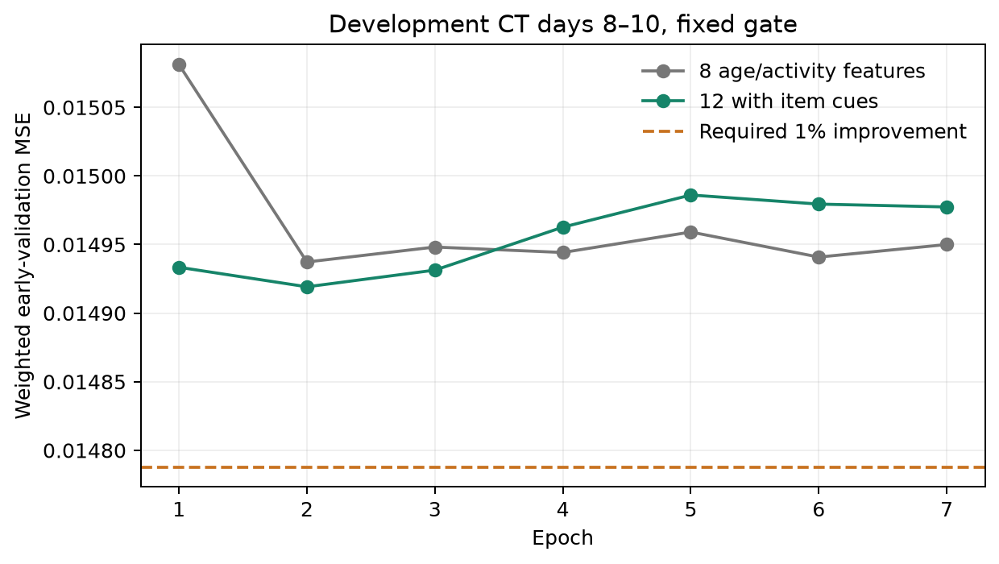

# H8: четыре признака последнего трека

14 ноября 2026. Gate не пройден: early-validation MSE ниже готового контроля
только на0.121% вместо требуемого1%. По заранее опубликованному критерию
дорогой replay не запускается. **Качество рекомендаций и serving cost
этого варианта на PV/test не оценены.**

## Проверка

[Протокол](../../notes/content-controller.md) и код опубликованы в4390ad6
до обучения; scope/criterion уже записаны в ddb4f39. Старый frozen
user-holdout этой гипотезе не передаётся.

К8 age/activity fields добавлены4 causal item cues: latest==cached latest,
latest есть в cached50, cosine frozen CE1k ID embeddings latest/cached latest,
log1p(train count latest). Это не аудиопризнаки и не новое кодирование
истории. Ни target текущего запроса, ни будущие queries/feedback не используются.

Те же1468108 fit contexts,133110 weighted requests, labels/states/weights
совпадают с контролем побитно. CT8/2/4, MLP12→32→32→1,1505 параметров
вместо1377; seed42, optimizer/loss/patience5 прежние. Best2/total7,
остановка по validation. Само CPU-обучение1.59с, fit stage3.50с,
static feature setup0.16с. Новые общие CPU tables64467744B≈61.5MiB;
peak process RSS2915MiB включает dataset/examples и не является
добавочной памятью features.

| Модель | Weighted early MSE |
| --- | ---: |
| Готовый8-feature MLP |0.01493725975|
| Новый12-feature MLP |0.01491918036|
| Требуемый порог1% |≤0.01478788715|

Улучшение0.121% — point estimate supervised MSE, не проверка статистической
значимости. Оно не проходит практический gate и не доказывает отсутствия
пользы этих признаков для всех learners или для NDCG при другом objective.
Контроллер не переходит к CT threshold replay, новому PV quality/cost
или оценке на прежнем user-holdout; дополнительные варианты не перебираются.

## Проверки и решение

25 CPU/MPS regression tests прошли. Проверены scalar/matrix features,
repeat/novelty/cosine значения, независимость от будущих queries/labels,
одинаковые training examples с контролем и source/checkpoint hashes.
Gate пересчитан из MSE и сверен с независимыми Torch validation curves
обоих runs; exported NumPy prediction delta4.10e−8. Отсутствуют новые
replay/results artifacts и входы из final-user-holdout.

H8 закрыта по resource criterion. Этот опыт дополняет отрицательный
closed-loop результат8-feature controllers, но не является новым
closed-loop сравнением. Encoder и основные frozen выводы H7 сохранены.
Дальнейшие новые objectives/архитектуры относятся к отдельному исследованию
с новым holdout; текущая обоснованная очередь завершена.

[Gate](content-controller-probe/validation-gate.json),
[probe metadata](content-controller-probe/probe.json),
[проверки](content-controller-probe/verification.json),
[кривая обучения](content-controller-probe/model-training.json).
