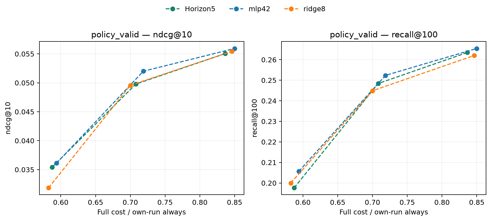

# H3: польза refresh на пяти запросах

14 ноября 2026. Более плотная метка не дала подтверждённого улучшения
quality–cost. На PV point estimates ниже immediate-MLP42 во всех режимах,
при немного меньшей стоимости. Перебирать дополнительные горизонты
по этим результатам не будем; immediate-MLP остаётся основным вариантом.

## Что изменено

Только training/early-validation target одного MLP42 из H2. Для текущего
запроса сравниваем два фиксированных snapshot: пересчитанный сейчас и
старый cached. Считаем разность summed positive-target NDCG rewards на
текущем и следующих4 запросах этого пользователя и усредняем по числу
запросов. Запрос без positive targets даёт0 и входит в знаменатель.
Оба snapshot удерживаются на всём горизонте — это supervised приближение
будущей пользы, а не оптимальная RL value function.

Горизонт заканчивается на границе соответствующего CT fit/early-validation
отрезка. Нет labels из CT tuning, PV или test. Все402350 fit/106902 early
contexts и request weights сохранены.8252/6867 contexts имеют укороченный
горизонт на границе. Признаки, MLP1377 параметров, seed42, optimizer,
early stopping, CT8/2/4, frozen student43, каталог и106 правил — прежние.

544710 уникальных snapshot/track пар,412065 reuse и132645 новых; подготовка
12.01с, из них MPS scoring9.47с. Доля ненулевой fit-метки выросла с8.89%
до22.20%: положительная14.48%, отрицательная7.73%. MLP best13/total18,
patience5, CPU обучение1.07с, весь controller run51.51с.
Early MSE0.007010 — другая целевая величина, напрямую сравнивать её
с MSE immediate labels нельзя.

## Closed-loop PV

Порог выбирается на CT last4, после этого фиксируется. Полная cost model
включает CPU features/prediction и MPS serving. Нормирование по own-run
always; фактическая стоимость различается, одинаковый CT budget не
означает одинаковый PV cost.

| CT budget | Horizon5 cost | Immediate cost | Horizon5 NDCG | Immediate NDCG | Horizon5 Recall | Immediate Recall |
| --- | ---: | ---: | ---: | ---: | ---: | ---: |
|60%|58.74%|59.40%|0.035401|0.036123|0.197658|0.205651|
|75%|70.81%|71.88%|0.049787|0.052003|0.248397|0.252372|
|90%|83.64%|85.00%|0.055051|0.055933|0.263486|0.265453|

В75%-режиме delta NDCG к immediate-MLP−0.002217,
CI[−0.004062;−0.000733]. В60/90%-режимах NDCG CI включают0;
все Recall CI включают0. Costs ниже на0.66–1.36 процентного пункта always,
поэтому это не доказательство ухудшения при строго равной стоимости.

Все3 NDCG CI к CT-selected expected mixtures простых правил при близкой
стоимости включают0. В среднем режиме Recall ниже такого ожидания:
delta−0.011687, CI[−0.018668;−0.005462]. На CT tuning новый вариант также
не дал причины продолжать эту ветку: NDCG0.035004/0.054019/0.060984
против0.038260/0.056590/0.062651 immediate-MLP, при более низких costs.
Надёжный общий выигрыш learned refresh по-прежнему не установлен.

## Проверки и решение

19 CPU/MPS тестов прошли.128 новых меток независимо проверены скалярным
расчётом по запросам/targets. Горизонт1 на всех fit/early contexts
воспроизводит прежние immediate labels с max delta4.44e−16.
Совпадение requests/states/weights, source/selection hashes, причинность
и неизменность encoder проверены. CPU oracle256 label-пар:253 точных
ранга, max delta1, одинаковые метрики; аналогичный guard есть в controller
run.36 paired CI независимо пересчитаны. Mixed cost error≤2.87%.

CI pointwise,2000 whole-user bootstrap, seed42, без поправки на множественные
сравнения. Expected mixtures — справочная оценка ожидания назначения
политики пользователю; assignment cost/variance не измерены. PV служит
исследовательской проверкой, test остаётся закрыт.

H3 закрыта для фиксированного5-request приближения: плотность метки выросла,
польза для политики не подтверждена. Это не опровергает все future-aware
controllers. Следующая проверка H4 относится к serving: при неизменном
каталоге между refresh можно кэшировать готовый top100. Сначала проверяем
точность, затем измеряем полный путь и строим отдельный frontier этого режима.

[Сравнения и проверки](controller-horizon/comparison.json),
[таблица](controller-horizon/comparison.csv),
[подготовка меток](controller-horizon/label-preparation.json),
[training curve](controller-horizon/model-training.json).
