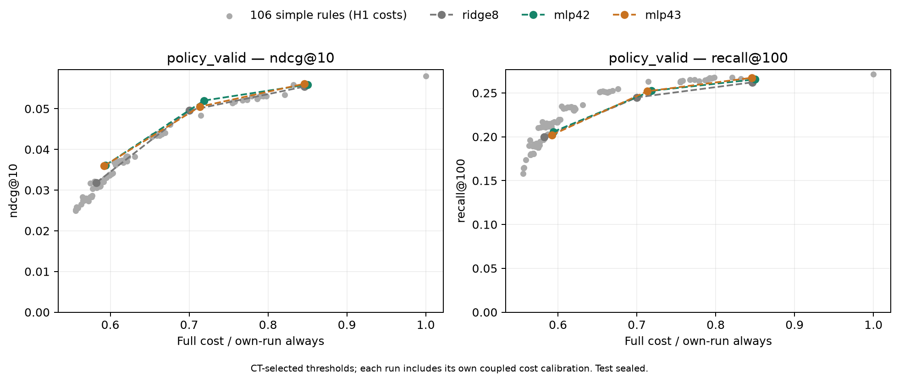

# H2: нелинейный контроллер refresh

14 ноября 2026. CPU MLP лучше ridge предсказывает немедленную пользу refresh,
но общего преимущества перед простыми политиками при сопоставимой стоимости
пока нет. Это проверка модели контроллера; encoder student43 не переобучается.

## Протокол

Общий frozen student43, каталог114125, history50, те же62129/29914 запросов
и52191/23394 положительных targets CT/PV.106 простых правил из H1.
Первые8 дней CT — fit, следующие2 — early validation, последние4 — выбор
порога под budgets60/75/90% полного always cost. PV не участвует в подборе;
test закрыт. Начальный обязательный refresh и запросы без positive targets
учитываются в стоимости. Состояние кэша развивается по решениям контроллера.

Matched ridge: прежние8 causal признаков, λ0.001; fit на тех же402350
stale contexts, суммарный вес35803 запросов. MLP8→32→32→1, ReLU,
1377 параметров, CPU4 threads, AdamW0.001, weight_decay0.0001, batch4096,
patience5 по weighted MSE. Seed42/43 меняет только initialization и shuffle.
Нормализация и пороги берутся из fit. Ни один из seed не выбран по PV.

| Learner | Early-validation MSE | Best / total epochs | Fit stage | Whole run |
| --- | ---: | ---: | ---: | ---: |
| Constant fit mean |0.02572546|—|—|—|
| Ridge8 |0.02561299|—|0.29с|38.65с|
| MLP42 |0.02522486|7 /12|1.40с|49.45с|
| MLP43 |0.02528286|6 /11|1.40с|49.56с|

MLP снижает MSE относительно ridge на1.52%/1.29%. Fit stage включает
подготовку примеров/признаков; само CPU-обучение MLP занимает0.72/0.69с.
Веса запросов суммируются в1 по различным наблюдавшимся stale states;
6.70% веса приходится на положительную пользу,2.20% — на отрицательную.

## Closed-loop результат на PV

Стоимость — полный B=1 CPU feature/prediction + MPS encoder/cache/scoring/top100.
Для каждого run своя совместная interleaved калибровка plain/controller paths;
CPU-решение не прибавляется повторно. В таблице cost / own-run always,
а budgets обозначают потолок на CT tuning, не точную равную стоимость на PV.

| Model | CT budget | PV cost | Refresh | NDCG@10 | Recall@100 |
| --- | ---: | ---: | ---: | ---: | ---: |
| Ridge8 |60%|58.25%|6.96%|0.031854|0.200009|
| MLP42 |60%|59.40%|8.14%|0.036123|0.205651|
| MLP43 |60%|59.23%|8.89%|0.035968|0.202060|
| Ridge8 |75%|70.02%|39.55%|0.049575|0.244892|
| MLP42 |75%|71.88%|36.75%|0.052003|0.252372|
| MLP43 |75%|71.34%|35.45%|0.050499|0.251945|
| Ridge8 |90%|84.62%|65.08%|0.055437|0.262033|
| MLP42 |90%|85.00%|64.88%|0.055933|0.265453|
| MLP43 |90%|84.59%|64.80%|0.056125|0.267291|

MLP даёт более высокие point estimates NDCG и Recall относительно ridge
во всех режимах, но все6 paired NDCG CI включают0. Из Recall CI выше0
только MLP43 в90%-режиме: delta+0.005258, CI[+0.002084;+0.008933].
Costs между runs близки, но измерены отдельно; это не строгое сравнение
при одинаковой фактической стоимости и не оценка дисперсии encoder seeds.

На75%-режиме MLP42 против выбранного на CT events3: delta NDCG+0.003607,
CI[+0.000042;+0.008296], при PV cost71.88% против71.41%. Recall ниже
на0.010516, CI[−0.018957;−0.003643]. MLP43 сравнивается с events4, потому
что events3 чуть не проходит его CT cost ceiling; различие comparator
нельзя интерпретировать как более сильный результат seed43.

Дополнительная проверка убирает разрывы дискретной сетки: на CT tuning
выбирается ожидание смеси двух простых политик при cost контроллера,
после чего те же веса оцениваются на PV. **Все6 NDCG CI MLP относительно
такого ожидания включают0**. В75%-режиме Recall обоих MLP ниже.
Это справочный результат для независимого назначения политики пользователю
в ожидании; стоимость назначения и его реализованная случайность не измерены.

## Проверки и вывод

18 CPU/MPS тестов прошли. Отдельный regression test воспроизводит внешний
inference mode драйвера: fit MLP явно включает autograd и отключает inference
mode. Изначальный запуск упал до обучения/записи результатов; исправленные
runs завершены полностью. Torch/NumPy serving predictions совпадают с max
delta<8.2e−8. CPU oracle проверяет256 пар на run и совпадение метрик.
Проверены hashes, неизменность encoder, selection до PV, идентичные fit
examples и causal user/split/time boundaries.60 paired CI независимо
пересчитаны через матрицу bootstrap-кратностей пользователей.

Максимальная ошибка прогноза mixed serving cost3.86%/3.57%/3.49% для
ridge/MLP42/MLP43. Поэтому малые cost-различия не являются доказательством
экономии. Все CI pointwise,2000 whole-user bootstrap, seed42; поправки
на множественные сравнения нет. PV уже используется для исследовательских
выводов серии, финальную проверку оставляем закрытому test.

H2 частично подтверждена: нелинейность помогает supervised задаче и
point estimates closed-loop, но этого недостаточно для подтверждения
полезности learned refresh в целом. Следующая минимальная проверка H3 —
фиксированная метка пользы на5 запросах, чтобы учитывать повторное
использование обновлённого представления. Меняем только метку одного MLP;
encoder, causal признаки, CT8/2/4, grid и PV сохраняем.

[Все сравнения и CI](controller-models/comparison.json),
[компактная таблица](controller-models/comparison.csv),
[MLP42 curve](controller-models/mlp42-training.json),
[MLP43 curve](controller-models/mlp43-training.json).
Raw arrays и полные локальные reference-данные находятся в data/runs/controller-*.
