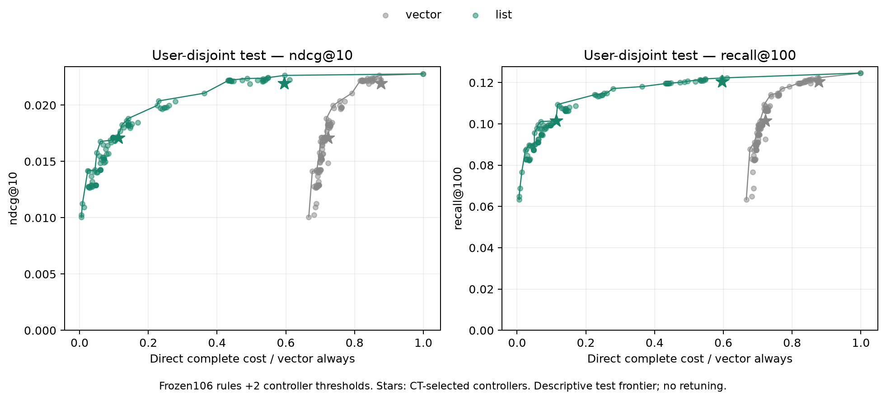

# H7: заранее зафиксированная user-holdout проверка

14 ноября 2026. Frozen controller не улучшил quality–cost относительно
простых comparators на новой когорте. В высоком режиме NDCG ниже гибридного
правила, и primary97.5% interval лежит ниже0; в низком NDCG interval включает0.
Secondary Recall ниже в обоих сравнениях. Эти результаты не используются
для настройки этой модели или её порогов.

## Независимость и зафиксированный протокол

Старый development test уже открывался при encoder search; это ограничение
выявлено до новой оценки. Выбраны256 пользователей по train_events≥20 и
sha256(`20261114:uid`) из7443 подходящих вне всех1000 development uid.
Выбор независимо воспроизведён DuckDB SHA256-sort, overlap0. Будущая
активность и targets не участвуют в выборе.

Протокол опубликован коммитом **b590e78** до подготовки новых event files:
[правила](../../notes/final-user-holdout.md), [frozen JSON](final-user-holdout/protocol.json).
МодельCE1k, её vocabulary244194, MLP42, два CT-selected порога и grid106
заморожены. Первичные comparators — events10 и OR2events+300sec. Это
unseen-user проверка с доступной прошлой историей, не переобучение на8454.

Test14 дней:24790405…26000005. Активны249 из256 пользователей,236 имеют
известные положительные targets.58383 запросов,40638 scored targets из44779
положительных событий со строго прошлой историей: **coverage90.75%**,
4141 unknown targets исключены. Unknown history items остаются UNK;
никакие новые items/embeddings не добавляются. Метрики ниже условны на
известные targets. History/prefix group semantics и mandatory cache
initialization те же, что в development.

Подготовка1.28с; полный replay и216 direct serving cases123.29с.
Peak RSS1595MiB, MPS driver2057MiB; это process allocator, не per-user cache.

## Primary comparisons

В каждой строке одни и те же40638 targets и полный каталог244194.
User bootstrap2000, seed42. Для двух primary NDCG сравнений заданы97.5%
intervals на каждое — Bonferroni family2. Recall — secondary95%.

| CT label | Controller NDCG | Simple NDCG | Delta NDCG |97.5% CI|
| --- | ---: | ---: | ---: | --- |
|75%, q75 vs events10|0.017089|0.017712|−0.000622|[−0.001771;+0.000504]|
|90%, q25 vs hybrid2/5min|0.021916|0.022642|−0.000726|[−0.001389;−0.000112]|

Recall q75−events10:−0.007924,95% CI[−0.010792;−0.005049].
Recall q25−hybrid:−0.001772,95% CI[−0.003347;−0.000348].
К fixed CT expected mixtures NDCG95% CI включают0, Recall CI ниже0.
Это вторичные ожидания per-user assignment; его variance/cost не измерены.

## Качество простых правил и стоимость

| Фиксированная политика | Refresh | NDCG@10 | Recall@100 | Vector ms | Vector+list ms |
| --- | ---: | ---: | ---: | ---: | ---: |
| always |100%|0.022778|0.124637|2.451|2.448|
| never, с initialization |0.43%|0.010074|0.063291|1.634|0.0138|
| events10 |11.73%|0.017712|0.109405|1.762|0.289|
| events3 |36.50%|0.021065|0.118067|1.942|0.890|
| TTL30мин |14.07%|0.018263|0.106304|1.770|0.347|
| TTL24ч |2.62%|0.012727|0.082755|1.689|0.0644|
| hybrid2events/5min |59.76%|0.022642|0.122226|2.137|1.462|
| controller q75 |11.19%|0.017089|0.101481|1.772|0.277|
| controller q25 |58.92%|0.021916|0.120454|2.150|1.460|

Cost — прямые paired полные B=1 workloads108 политик в двух режимах,
384 requests/case,3 interleaved блока. Входят policy/CPU features/prediction,
encoder на refresh, cache read/write, scoring и canonical top100 CPU output.
List hit копирует готовый список; сеть/диск/сериализация исключены одинаково.
Refresh count стратифицирован к фактической доле с округлением, не inferred
из homogeneous branches. Source/kernel precision и frozen-state guards
сохранены. Нового выбора политик по этому frontier нет.

Hybrid сохраняет точечные99.4% fresh NDCG при59.7% стоимости always в list
режиме. Paired NDCG delta к fresh−0.000136,95% CI[−0.000614;+0.000384].
Это **не** доказательство эквивалентности/non-inferiority: margin заранее
не задавался. Recall ниже fresh на0.002412,95% CI[−0.003605;−0.001170].

Controller q25 и hybrid имеют близкие costs: vector87.70%/87.19% always,
list59.64%/59.70%. Различие list cost0.09% меньше точности timing такого
сравнения; оно не подтверждает cost-преимущества контроллера.
У q75 list cost на3.9% меньше events10, но Recall существенно ниже;
строгое равенство фактических затрат не заявляется. CT budget label не
означает точный такой же budget в новой когорте.

TTL24ч теряет44.1% fresh NDCG, TTL30мин —19.8% по point estimates;
соответствующие paired95% intervals ниже0. Потери считаются **на тех же
events относительно fresh**, а не через raw accuracy разных age/user групп.
Таким образом staleness остаётся проблемой и вне development users.

## Проверки и ограничения

23 CPU/MPS теста прошли, включая tied-group final reader и блокирование
изменённого незакоммиченного протокола.228 bootstrap intervals независимо
сверены matrix-count и indexed-user реализациями; secondary controller
intervals также сверены прежним rank-bootstrap helper.216 paired serving
cases проверены по identical samples и полным means. CPU oracle256 пар:
одинаковые metrics/membership, max top100 rank delta0. Проверены hashes,
causal user/time refs, frozen weights и guard повторного evaluation,
сохраняющий готовые artifacts.

Старые users и новый user-holdout различаются; абсолютное падение fresh
качества относительно development PV нельзя приписывать только времени,
масштабу или контроллеру. Warm histories содержат UNK, targets ограничены
frozen vocabulary. Общие items и временные факторы могут связывать users;
user bootstrap их не устраняет. Runtime локальный MPS serial B=1,
не datacenter throughput, и timing noise не включён в quality CI.
Точные positions хранятся только в top100; MRR не оценивается.

Первая frozen maintenance-серия завершена без refit/tuning на этой когорте.
Её primary вывод — отсутствие подтверждённого преимущества данного
контроллера; основной system result — необходимость учитывать отдельный
static-list serving baseline. Новые content-aware hypotheses проверяются
на development данных и требуют нового holdout, если дойдут до подтверждения;
этот test не возвращается в подбор параметров.

[Все результаты и проверки](final-user-holdout/comparison.json),
[primary quality/cost](final-user-holdout/primary-comparison.csv),
[все политики](final-user-holdout/policies.csv),
[данные и coverage](final-user-holdout/data-preparation.json),
[raw block timings](final-user-holdout/serving-results.json).
