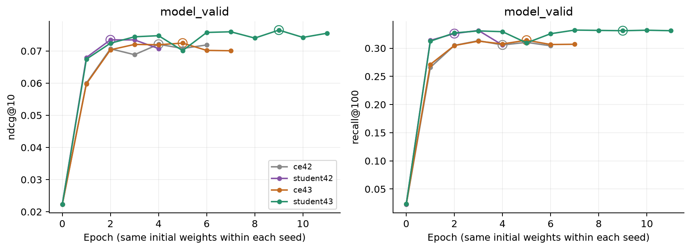

# Парный повтор CE50 и student T1

12 ноября 2026. Два новых последовательных локальных запуска seed43 на MPS
FP32, 4 CPU-потока, fallback0. Готовая пара seed42 переиспользована.
[Протокол и команды](../../notes/paired-seed-repeat.md).

## Сопоставимость

Сохранены те же256 пользователей, train739571, model_valid29313,
controller_train52191, policy_valid23394, каталог114125, OOT и positive target.
History50, dim64, 2blocks/heads, dropout0.2, batch256,
Adam0.001/(0.9,0.98), clip5, dummy negatives16. Все7357888 параметров,
включая ID-векторы, trainable. Seed43 меняет initialization, dropout и train
shuffle; выборка пользователей и split остаются прежними.

Обе модели обучаются с нуля до patience2 по model_valid NDCG без лимита эпох.
Random epoch0 не кандидат. Учитель student43 — собственный CE43 best5,
frozen/eval. Alpha0, T1, lambda1, loss = CE + KL(teacher||student),
полный каталог, batchmean. Student42 использует свой CE42 best4.

Student43 прерван вместе с чатом на третьем проходе и возобновлён из
`last.pt` конца epoch2 с сохранёнными Adam/CPU/MPS/NumPy RNG. Третий проход
повторён. Trainer elapsed исключает отброшенный частичный проход и простой;
журналы исходного и возобновлённого процесса сохранены отдельно.

Перед CE43 сохранён случайный `initial.pt`. Все29 его тензоров побитово
совпали с повторно построенным student initializer; фактические state/CPU/MPS
RNG hashes в обоих training loops совпали до первого update. Это cold start;
обученные веса teacher в student не копируются. Сверка с архивным source и
все29313 initial validation ranks также совпали.
[Проверка пары](paired-seed-repeat/pair-initialization.json),
[восстановление инициализации](paired-seed-repeat/initialization.json),
[teacher targets](paired-seed-repeat/teacher-check.json).

Learning AST teacher/loss/training driver совпадает с seed42. В evaluation
сохранённые CE42 ranks переиспользуются только при совпадении checkpoint SHA;
для CE43 оценки вычисляются заново. Проверены одинаковые события, истории,
временные метки, targets, users и каталог. Teacher alpha0 использует оценки
своего CE43. Это отдельная проверенная правка оценки, без изменения обучения.

Все представления fresh, histories заканчиваются перед текущей timestamp
group. Каталог без seen-item exclusion. Checkpoints выбираются и фиксируются
до CT/PV. Test не читается. Политики кэша и serving benchmark здесь не повторяются;
прежние frontier относятся к исходному CE42.

Одинаковый рецепт и patience не означают одинаковое число selected updates:
номер лучшей эпохи может различаться между моделями и seeds. Сравнивается
качество validation-selected checkpoints, а не обучение при равном числе шагов.

## Обучение и ресурсы

| Модель | Эпох | Best | Selected updates | MV NDCG | MV Recall | Trainer, мин |
| --- | ---: | ---: | ---: | ---: | ---: | ---: |
| CE50 seed42 | 6 | 4 | 11556 | 0.072085 | 0.305769 | 12.63 |
| Student T1 seed42 | 4 | 2 | 5778 | 0.073463 | 0.325930 | 16.35 |
| CE50 seed43 | 7 | 5 | 14445 | 0.072448 | 0.314229 | 15.59 |
| Student T1 seed43 | 11 | 9 | 26001 | 0.076497 | 0.331048 | 49.61 |

В seed43 student улучшался до epoch9, в seed42 — до epoch2. Поэтому новый
student дороже по числу эпох и selected updates; это часть результата прежнего
validation-stopping протокола. Время student43 — накопленное trainer-время,
без прерванной части epoch3 и простоя. Исторические timings seed42 и эти
последовательные запуски не являются парным performance benchmark.

Peak RSS CE43/student43: **1067,0 /1101,0 MiB**; MPS tensors **112,9 /141,2 MiB**,
максимальные сохранённые driver snapshots **1051,9 /2075,9 MiB**. MPS snapshots
не гарантируют внутренний peak; с RSS их не складываем в unified memory.
Serving architecture и число параметров прежние; новая latency не измерялась.

[Training CSV](paired-seed-repeat/training.csv),
[CE43](paired-seed-repeat/training-ce43.json),
[student43](paired-seed-repeat/training-student43.json).

## Качество на тех же событиях

| Split | Модель | NDCG@10 | Recall@100 | Hit@1 |
| --- | --- | ---: | ---: | ---: |
| model_valid | CE50 seed42 | 0.072085 | 0.305769 | 0.031420 |
| model_valid | Student T1 seed42 | 0.073463 | 0.325930 | 0.030191 |
| model_valid | CE50 seed43 | 0.072448 | 0.314229 | 0.031420 |
| model_valid | Student T1 seed43 | 0.076497 | 0.331048 | 0.033466 |
| controller_train | CE50 seed42 | 0.056663 | 0.265870 | 0.022839 |
| controller_train | Student T1 seed42 | 0.057909 | 0.284819 | 0.021881 |
| controller_train | CE50 seed43 | 0.057778 | 0.267192 | 0.024085 |
| controller_train | Student T1 seed43 | 0.062505 | 0.288000 | 0.026058 |
| policy_valid | CE50 seed42 | 0.055093 | 0.252201 | 0.024109 |
| policy_valid | Student T1 seed42 | 0.055750 | 0.272036 | 0.022356 |
| policy_valid | CE50 seed43 | 0.054199 | 0.258271 | 0.024023 |
| policy_valid | Student T1 seed43 | 0.057996 | 0.271095 | 0.025092 |

PV, student относительно собственного CE:

| Seed | Метрика | Абсолютная разница | Относительно CE | Парный 95% CI |
| --- | --- | ---: | ---: | --- |
| 42 | ndcg@10 | +0.000657 | +1.19% | [-0.001575; +0.002869] |
| 42 | recall@100 | +0.019834 | +7.86% | [+0.015338; +0.024302] |
| 43 | ndcg@10 | +0.003797 | +7.01% | [+0.001632; +0.005982] |
| 43 | recall@100 | +0.012824 | +4.97% | [+0.007351; +0.018005] |

**Recall-прирост повторился в обоих seeds**, оба CI выше нуля. В seed43
выше и NDCG; его CI тоже выше нуля. В seed42 NDCG имеет положительную
точечную разницу, но CI включает ноль. Hit1 в seed43 выше своего CE43
на4,45%, тогда как seed42 student терял Hit1. Стабильного общего улучшения
самого верха ранжирования по двум seeds пока нет.

Student43 против student42: NDCG **+0,002246**, CI **[−0,000337; +0,005003]**;
Recall **−0,000940**, CI **[−0,006816; +0,004904]**. Оба интервала включают0.
Нельзя объявлять seed43 надёжно сильнее seed42 по этому прямому сравнению.
Средняя внутри пары разница по двум seeds: NDCG **+0,002227**,
Recall **+0,016329**; это описательное среднее, без общего CI.

2000 whole-user bootstrap, seed42, event-weighted, fixed checkpoints.
Интервалы учитывают пользователей, но не training variance; два seeds
не дают её надёжной оценки. CI pointwise, без поправок за исследование срезов.
Model_valid использован для выбора эпохи. PV уже участвовал в диагностике;
это исследовательское сравнение, закрытый test не использован.

[Все метрики, CI и rank transitions](paired-seed-repeat/comparison.json),
[metrics CSV](paired-seed-repeat/metrics.csv),
[effects CSV](paired-seed-repeat/effects.csv).

## Повторы и популярность

PV NDCG, четыре непересекающиеся history-группы и один вложенный срез.
Популярность определяется по положительным train-прослушиваниям, tie item_idx.

| Target | N | CE42 | Student42 | CE43 | Student43 |
| --- | ---: | ---: | ---: | ---: | ---: |
| Последний трек | 415 | 0.569501 | 0.508014 | 0.539295 | 0.540686 |
| Предпоследний, кроме последнего | 289 | 0.179030 | 0.178503 | 0.143995 | 0.157784 |
| Более ранний в окне50 | 3835 | 0.105617 | 0.108821 | 0.102899 | 0.110943 |
| Вне окна50 | 18855 | 0.031595 | 0.033120 | 0.032240 | 0.035073 |
| Последний после train top10000 | 153 | 0.341739 | 0.210288 | 0.367893 | 0.301996 |

В seed43 общий repeat-срез: delta NDCG **+0.001390**,
CI **[-0.036545; +0.047717]** включает ноль: общая repeat-потеря в seed43 не подтверждается.
Но на153 повторах после train top10000 остаётся потеря **-0.065897**,
CI **[-0.120050; -0.010254]**. Она меньше по точечной величине, чем в seed42,
но знак потери NDCG на этом срезе повторился в обоих seeds. Положительный
общий результат не означает устранения проблемы менее популярных повторов.

Вклад history-групп в общий PV NDCG student43−CE43:

- last_item: +0.000025;
- second_last_only: +0.000170;
- earlier_in_window: +0.001319;
- outside_window: +0.002283.

Seed42: student выше своего CE по PV NDCG в **5 из7 дней**;
макро-разница по пользователям **+0.003434**. Основная метрика остаётся event-weighted.

Seed43: student выше своего CE по PV NDCG в **6 из7 дней**;
макро-разница по пользователям **+0.003142**. Основная метрика остаётся event-weighted.

[Все срезы](paired-seed-repeat/segments.csv),
[пользователи](paired-seed-repeat/users.csv),
[дни](paired-seed-repeat/days.csv).

## Проверки и вывод

**81 CPU/MPS тест прошёл**, включая regression нового CE checkpoint в replay.
Проверены configs, source/data/checkpoint hashes, actual state/CPU/MPS RNG,
все29 сохранённых initial tensors, validation-selected epochs и stopping.
Функции CE loss/optimizer/input/ranking совпадают по AST с исходным CE50.
Все104898 model_valid/CT/PV события совпали с прежним сравнением. Общие
парные CI независимо пересчитаны через bootstrap user-count matrix.

CPU oracle на128 общих событиях: CE43 —127 точных ranks, max delta1,
student43 —128 точных ranks; NDCG/Recall/Hit1 совпали с MPS у обеих моделей.
[Проверки](paired-seed-repeat/verification.json),
[тесты](paired-seed-repeat/tests.txt),
[журнал CE43](paired-seed-repeat/ce43-log.txt),
[прерванный student](paired-seed-repeat/student-interrupted-log.txt),
[возобновлённый student](paired-seed-repeat/student-resumed-log.txt),
[resume metadata](paired-seed-repeat/resume.json).

T1 теперь имеет воспроизводимый Recall-прирост относительно собственного CE
в двух seeds и поддержку NDCG-прироста в seed43. При этом величина выигрыша,
best epoch и training cost заметно зависят от запуска, а tail-repeat NDCG
остаётся слабым местом. Это перспективный single-encoder кандидат, но данных
пока недостаточно для общего утверждения о превосходстве по всем метрикам.
Исходный CE42 cache baseline и его frontier сохраняются; этот опыт проверяет
fresh-качество, а не влияние staleness новых weights. Дополнительных вариантов
обучения не запускалось.

Checkpoints, saved initializer и per-event arrays находятся локально в
`data/runs/paired-seed-repeat/`; configs, JSON/CSV, графики, журналы и отчёт — в Git.
