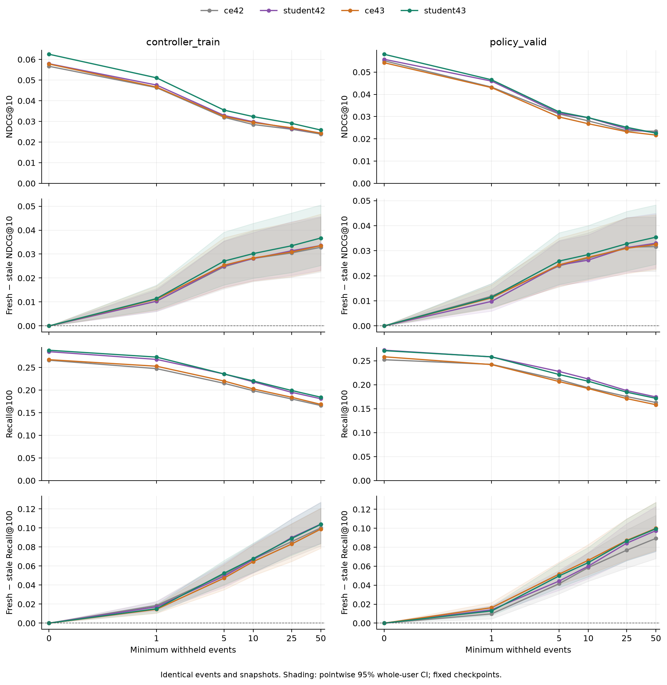
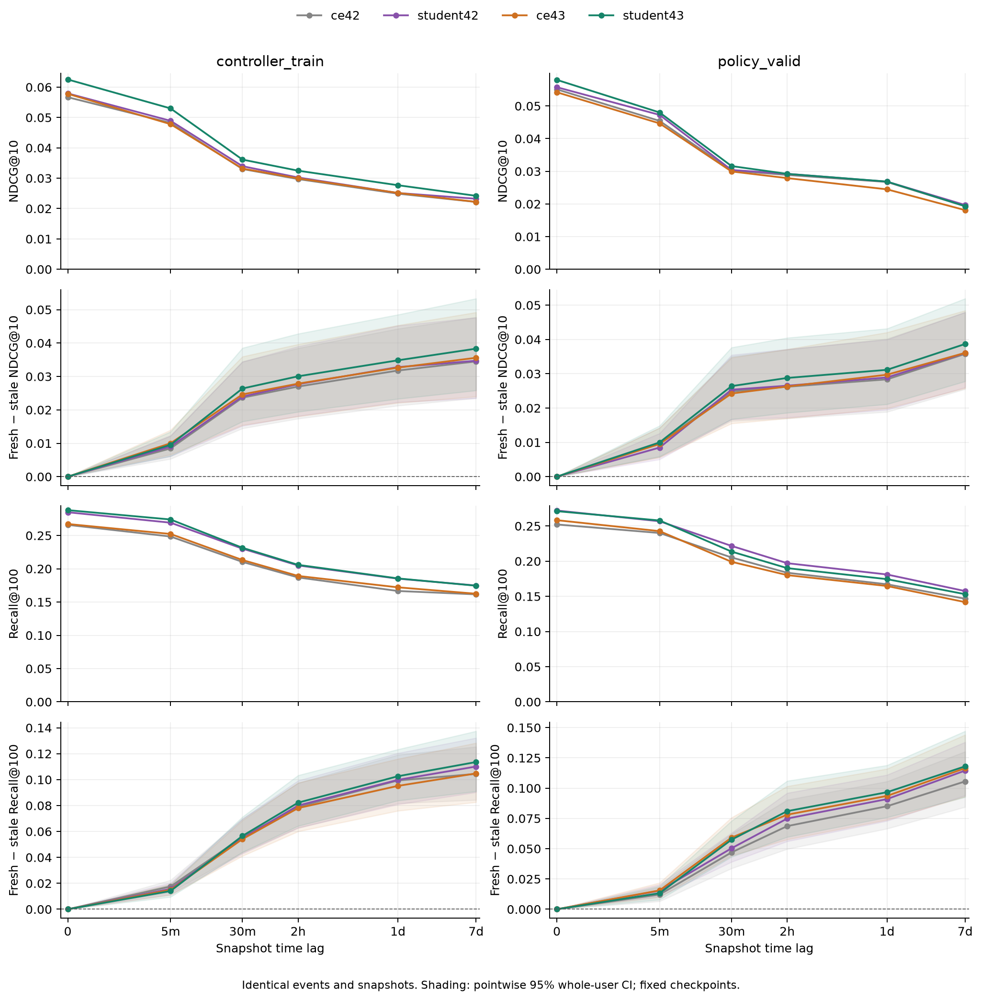

# Fresh/stale качество CE50 и student в двух seeds

12 ноября 2026. Четыре frozen best checkpoints пилота256: CE42/student42 T1
и CE43/student43 T1. Нового обучения нет; CE42 ranks переиспользованы,
три остальных replay выполнены локально на MPS FP32, fallback0, 4 CPU-потока.
[Протокол и команды](../../notes/paired-staleness-replay.md),
[конфигурация](paired-staleness-replay/config.json).

## Одинаковые входы

Сохранён исходный fixed-lag replay: history50, каталог114125 без seen-item
exclusion, 52172 CT и23394 PV events. Те же19 CT events исключены из всех
условий, потому что хотя бы один lag оставляет пустую историю. На PV
исключений нет. Targets, users, event_id, snapshots и cutoff одинаковы
для четырёх моделей. Веса и собственные item tables каждой модели frozen.

Event lags: минимум1/5/10/25/50 новых событий, без разрезания timestamp-групп.
Time lags:5мин/30мин/2ч/1сутки/7суток; видимы только события строго до t−lag.
Каждый user vector полностью пересчитан по своему старому prefix с окном50.
Это counterfactual age ablation; частота реальных refresh и policy frontier
этим опытом не определяются. Test не читается.

## Как отделяется свежесть от исходного качества

Для каждой модели показаны абсолютное качество и потеря `fresh−stale`.
Дополнительно внутри каждого seed считаются student−CE при одном лаге и
**снижение потери от устаревания**:

`(CE_fresh−CE_stale)−(student_fresh−student_stale)`.

Положительная разница означает меньшую абсолютную потерю у student.
Она равна изменению преимущества student над CE относительно fresh.
Поэтому более высокий stale score сам по себе ещё не доказывает меньшую
чувствительность к устареванию. Относительное удержание `stale/fresh`
сохранено в CSV как описательная величина.

95% CI:2000 перевыборок целых пользователей, event-weighted, bootstrap seed42
для обеих пар. Checkpoints фиксированы; интервалы не включают training variance.
CI pointwise, без поправки за множество лагов. Два training seeds и пилот256
ограничивают обобщение; PV уже использовался в исследовательской диагностике.

## Основной результат

Student сохраняет Recall-преимущество над своим CE **при всех10 ненулевых
лагах в обоих seeds и обоих периодах**, каждый pointwise CI выше0.
Устойчивого уменьшения потери от устаревания по двум seeds не выявлено.
У seed43 преимущество NDCG над CE на многих лагах положительно, но часто
меньше его fresh-преимущества в абсолютных единицах. Проблема обновления
представления остаётся у всех четырёх энкодеров.

## Кривые и абсолютное качество

Верхняя пара строк каждого графика: NDCG и его абсолютная потеря от fresh.
Нижняя пара: Recall и его потеря. Колонки — CT/PV. CI относятся к парной
потере каждой модели; их визуальное перекрытие не заменяет CI разницы потерь.

PV NDCG@10, одинаковые23394 события для всех условий.

### Число событий

| Lag | CE42 | Student42 | CE43 | Student43 |
| --- | ---: | ---: | ---: | ---: |
| Fresh | 0.055093 | 0.055750 | 0.054199 | 0.057996 |
| 1 событие | 0.043231 | 0.045941 | 0.043009 | 0.046529 |
| 5 событий | 0.031146 | 0.031455 | 0.029808 | 0.032092 |
| 10 событий | 0.028074 | 0.029482 | 0.026793 | 0.029518 |
| 25 событий | 0.023661 | 0.024479 | 0.023211 | 0.025177 |
| 50 событий | 0.023421 | 0.022731 | 0.021697 | 0.022569 |

### Время

| Lag | CE42 | Student42 | CE43 | Student43 |
| --- | ---: | ---: | ---: | ---: |
| Fresh | 0.055093 | 0.055750 | 0.054199 | 0.057996 |
| 5 минут | 0.045433 | 0.047271 | 0.044670 | 0.048015 |
| 30 минут | 0.030228 | 0.030401 | 0.029952 | 0.031596 |
| 2 часа | 0.028881 | 0.029234 | 0.027915 | 0.029220 |
| Сутки | 0.026732 | 0.026832 | 0.024478 | 0.026852 |
| 7 суток | 0.019302 | 0.019678 | 0.018110 | 0.019317 |

PV Recall@100, выбранные точки; полная сетка обоих периодов — в CSV.

| Lag | CE42 | Student42 | CE43 | Student43 |
| --- | ---: | ---: | ---: | ---: |
| Fresh | 0.252201 | 0.272036 | 0.258271 | 0.271095 |
| 1 событие | 0.242455 | 0.258015 | 0.241985 | 0.258229 |
| 50 событий | 0.162862 | 0.174532 | 0.158288 | 0.171625 |
| Сутки | 0.167137 | 0.181072 | 0.164700 | 0.174446 |
| 7 суток | 0.146619 | 0.157519 | 0.141788 | 0.153073 |

[Все88 строк качества, Hit1 и удержание stale/fresh](paired-staleness-replay/quality.csv),
[метрики, CI, реальные ages и прежние repeat/activity срезы](paired-staleness-replay/results.json).

## Потеря относительно собственного fresh

Относительная потеря PV NDCG; описательная величина.

| Модель | 1 событие | 50 событий | Сутки | 7 суток |
| --- | ---: | ---: | ---: | ---: |
| ce42 | 21.5% | 57.5% | 51.5% | 65.0% |
| student42 | 17.6% | 59.2% | 51.9% | 64.7% |
| ce43 | 20.6% | 60.0% | 54.8% | 66.6% |
| student43 | 19.8% | 61.1% | 53.7% | 66.7% |

При суточном лаге все модели теряют примерно **51–55% NDCG** своего fresh.
При50 событиях — примерно **57–61%**. Рост исходного качества student
не устраняет сильной зависимости от последних взаимодействий.

### Парная разница потерь

Положительный знак ниже означает меньшую абсолютную потерю у student.
Числа — difference-in-differences и парный95% CI, отдельно для каждого seed.

| PV lag | Seed | Снижение потери NDCG | Снижение потери Recall |
| --- | ---: | --- | --- |
| 1 событие | 42 | +0.002052 [+0.000484; +0.003645] | -0.004275 [-0.009328; +0.000539] |
| 1 событие | 43 | -0.000277 [-0.001800; +0.001208] | +0.003420 [-0.000491; +0.007692] |
| 50 событий | 42 | -0.001347 [-0.003546; +0.000811] | -0.008164 [-0.013381; -0.002300] |
| 50 событий | 43 | -0.002925 [-0.005088; -0.000860] | +0.000513 [-0.004701; +0.006222] |
| Сутки | 42 | -0.000557 [-0.002790; +0.001738] | -0.005899 [-0.010829; -0.000870] |
| Сутки | 43 | -0.001423 [-0.003754; +0.000753] | -0.003078 [-0.008928; +0.002904] |
| 7 суток | 42 | -0.000281 [-0.002487; +0.001887] | -0.008934 [-0.015463; -0.001974] |
| 7 суток | 43 | -0.002590 [-0.004705; -0.000559] | -0.001539 [-0.008343; +0.005461] |

Seed42 на PV теряет меньше NDCG при лаге1: разница потерь **+0,002052**,
CI **[+0,000484; +0,003645]**. На CT при этом лаге разница **+0,000008**,
CI **[−0,001098; +0,001148]**; у seed43 на PV **−0,000277**,
CI **[−0,001800; +0,001208]**. Этот локальный эффект не повторился в другой
паре и периоде.

У seed43 на PV при50 событиях разница потерь NDCG **−0,002925**,
CI **[−0,005088; −0,000860]**: часть fresh-преимущества student исчезает.
При30мин разница **−0,002153**, CI **[−0,003759; −0,000578]**;
при7суток **−0,002590**, CI **[−0,004705; −0,000559]**. На CT на многих
лагах преимущество student43 над CE43 тоже сужается относительно fresh.

Для Recall при больших лагах у seed42 абсолютная потеря часто больше,
чем у CE42, хотя stale Recall student остаётся выше. Например, PV сутки:
student−CE **+0,013935**, но снижение потери **−0,005899**,
CI **[−0,010829; −0,000870]**. Обе характеристики нужны для оценки энкодера.

У seed43 при суточном лаге PV NDCG **0,026852** против **0,024478** CE43,
student−CE **+0,002374**, CI **[+0,000583; +0,004269]**. Это преимущество
качества при одинаковом лаге; CI разницы потерь для этого случая включает0.

[Все88 парных сравнений](paired-staleness-replay/comparisons.csv).
Ни одно из этих сравнений не используется для нового подбора weights или refresh policy.

## Исполнение и проверки

Три новых replay выполнены за **143.61с (2.39мин)**, включая
проверки и экспорт. CE42 ranks переиспользованы побитово.100873 уникальных
snapshots и645916 уникальных snapshot/target пар на модель соответствуют
831226 lag/target оценкам. Это offline deduplication, без измерения serving
refresh frequency или задержек production.

| Модель | Новое encoding, с | Scoring/ranking, с | Fresh CT точных ranks | Fresh PV точных ranks |
| --- | ---: | ---: | ---: | ---: |
| ce42 | reuse | reuse | 52169/52172 | 23394/23394 |
| student42 | 1.274 | 45.126 | 52170/52172 | 23394/23394 |
| ce43 | 1.242 | 44.904 | 52164/52172 | 23393/23394 |
| student43 | 1.239 | 45.329 | 52167/52172 | 23393/23394 |

Fresh NDCG/Recall/Hit1 совпали с ранее сохранённым сравнением у всех моделей
и обоих split. Немногочисленные rank-различия максимум1 находятся вне
порогов этих метрик. На256 одинаковых смешанных fresh/stale парах CPU oracle
дал совпадающие метрики для каждой новой модели:255/250/253 точных ranks,
максимальные отклонения1/1/2 для student42/CE43/student43 соответственно.
Исходный CPU oracle CE42 переиспользован с проверкой hashes.

**10 CPU/MPS тестов прошли**: строгая хронология, timestamp-группы, poisoned
test-файл, общий cohort, naive recomputation и новый парный статистический
расчёт. Независимо через user-count matrix пересчитаны **352 парных CI**,
включая stale−fresh, student−CE и разницу потерь. Проверены все data/source/
checkpoint hashes, frozen state, event alignment, JSON/CSV/SVG и графики.

[Verification](paired-staleness-replay/verification.json),
[тесты](paired-staleness-replay/tests.txt),
[журнал](paired-staleness-replay/execution-log.txt).

Student даёт более высокий Recall и часто более высокий NDCG при старой
истории, но систематического выигрыша именно в чувствительности к возрасту
кэша эти две пары не показывают. Поэтому исследование refresh-политик
остаётся актуальным и для более сильного single-encoder baseline. Новых
политик или serving benchmarks здесь не выполнялось; прежние frontier
относятся к исходному CE42. Checkpoints не изменены, test закрыт.

Raw ranks сохранены локально в `data/runs/paired-staleness-replay/ranks.npz`;
исходные snapshots остаются в `data/runs/sasrec-256-replay/replay.npz`.
Компактные JSON/CSV/PNG/SVG, код, конфигурация и отчёт публикуются в Git.
