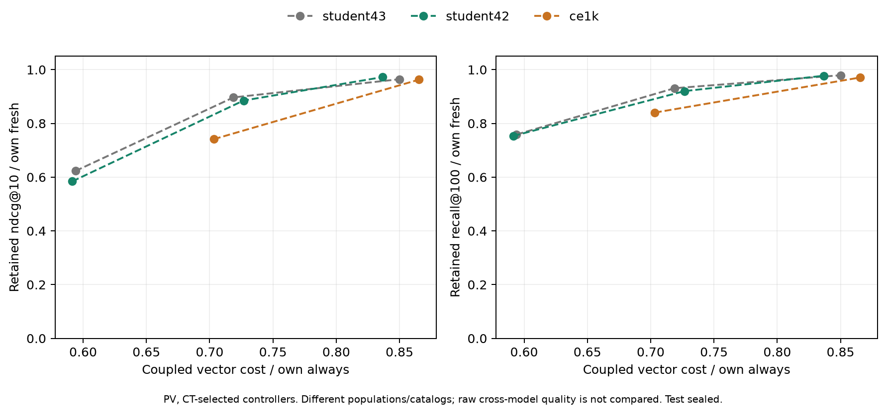

# H5: другой seed и пилот1к

14 ноября 2026. Проверка student42 и готовой CE1k не подтвердила общий
выигрыш learned refresh. Top100-cache ускоряет serving во всех проверенных
моделях. Повторного обучения SASRec нет; новые MLP обучены на собственных
CT-метках при том же рецепте H2.

## Протокол и ресурсы

Frozen student42 из парного T1-эксперимента; готовый CE1k, catalogue244194.
Для256 тот же catalogue114125,62129/29914 CT/PV requests и52191/23394
targets. На1к:230480/113258 requests,182749/88425 targets,805 positive
PV users. Временные границы прежние; CT8/2/4 fit/early-stop/tuning, PV
не выбирает модель/пороги, test в этой серии не читается.

Grid106,8 causal features, immediate gain, MLP1377 параметров с seed42,
AdamW0.001, batch4096, patience5. Student42/43 различаются encoder seed
и его собственным teacher в прежнем парном рецепте. CE1k одновременно
отличается когортой, каталогом и encoder recipe; этот опыт не изолирует
причинный эффект увеличения числа пользователей.

| Этап | Student42 | CE1k |
| --- | ---: | ---: |
| Snapshot lists / reference preparation |38.90с|208.00с|
| MPS scoring snapshots |11.59с|104.69с|
| Fit contexts |402350|1468108|
| MLP best / total epochs |21 /26|2 /7|
| Полный controller run |44.94с|101.09с|
| Дополнительные paired serving checks |18.39с|28.43с|
| Peak reference RSS |1162MiB|2827MiB|

Exact top100 считается один раз для каждого snapshot и переиспользуется
для targets. За пределами100 записан явный sentinel1000000, а не полный
rank. Это достаточно для NDCG@10/Recall@100/Hit@1 и immediate labels;
не подходит для MRR, среднего ранга или cutoff>100. Независимые CPU oracles
по256 пар в каждом reference и controller run совпали по метрикам и
membership; max top100 rank delta0. Веса энкодера не меняются.

## Качество контроллера относительно own fresh

Стоимость здесь — coupled vector-cache calibration, чтобы повторить H2.
Одинаковый budget не означает одинаковую refresh fraction: scoring floor
на1к выше. Сырые NDCG разных когорт не используются как доказательство
влияния масштаба. Полные значения и paired CI находятся в таблицах.

| Encoder | CT budget | PV cost / always | Refresh | Сохранённый NDCG | Сохранённый Recall |
| --- | ---: | ---: | ---: | ---: | ---: |
| Student43 |60%|59.40%|8.14%|62.29%|75.86%|
| Student42 |60%|59.15%|7.28%|58.43%|75.33%|
| CE1k |60%|Недостижим|—|—|—|
| Student43 |75%|71.88%|36.75%|89.67%|93.09%|
| Student42 |75%|72.68%|37.54%|88.50%|92.02%|
| CE1k |75%|70.33%|11.52%|74.14%|84.02%|
| Student43 |90%|85.00%|64.88%|96.44%|97.92%|
| Student42 |90%|83.67%|61.74%|97.23%|97.74%|
| CE1k |90%|86.54%|59.57%|96.28%|97.07%|

На1к never с initialization стоит66.25% always на PV в vector режиме,
поэтому60% недостижимы даже без регулярных refresh. Это ограничение
serving, а не нулевая рекомендация или training failure.

Для одного простого правила и близкой частоты update различие выглядит
иначе: events3 сохраняет83.45%/86.25%/93.02% own fresh NDCG для
student43/student42/CE1k при36.17%/36.17%/36.33% refresh. TTL30мин
сохраняет65.67%/66.62%/79.05% при15.03%/15.03%/14.61% refresh.
Поэтому нижнюю точку CE1k при75% cost нельзя интерпретировать как
большую чувствительность модели к staleness. Это описательные различия
в собственных когортах, без причинного вывода об эффекте dataset size.

## Есть ли преимущество перед простыми правилами

У student42 все3 NDCG CI к CT cost-matched expected mixtures включают0.
В среднем режиме Recall ниже: delta−0.011016,
CI[−0.016870;−0.005759]. Прежнее отсутствие общего выигрыша повторилось
на втором student seed.

На CE1k две доступные точки контроллера уступают таким ожиданиям:

| CT budget | Delta NDCG |95% CI| Delta Recall |95% CI|
| --- | ---: | --- | ---: | --- |
|75%|−0.001248|[−0.002517;−0.000229]|−0.006869|[−0.009626;−0.004064]|
|90%|−0.000476|[−0.000967;−0.000035]|−0.002128|[−0.003247;−0.001007]|

К дискретным comparators events10/hybrid2+5min NDCG CI включают0,
Recall CI ниже0. Это исследовательский результат на PV, а не доказательство
невозможности learned refresh. Expected mixtures выбираются только на
CT tuning и оцениваются в ожидании per-user assignment; его variance/cost
не измерены. CI pointwise,2000 whole-user bootstrap, seed42, без коррекции
множественных сравнений и без учёта всей истории выбора encoder recipe.

## Прямой serving check

По11 заранее заданных/CT-selected политик на каждой новой модели,
оба периода и оба режима:88 paired workload cases. Полные B=1 пути,
384 стратифицированных requests на case, идентичные samples двух режимов;
среднее всех блоков, без additive model. Это проверка selected costs,
не новый полный frontier и не подбор порогов по PV.

| PV policy | Student42 vector→list, мс | CE1k vector→list, мс |
| --- | ---: | ---: |
| always |1.906→1.913|2.461→2.450|
| events3 |1.418→0.695|1.960→0.895|
| TTL30мин |1.252→0.287|1.770→0.359|
| Controller среднего режима |1.438→0.728|1.774→0.292|
| Controller высокого режима |1.620→1.193|2.147→1.473|

Средний controller использует разные пороги/refresh fractions, поэтому
последние строки не являются сравнением качества encoder между собой.
Static list cache применим только при frozen item table/candidates/context;
vector path сохраняет сравнение с полным scoring каталога. Цена реальных
сменных candidate sets зависит от их размера и здесь не измеряется.

## Проверки и решение

21 CPU/MPS regression test прошёл;64 paired CI независимо пересчитаны.
Сверены hashes, data/checkpoints, fixed chronological boundaries, одинаковые
events каждого paired comparison, causal cache states и frozen weights.
Mixed errors coupled vector model≤3.21%/0.66% для новых моделей;
88 прямых serving cases проверены отдельно по paired samples/means.
Небольшие cost-различия и близкие budget cutoffs остаются чувствительны
к локальному timing drift; сырые block means опубликованы.

H5 закрыта в проверенном объёме: staleness/serving эффекты воспроизводятся,
общая польза learned controller — нет. Дополнительный перебор MLP и новых
горизонтов без новой причины не нужен. Следующий обязательный шаг —
аудит финального test-протокола: ранние encoder experiments уже открывали
старый test, хотя текущая maintenance-серия его не читает. Это ограничение
нужно обозначить до финальной оценки и проверить отдельную ранее
неоценивавшуюся когорту, выбрав её по train и исключив development users.

[Сравнения и проверки](policy-transfer/comparison.json),
[контроллеры](policy-transfer/controller-comparison.csv),
[вся сетка](policy-transfer/policies.csv),
[прямые costs](policy-transfer/direct-resources.csv).
