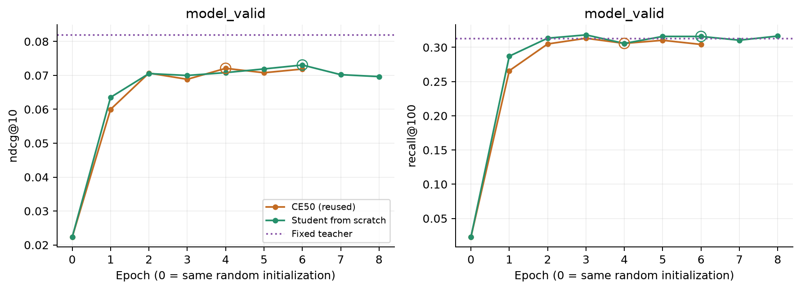
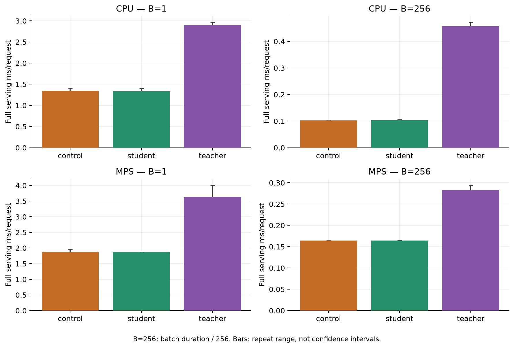

# Student с нуля: фиксированный CE50+CE2 teacher

11 ноября 2026. Пилот 256, Apple M3 Pro / MPS FP32, 4 CPU-потока, fallback отключён.
Выполнен **один новый training run**; готовые CE50 и CE2 не переобучались.
[Протокол и команды](../../notes/sasrec-256-distillation-cold.md),
[машинная сводка](sasrec-256-distillation-cold/summary.json).

Student выбран по model_valid на эпохе **6**,
остановка после **8** эпох по patience2.
На policy_valid изменение к готовому CE50: NDCG **-2.05%**,
Recall **+4.88%**. Проверка model_valid «NDCG выше,
Recall не ниже»: **True**. Это один seed и одна фиксированная KD-постановка.
На отдельном policy_valid по парным пользовательским интервалам: **ndcg@10: прирост не подтверждён; recall@100: прирост подтверждён**.
Validation guard описывает model_valid и не заменяет проверку переноса.

## Инициализация и обучение

Исходный initial.pt CE50 не сохранялся. Его начальное состояние восстановлено
из source commit591575a, исходных config и seed42. SHA archived source совпадают
с реестром исходного эксперимента; AST constructors, sampling и CE update
проверены на совпадение. Все **29 тензоров** восстановленной CE50
и нового student совпадают побитово, CPU RNG совпадает с сохранённым CE last.pt.
На **29,313** начальных validation targets ранги совпадают
точно и воспроизводят метрики исходного лога. В реальном training loop перед
первым update дополнительно проверены SHA весов и CPU/MPS RNG.
[Проверка и границы реконструкции](sasrec-256-distillation-cold/initialization.json).

Это случайная инициализация, без загрузки обученных CE50 weights; epoch0
не участвует в выборе, как у контроля. Все ID-векторы student trainable.
History50, dim64, 2 blocks/heads, dropout0.2, batch256, Adam lr0.001,
betas(0.9,0.98), clip5, seed42, dummy negatives16 сохранены.
Train **739 571** prefixes, model_valid **29 313**, полный каталог **114 125**.
Одиночный student: **7,357,888 параметров**.

Teacher — frozen/eval CE50 epoch4 + native CE2 epoch7 (positions48/49).
Alpha короткой ветви **0.4**, T **2**, lambda **1** фиксированы;
alpha переиспользована из прежнего model_valid selection. Никаких новых grids.
Teacher logits = per-query z-score mixture × population std исходных long logits.
Loss = CE + lambda × T² × KL(teacher || student), `batchmean`; KL суммируется
по каталогу, не усредняется по B×items. Targets вычисляются на лету,
teacher gradients отсутствуют. Student inference не использует teacher.

| Запуск | Эпох | Best | model_valid NDCG@10 | Recall@100 | Trainer, мин | Peak RSS, MiB |
| --- | ---: | ---: | ---: | ---: | ---: | ---: |
| control | 6 | 4 | 0.072085 | 0.305769 | 12.63 | 1033.7 |
| student | 8 | 6 | 0.073060 | 0.315935 | 46.94 | 1083.8 |

Время и память контроля взяты из **исторического** запуска, не из нового парного
training benchmark. Student full run с setup/проверками:
**46.95 мин**;
внутри trainer time включает train, validation и checkpoint I/O.
Исторический контроль такого outer-таймера не сохранял.

| Запуск | Max saved MPS tensors, MiB | Max saved MPS driver, MiB |
| --- | ---: | ---: |
| control | 112.9 | 1051.9 |
| student | 169.4 | 2075.9 |

RSS — максимум процесса. MPS — snapshots после эпох, не гарантированный
внутренний пик kernels; это общая unified memory, значения не суммируются.

[Все эпохи, CE и T²KL](sasrec-256-distillation-cold/training.csv).

## Fresh качество на прежних CT/PV событиях

Best checkpoint зафиксирован до чтения CT/PV. Прежние 52 191 CT / 23 394 PV
targets, полные одинаковые candidate sets, строго прошлые history перед
timestamp group; без исключения уже прослушанных items. Контрольные ranks
переиспользованы из проверенного replay, student/teacher рассчитаны заново.
Test не читается. Выбора по CT/PV нет.

| Split | Модель | NDCG@10 | Recall@100 | Hit@1 |
| --- | --- | ---: | ---: | ---: |
| controller_train | control | 0.056663 | 0.265870 | 0.022839 |
| controller_train | student | 0.058451 | 0.276810 | 0.023874 |
| controller_train | teacher | 0.064759 | 0.268284 | 0.026940 |
| policy_valid | control | 0.055093 | 0.252201 | 0.024109 |
| policy_valid | student | 0.053961 | 0.264512 | 0.022869 |
| policy_valid | teacher | 0.063086 | 0.259853 | 0.028383 |

Student минус CE50 на PV: 2 000 bootstrap целых пользователей, seed42,
event-weighted. Интервалы pointwise при фиксированных checkpoints;
training variance и поправки на множественные проверки не включены.

| Метрика | Разница | 95% CI |
| --- | ---: | --- |
| ndcg@10 | -0.001131 | [-0.003519; +0.001006] |
| recall@100 | +0.012311 | [+0.007073; +0.017718] |

[Полные paired CI и last-item/in-window/outside strata](sasrec-256-distillation-cold/evaluation.json).

На PV student хуже распознаёт повторы последнего item: NDCG **0.4924**
против **0.5695** у CE50
(415 targets). На items вне текущего окна
Recall **0.2118** против
**0.1968**.
Это описательные срезы фиксированных моделей, не доказательство причины.

## Стоимость fresh serving

Обе одиночные модели: encoder50 + full-catalog scoring + final top100.
Teacher: две ветви, native recent2, z-score/mix и один top100.
Включены подготовка/передача token IDs и результат на CPU; input уже
токенизирован, без сети, storage и queues. Веса моделей чередуются в одном
процессе. B1: 5×128, warmup16; B256: 3×8, warmup2; MPS sync.

Медиана серий, мс/запрос. B256 — batch duration/256, **throughput**,
а не индивидуальная online latency.

| Модель | CPU B1 | MPS B1 | CPU B256 | MPS B256 |
| --- | ---: | ---: | ---: | ---: |
| control | 1.3436 | 1.8696 | 0.1030 | 0.1644 |
| student | 1.3345 | 1.8668 | 0.1034 | 0.1645 |
| teacher | 2.8943 | 3.6332 | 0.4577 | 0.2828 |

[CPU timings/memory](sasrec-256-distillation-cold/serving-cpu.json),
[MPS timings/memory](sasrec-256-distillation-cold/serving-mps.json).
Общий process держит три модели: control, student, recent teacher;
control делит long-ветвь учителя. RSS profiling process не равен памяти
standalone student. У control/student одинаковая архитектура и параметрический
размер; небольшая разница timings не означает изменение сложности.

## Проверки и пределы вывода

79 CPU/MPS тестов: loss/градиенты, frozen teacher, native2, default trainer,
warm start и cold state/RNG guard. Сохранены SHA source, data, checkpoint,
locked selection, исходники восстановленного initializer, logs/JSON/CSV/plots.
Test не открыт. Измерено fresh качество; stale replay и policy frontier
этого student не проводились. Прежние cache/frontier результаты относятся
к исходным CE50 weights. Один seed/256 пользователей ограничивают обобщение.
[Итоговые проверки артефактов](sasrec-256-distillation-cold/verification.json).
