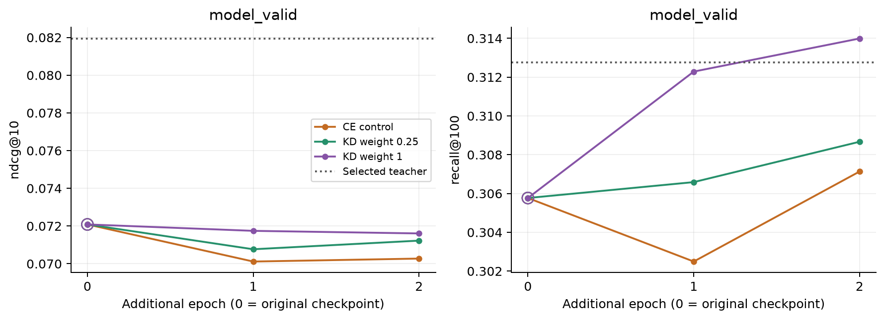
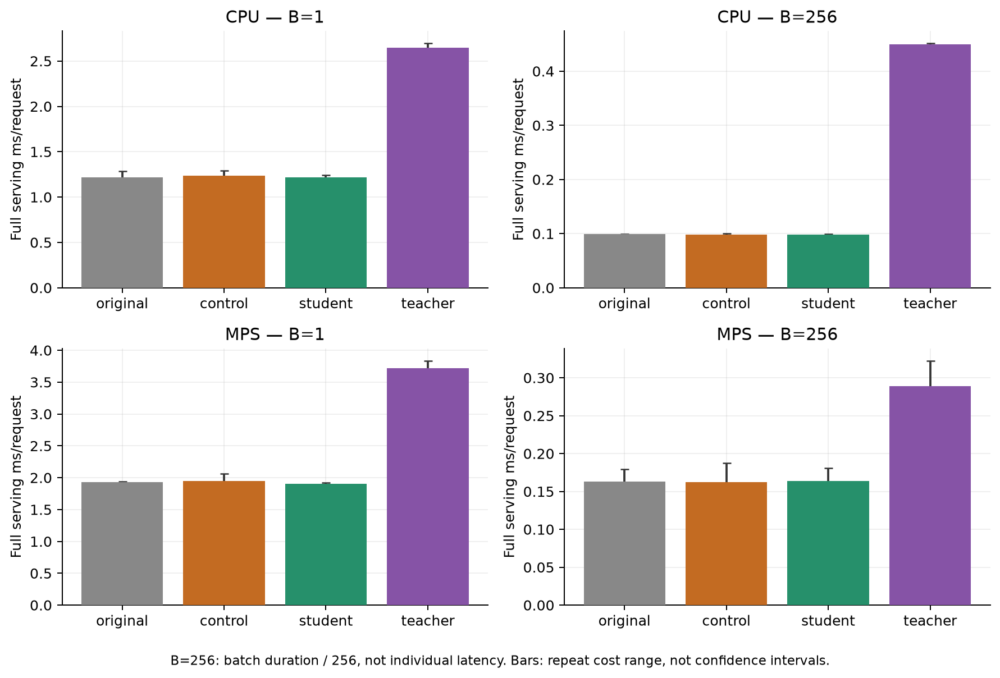

# Дистилляция CE50+CE2 в одиночный SASRec50

11 ноября 2026. Пилот 256, локальные Apple M3 Pro / MPS FP32, 4 CPU-потока,
fallback отключён. Учитель и initializer готовы из прежних запусков;
текущий эксперимент не повторяет их pretraining.
[Протокол и команды](../../notes/sasrec-256-distillation.md),
[сводка](sasrec-256-distillation/summary.json).

**В проверенной постановке дистилляция не улучшила одиночный baseline.**
Control и оба KD-запуска остановились после двух дополнительных эпох;
по validation NDCG лучшими во всех случаях остались исходные веса (epoch0).
Формальный выбор weight0.25 — разрешение ничьей двух epoch0 candidates,
а не свидетельство лучшего KL coefficient. Веса выбранных checkpoints побитово
совпадают с исходным CE50, поэтому их CT/PV качество одинаково.

## Протокол

Учитель — frozen CE50 epoch4 + CE2 epoch7. Alpha **0.4** выбран
по model_valid NDCG из 0/0.1/…/1, tie — меньший alpha. Model_valid учителя:
**0.081946 / 0.312762**.
Native recent2 сохраняет learned positions48/49; scaling soft targets проверен
на всех 29 313 validation targets и сохраняет выбранные метрики.
[Teacher selection](sasrec-256-distillation/teacher-selection.json),
[implementation check](sasrec-256-distillation/teacher-check.json).

Teacher logits = z-score mixture × population std исходных long logits.
Это положительное affine scaling, сохраняющее ranking и возвращающее logits
в шкалу CE50; вероятности прослушивания не калибруются. T=2 фиксирована.
Loss = CE(student raw logits, target) + weight × T² × KL(teacher || student),
полный каталог **114 125** items. Вес CE остаётся 1 во всех вариантах.
KL суммируется по классам и усредняется по batch (`batchmean`), не по B×catalog.
Учитель eval/frozen, без current feedback или градиентов; dense soft targets
вычисляются на лету, не сохраняются на диск.

Control weight0 и students weight0.25/1 начинают из одинакового CE50 checkpoint,
Adam новый. Прежние train **739 571** / model_valid **29 313** prefixes,
history50, dim64, 2 blocks/heads, dropout0.2, batch256, lr0.001,
seed42, dummy negatives16 и patience2 сохранены. Все ID-векторы student trainable.
Лимита эпох нет, epoch0 участвует в best selection. Inference student — обычный
SASRec50, **7 357 888 параметров**, без teacher modules или второго scoring.

## Обучение и выбор

| Запуск | Эпох | Best дополнительная эпоха | model_valid NDCG | Recall | Полный запуск, мин | Peak RSS, MiB |
| --- | ---: | ---: | ---: | ---: | ---: | ---: |
| control | 2 | 0 | 0.072085 | 0.305769 | 3.72 | 1062.4 |
| kd-0.25 | 2 | 0 | 0.072085 | 0.305769 | 11.09 | 1078.7 |
| kd-1 | 2 | 0 | 0.072085 | 0.305769 | 11.47 | 1080.2 |

Best epoch0 означает сохранение исходных весов после неудачного дообучения.
Nonzero weight **0.25** выбран только по best
model_valid NDCG, tie — меньший weight; после этого выбор зафиксирован до
чтения CT/PV. Критерий принятия: NDCG выше контроля, Recall не ниже.
[Locked selection](sasrec-256-distillation/selection.json),
[все эпохи и CE/KL components](sasrec-256-distillation/training.csv).

У последней фактически обученной модели weight1 validation Recall
**0.313990** (+2.7% к initializer), NDCG
**0.071607** (-0.7%).
Это описание model_valid; дополнительные unselected weights на CT/PV
не подбирались и не оценивались.

Полное время включает setup, сбор данных, обучение, validation, checkpoints
и финальные проверки. В raw training JSON отдельно `setup_seconds`,
`elapsed_seconds` trainer и train time каждой эпохи. Peak RSS — процесс;
MPS tensor/driver snapshots сохранены по эпохам и не суммируются с RSS.

| Training run | Max saved MPS tensors, MiB | Max saved MPS driver, MiB |
| --- | ---: | ---: |
| control | 112.9 | 1051.9 |
| kd-0.25 | 169.4 | 2075.9 |
| kd-1 | 169.4 | 2075.9 |

Это snapshots после эпох и allocator residency, не гарантированный пик
временных buffers внутри forward/backward kernels.

## Качество на фиксированных CT/PV событиях

Использованы прежние 52 191 CT / 23 394 PV targets и одинаковый полный каталог.
Original ranks переиспользованы из проверенного fresh replay; control/student/
teacher оценены на тех же строго прошлых histories. Teacher использует alpha
с model_valid, а не прежний CT selection. Test не читается.

| Split | Модель | NDCG@10 | Recall@100 | Hit@1 |
| --- | --- | ---: | ---: | ---: |
| controller_train | original | 0.056663 | 0.265870 | 0.022839 |
| controller_train | control | 0.056663 | 0.265870 | 0.022839 |
| controller_train | student | 0.056663 | 0.265870 | 0.022839 |
| controller_train | teacher | 0.064759 | 0.268284 | 0.026940 |
| policy_valid | original | 0.055093 | 0.252201 | 0.024109 |
| policy_valid | control | 0.055093 | 0.252201 | 0.024109 |
| policy_valid | student | 0.055093 | 0.252201 | 0.024109 |
| policy_valid | teacher | 0.063086 | 0.259853 | 0.028383 |

Student минус continued control на PV, 2 000 bootstrap целых пользователей,
seed42, event-weighted, fixed checkpoints. Интервалы pointwise, без поправки
за множественные сравнения; training variance не включена.

| Метрика | Разница | 95% CI |
| --- | ---: | --- |
| ndcg@10 | +0.000000 | [+0.000000; +0.000000] |
| recall@100 | +0.000000 | [+0.000000; +0.000000] |

[Все paired CI и repeat/window strata](sasrec-256-distillation/evaluation.json),
[metrics CSV](sasrec-256-distillation/metrics.csv).

## Полная стоимость inference

Original/control/student выполняют один encoder50 и один full-catalog scoring.
Teacher использует нужные ветви, native recent2, per-query z-score/mix и один
final top-100. Передача token IDs и результата на CPU включены; input уже
токенизирован, сеть/storage/queues исключены. Модели чередуются в одном процессе.
B=1: 5×128 запросов, warmup16; B=256: 3×8 batch, warmup2; MPS sync.

Медианы серий, **мс/запрос**. B=256 — throughput (batch duration/256),
не latency одного online запроса.

| Модель | CPU B=1 | MPS B=1 | CPU B=256 | MPS B=256 |
| --- | ---: | ---: | ---: | ---: |
| original | 1.2187 | 1.9262 | 0.0992 | 0.1627 |
| control | 1.2330 | 1.9503 | 0.0986 | 0.1622 |
| student | 1.2158 | 1.9082 | 0.0986 | 0.1634 |
| teacher | 2.6492 | 3.7210 | 0.4496 | 0.2891 |

[Все повторы и memory probes CPU](sasrec-256-distillation/serving-cpu.json),
[MPS](sasrec-256-distillation/serving-mps.json),
[serving CSV](sasrec-256-distillation/serving.csv).
Малые timing differences одиночных моделей не означают изменение сложности:
архитектура и число параметров одинаковы. Profiling process держит все четыре
модели для чередования; его RSS не является памятью standalone student.
MPS memory stage snapshots не гарантируют захват внутренних kernel peaks.

## Проверки и ограничения

77 CPU/MPS тестов: KL direction/gradients, frozen teacher, native2, warm start,
epoch0 fallback, default trainer/resume. Проверяются SHA checkpoints, train/
model_valid files, protocol и source; одинаковые initial CPU/MPS RNG states.
Teacher и weight selection выполняются на model_valid, модельные checkpoint
hashes фиксируются до CT/PV. Test events не читались.

После обучения исправлен экспорт относительного output path и уточнено имя
data-read metadata flag. Формулы и веса не менялись; фактически выполненный
training source сохранён с исходным SHA в
[source history](sasrec-256-distillation/source-history.json).

Один seed и небольшой pilot; это проверка конкретного KD loss/температуры/
двух nonzero weights, а не общий предел дистилляции. Текущие cost и quality
относятся к fresh inference; cache replay для новых весов не выполнялся.
[Проверки артефактов](sasrec-256-distillation/verification.json).
