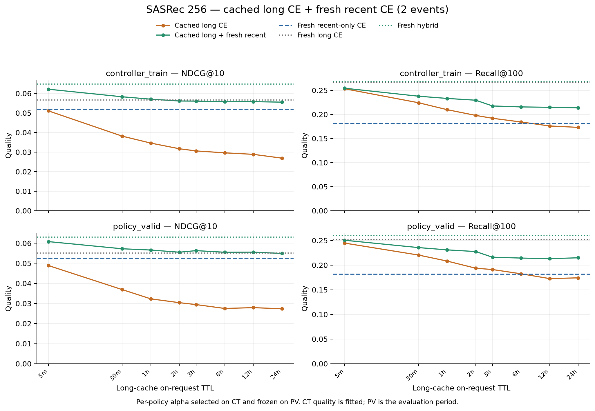
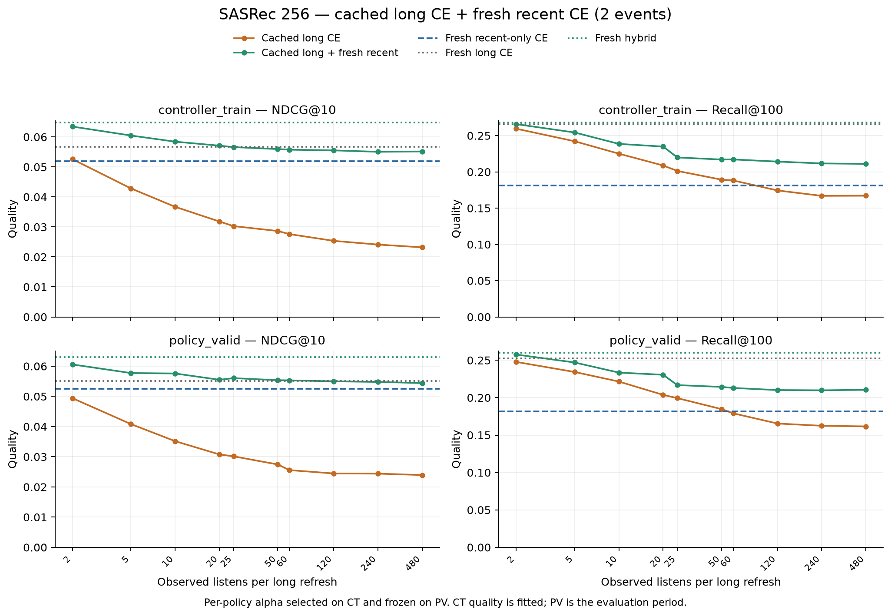
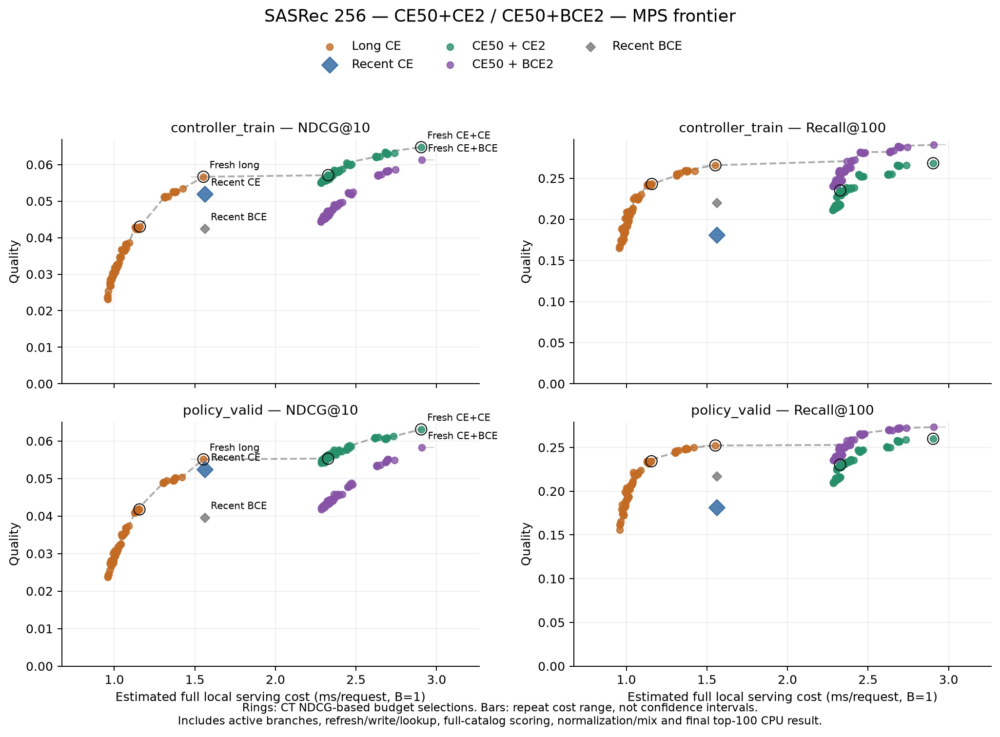
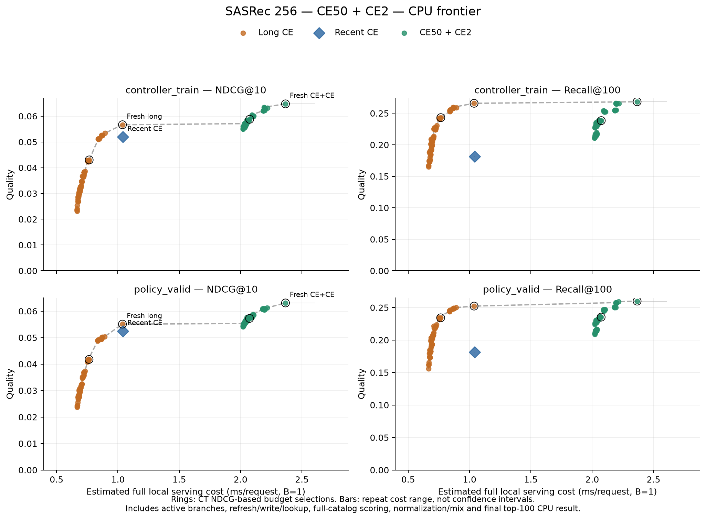

# Recent full CE, новая смесь и измеренный quality–cost frontier

10 ноября 2026. Пилот **256 пользователей**, Apple M3 Pro / 36 GiB,
локальные CPU/MPS FP32, 4 CPU-потока, MPS fallback отключён.
Обучена только recent-модель; длинная CE50 и прежняя BCE2 остаются фиксированными.
[Протокол и команды](../../notes/sasrec-256-hybrid-ce.md),
[машиночитаемая сводка](sasrec-256-hybrid-ce/summary.json).

На policy_valid свежая CE50+CE2 смесь даёт **0.063086 NDCG@10 / 0.259853 Recall@100**,
α=0.4 с CT. К прежней CE50+BCE2 это **+8.4% NDCG / −4.9% Recall**;
к fresh long — **+14.5% / +3.0%**. Все четыре парных интервала исключают ноль.
Прежняя смесь остаётся лучшей по Recall среди этих fresh-моделей.
Полный B=1 serving новой смеси стоит **2.37 мс CPU / 2.90 мс MPS**,
против **1.04 / 1.55 мс** у fresh long. Сокращение числа long-refresh
не означает такое же сокращение полной стоимости.

## Контролируемое обучение

Из [старого recent BCE2 config](../../configs/experiments/sasrec-256-recent-2.json)
в [новый](../../configs/experiments/sasrec-256-recent-2-full-ce.json) перенесено всё,
кроме `objective=full_ce`. Сохранены tensor length 50 / 2 видимых последних
события, dim 64, 2 головы и 2 блока, dropout 0.2, batch 256, Adam 0.001,
betas (0.9, 0.98), clipping 5, seed 42 и patience 2 по model_valid NDCG@10.
Лимит эпох отсутствует. Полный CE нормирует logits по всем 114 125 известным
train-трекам; 16 dummy negatives сохраняют прежний RNG stream, в loss не входят.
ID-таблица и остальные веса обучаются. Одна модель: **7 357 888 параметров**,
две: **14 715 776**; FP32-веса около 28.07 / 56.14 MiB.

- Train: **739 571** строго прошлых учебных prefixes/targets из 1 152 986 прослушиваний;
  model_valid: **29 313** targets. Данные и хронологические границы прежние.
- Остановка после **9 эпох**, best **7**, **18.70 мин** на MPS.
  Best model_valid: **0.068420 / 0.216798**; старый BCE2 best: 0.055054 / 0.258964.
- Initial validation побитово совпадает с BCE2; config diff содержит только loss.
  Это один запуск на loss, а не оценка training variance.
- Пик наблюдённого process RSS обучения **1033.41 MiB**; MPS tensor snapshot
  **112.95 MiB**, максимальный сохранённый driver snapshot **1051.86 MiB**.
  Это разные показатели unified memory, их нельзя складывать.

[Training log метрик](sasrec-256-hybrid-ce/training.json),
[проверка единственного изменения](sasrec-256-hybrid-ce/training-control.json).
Checkpoint recent: `48f54252ff8ffae491f686c5fa7b96897b64854dc1cc2c1b847d5b0e74ed127a`.
Long CE50: `decfa67cb108d71806fec5957e4d425650aa6acb33bd67bf4b71e1d105cc4eb0`.
Локальные checkpoints и массивы ranks остаются в `data/runs/`, в Git — отчёты и конфиги.

## Смеси и качество

Каталог общий, **114 125 кандидатов** на каждое предсказание; seen items не исключаются.
Все **52 191 CT / 23 394 PV targets**, **62 129 / 29 914 timestamp-групп запросов**
сохранены. Сначала предсказывается вся текущая timestamp-группа, затем её
прослушивания добавляются в историю; текущий feedback невидим.
Строго прошлые короткие и повторные прослушивания тоже входят в историю.

Обе модели используют собственные item-таблицы. Scores по одному и тому же
каталогу нормируются per-query:
`z=(s−mean)/max(population_std,1e−8)`;
`mixed=(1−α)*z_long+α*z_recent`.
Это согласование шкал scores, не калибровка вероятностей.
Для каждой из прежних **100** long-refresh политик α из 0/0.1/…/1 выбирается
по CT NDCG, tie — меньший α, и фиксируется до расчёта PV mixtures.
Все выбранные α — 0.4–0.7. Это постоянные веса каждой политики, не controller.
CT качество fitted; PV — отдельная оценка. Для чистого исследования возраста
нужен общий α, поскольку здесь одновременно меняются policy и её выбранный вес.

| Fresh-вариант на PV | α recent | NDCG@10 | Recall@100 | Hit@1 |
| --- | ---: | ---: | ---: | ---: |
| Long CE50 | 0 | 0.055093 | 0.252201 | 0.024109 |
| Recent BCE2 | 1 | 0.039578 | 0.216979 | 0.014405 |
| Recent CE2 | 1 | 0.052459 | 0.181457 | 0.026674 |
| CE50 + BCE2 | 0.3 | 0.058224 | 0.273190 | 0.021330 |
| CE50 + CE2 | 0.4 | 0.063086 | 0.259853 | 0.028383 |

Fresh новая смесь на CT: **0.064759 / 0.268284**,
recent CE2: **0.051897 / 0.181181**.
CE улучшает верхние позиции recent-модели, но снижает её Recall@100.
Смесь частично компенсирует это длинной ветвью. По fresh Hit@1 новая смесь
выше long и старой смеси; парные CI положительны, метрика вторичная.
[Hit@1 анализ](sasrec-256-hybrid-ce/secondary-hit1.json).

Парные 95% CI: 2 000 bootstrap целых пользователей, seed 42,
event-weighted метрики, fixed checkpoints/α. Интервалы pointwise,
без поправки за множественные сравнения и без training variance.

| PV сравнение | Метрика | Разница | 95% CI |
| --- | --- | ---: | --- |
| New hybrid − fresh long | ndcg@10 | +0.007993 | [+0.005108; +0.011267] |
| New hybrid − fresh long | recall@100 | +0.007652 | [+0.002463; +0.012824] |
| New hybrid − old hybrid | ndcg@10 | +0.004862 | [+0.001750; +0.008545] |
| New hybrid − old hybrid | recall@100 | -0.013337 | [-0.017909; -0.008838] |
| Recent CE − recent BCE | ndcg@10 | +0.012881 | [+0.006618; +0.020139] |
| Recent CE − recent BCE | recall@100 | -0.035522 | [-0.047282; -0.025001] |

[Все сравнения со старой смесью](sasrec-256-hybrid-ce/comparison-bce.json),
[новые метрики, CI и repeat/window сегменты](sasrec-256-hybrid-ce/results.json).
На непосредственных повторах fresh NDCG новой смеси **0.684970**, старой —
0.756767; на targets вне окна новой смеси **0.037832**, старой — 0.032674.
Поэтому изменение качества неоднородно по сегментам; общий выигрыш NDCG
не означает улучшения каждого типа событий.

## Устаревание длинной ветви

Recent всегда свежая. Политики срабатывают при запросе, а не по фоновому таймеру;
TTL — время с предыдущего refresh, event threshold — новые прослушивания.
OR-политики обновляют long при любом из двух условий. Инициализация каждого
user cache включена в refresh counts и стоимость.

| Long TTL | α | Long NDCG | Hybrid NDCG | Hybrid Recall | Long refresh, PV | Hybrid MPS мс/запрос |
| --- | ---: | ---: | ---: | ---: | ---: | ---: |
| Never | 0.7 | 0.023680 | 0.054105 | 0.209028 | 0.72% | 2.284 |
| 5 мин | 0.5 | 0.048886 | 0.060806 | 0.250363 | 45.20% | 2.617 |
| 30 мин | 0.6 | 0.036893 | 0.057231 | 0.235488 | 15.03% | 2.391 |
| 1 ч | 0.6 | 0.032289 | 0.056604 | 0.230871 | 10.31% | 2.352 |
| 3 ч | 0.7 | 0.029436 | 0.056308 | 0.215996 | 6.43% | 2.327 |
| 6 ч | 0.7 | 0.027513 | 0.055497 | 0.214243 | 4.94% | 2.316 |
| 12 ч | 0.7 | 0.027922 | 0.055555 | 0.213046 | 3.58% | 2.306 |
| 24 ч | 0.7 | 0.027348 | 0.054914 | 0.214799 | 2.79% | 2.299 |

Never hybrid даёт NDCG 0.054105, чуть ниже fresh long 0.055093,
но Recall 0.209028 существенно ниже 0.252201. При 24h NDCG 0.054914 / Recall
0.214799: freshness loss частично компенсируется, а полная стоимость остаётся
выше fresh long. Это результаты текущей реализации, не общий предел гибридов.
[Все 200 policy/split строк](sasrec-256-hybrid-ce/metrics.csv),
[1 100 CT alpha-точек](sasrec-256-hybrid-ce/alpha-grid.csv),
[выбранные веса](sasrec-256-hybrid-ce/selection.json).

## Полные замеры CPU/MPS

Измеряются полные ветви fresh-direct, refresh/write/serve и cache-hit/serve.
Fresh always обходит cache write. Hybrid включает свежий recent encoder,
long encoder только при refresh, CPU cache write/lookup, обе item-таблицы,
full-catalog scoring, обе нормировки, смешивание, **один** final top-100 и
возврат индексов на CPU. Endpoints α=0/1 пропускают неиспользуемую ветвь.
Результат serving — top-100, а не исследовательский полный target rank.

B=1: 5 серий × 128 запросов, warmup 16. B=256: 3 × 8 batch,
warmup 2. Одни CT-окна и порядок запросов для всех ветвей; порядок ветвей
перемешивается между сериями. Перед/после замера — MPS sync.
Выбраны только нужные **6455** CT-окна до предварительного кодирования.

Все числа ниже — медианы серий в **мс на запрос**. B=1 приближает локальную
последовательную latency; B=256 — batch duration / 256, **throughput**, не latency
одного online-запроса. Сеть, storage, очереди и конкурирующие запросы не моделируются;
вход — готовые CPU token IDs, локальные masking/transfer включены.
Component rows служат диагностикой, их времена нельзя просто складывать.

| Ветвь | CPU B=1 | MPS B=1 | CPU B=256 | MPS B=256 |
| --- | ---: | ---: | ---: | ---: |
| Fresh long | 1.0373 | 1.5528 | 0.0884 | 0.1344 |
| Long refresh/write/serve | 1.0414 | 1.7285 | 0.0884 | 0.1359 |
| Long cache hit/serve | 0.6640 | 0.9535 | 0.0584 | 0.1243 |
| Recent CE2 | 1.0419 | 1.5618 | 0.0887 | 0.1345 |
| Fresh CE50+CE2 | 2.3661 | 2.9042 | 0.4492 | 0.2372 |
| Hybrid refresh/write/serve, α=0.4 | 2.3493 | 3.0421 | 0.4500 | 0.2381 |
| Hybrid hit/serve, α=0.4 | 2.0152 | 2.2679 | 0.4202 | 0.2264 |
| Long encoder | 0.3122 | 0.9064 | 0.0296 | 0.0125 |
| Recent encoder | 0.3102 | 0.9037 | 0.0299 | 0.0126 |
| Long scoring + top-100 CPU | 0.6606 | 0.9601 | 0.0585 | 0.1240 |

При B=1 CPU быстрее MPS. При batch256 MPS быстрее CPU для полного гибрида,
но не для всех путей. Прежняя CE50+BCE2 fresh-смесь на MPS:
**2.9082 мс/запрос**,
практически та же стоимость, что у новой.

**Recent2 сейчас не является дешёвым encoder.** Он видит только 2 события,
но обе модели считают tensor length 50. Даже rare-refresh hybrid всё равно
кодирует recent и выполняет два scoring по каталогу и нормировку/смешивание.
На MPS свежая новая смесь стоит около **1.87×** fresh long. При rare refresh
эта реализация не выигрывает по полной стоимости у fresh long.
Нативный короткий inference и объединение scoring в этом эксперименте не делались.

Память профилирования включает обе модели и выбранные диагностические vectors:
process peak RSS CPU **1137.88 MiB**, MPS **697.61 MiB**.
MPS tensor stage snapshots для fresh hybrid: максимум сохранённых стадий
**61.58 MiB при B=1 / 399.39 MiB при B=256**; это не гарантированный пик
временных buffers внутри kernels. Финальный MPS driver snapshot **1052.73 MiB**.
Логический long cache для 256 пользователей — **64 KiB** (256 × 64 × FP32),
без Python-метаданных; recent cache отсутствует. У direct-fresh cache не нужен.
RSS, активные MPS tensors и driver allocations нельзя суммировать.

[CPU raw profile](sasrec-256-hybrid-ce/resources-cpu.json),
[MPS raw profile](sasrec-256-hybrid-ce/resources-mps.json),
[старый BCE MPS profile](sasrec-256-hybrid-ce/resources-bce-mps.json),
[все времена](sasrec-256-hybrid-ce/resources.csv).

## Quality–cost frontier

Стоимость политики — медиана пяти count-weighted сумм измеренных полных
refresh/hit paths плюс CPU decision cost; initializations учтены как refresh.
Always использует direct-fresh. α=1 исключает long, cache и refresh decisions.
Полные числа запросов/refresh берутся из того же replay, качество считается по
positive targets. Это calibrated estimate среднего B=1 serving cost;
не измерение всего многодневного replay по wall clock. Для B=256 показан
только throughput-контроль: его частично обновляемый frontier не оценивался.

CPU frontier: 201 вариант на split (100 long / 100 hybrid / recent CE).
MPS: **302** (те же варианты плюс 100 прежних BCE hybrid / recent BCE).
Один общий long-only profile используется для обеих MPS-рецептур.
Recall frontier относится к **NDCG-selected α**, а не к отдельному подбору α
по Recall. Между дискретными Pareto-точками нет обещания достижимой интерполяции.
Горизонтальные полосы — min/max повторных cost estimates, не confidence intervals.
При близких стоимостях положение точки может меняться из-за шума замера.

Ниже выбор **только по CT NDCG** при бюджетах относительно direct-fresh long.
PV значения получены для уже выбранной настройки; PV frontier описательный.
`hybrid_E_T` в имени политики означает OR: E новых событий либо T секунд.
Префикс `long:` / `hybrid:` означает модель, это другое использование слова hybrid.

| Устройство | CT бюджет | Выбранная настройка | PV мс/запрос | PV NDCG | PV Recall |
| --- | ---: | --- | ---: | ---: | ---: |
| CPU | 0.60× | Нет допустимой точки | — | — | — |
| CPU | 0.80× | `long:hybrid_5_1800` | 0.765 | 0.041759 | 0.234163 |
| CPU | 1.00× | `long:always` | 1.037 | 0.055093 | 0.252201 |
| CPU | 1.25× | `long:always` | 1.037 | 0.055093 | 0.252201 |
| CPU | 1.50× | `long:always` | 1.037 | 0.055093 | 0.252201 |
| CPU | 2.00× | `hybrid:hybrid_10_1800` | 2.073 | 0.057244 | 0.235231 |
| CPU | 2.50× | `hybrid:always` | 2.366 | 0.063086 | 0.259853 |
| MPS | 0.60× | Нет допустимой точки | — | — | — |
| MPS | 0.80× | `long:hybrid_5_1800` | 1.156 | 0.041759 | 0.234163 |
| MPS | 1.00× | `long:always` | 1.553 | 0.055093 | 0.252201 |
| MPS | 1.25× | `long:always` | 1.553 | 0.055093 | 0.252201 |
| MPS | 1.50× | `hybrid:hybrid_20_86400` | 2.327 | 0.055277 | 0.230230 |
| MPS | 2.00× | `hybrid:always` | 2.904 | 0.063086 | 0.259853 |
| MPS | 2.50× | `hybrid:always` | 2.904 | 0.063086 | 0.259853 |

На tight budget CT выбирает cached long-only; при достаточном бюджете — fresh
CE+CE. При промежуточном бюджете PV улучшение NDCG может быть очень небольшим,
а Recall хуже fresh long: CT выбор не гарантирует доминирования на PV.
По Recall свежая CE+BCE остаётся сильнее CE+CE при практически той же стоимости.
Следовательно, сейчас нет одной смеси, оптимальной по обеим метрикам.

Смешанные workload checks: 384 запроса каждого split, реальные stale snapshots
и refresh flags; существующий cache подготовлен до таймера, refresh внутри.
Максимальное абсолютное отклонение медианного времени от калиброванной оценки:
**7.34% CPU / 3.55% MPS CE / 7.15% MPS BCE**. Проверка выборочная,
не универсальная граница ошибки; точные значения и повторы в raw profiles.

## Проверки и ограничения

- **68 тестов** CPU/MPS прошли: [лог](sasrec-256-hybrid-ce/tests.txt).
  Проверены реальное refresh/write, direct bypass, endpoints, cached scoring
  и независимое полное кодирование.
- Recent-only inputs и ranks совпали на всех **75 585** CT/PV targets;
  независимый CPU oracle смеси — **256/256** exact ranks и те же метрики.
- Timed serving против независимого re-encoding: CPU **31/32** exact,
  max rank delta 1 и те же метрики; MPS CE и BCE — **32/32** exact.
  CPU стоимость использует сохранённое quality MPS replay с этими checks,
  полного CPU quality replay заново не делали.
- Hashes данных, исходников расчёта, checkpoints, frozen state и CT selection
  проверены. Все data files — train/model_valid/CT/PV, items/users;
  **test events не читались**. Существующие старые test-результаты не использовались
  для настройки этого эксперимента.
- Один pilot/seed, CT/PV уже неоднократно исследовались; это exploratory baseline,
  не финальная независимая оценка диплома. Следующий контролируемый шаг — реально
  короткий inference с сохранением позиционной семантики и rank oracle, затем
  повторный resource frontier; controller до этого не обучался.

[Итоговая проверка артефактов](sasrec-256-hybrid-ce/verification.json).
