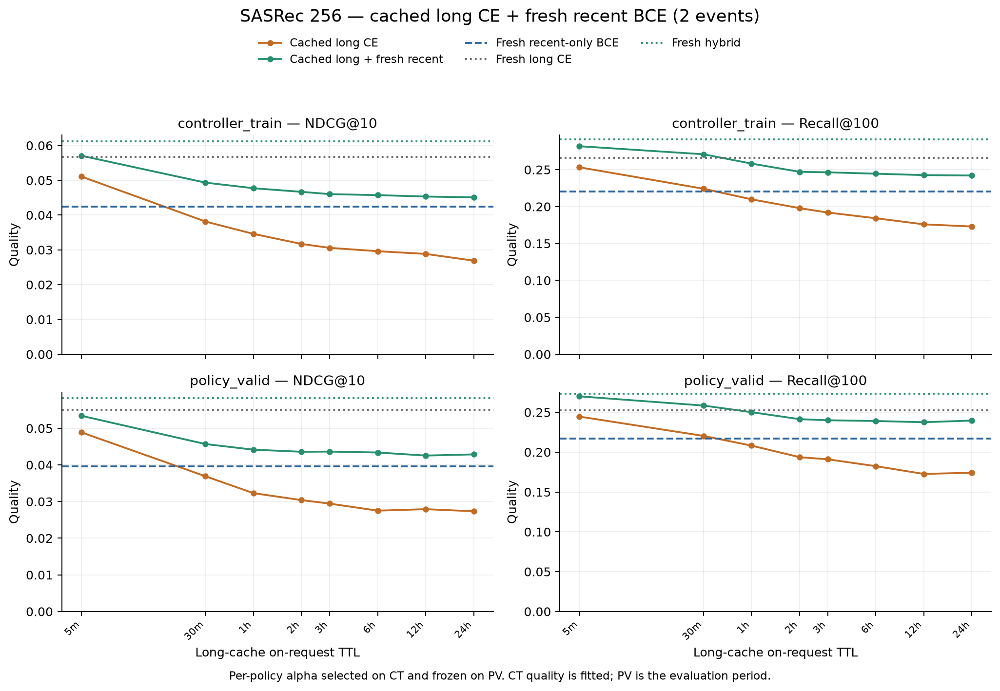
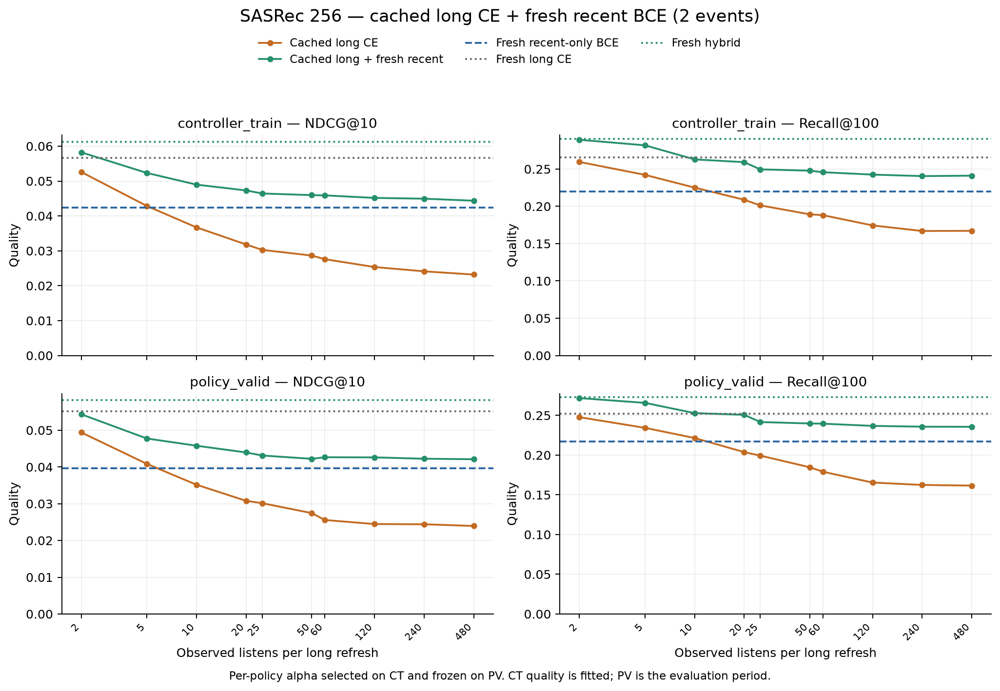

# Гибрид: cached long CE + свежая recent-only BCE

10 ноября 2026. Готовые модели пилота 256 смешаны **по scores**, без нового
обучения и без изменения их весов. Все вычисления локальны, MPS FP32;
CPU fallback отключён. История long — 50, recent — последние 2 прослушивания.
Каталог **114 125** items, все **52 191 CT / 23 394 PV targets** сохранены.
[Конфиг](../../configs/experiments/sasrec-256-hybrid.json),
[план и команда](../../notes/sasrec-256-hybrid.md).

На **policy_valid** fresh long CE даёт **0.055093 / 0.252201**,
recent-only BCE — **0.039578 / 0.216979**,
fresh hybrid — **0.058224 / 0.273190** NDCG@10 / Recall@100.
Выбранный на CT вес recent для свежего long: **alpha=0.3**.

## Модели и смесь

| Ветвь | Обучение | Вход | Checkpoint |
| --- | --- | --- | --- |
| Long | Full CE, seed 42 | Последние 50 событий snapshot | Эпоха 4, `decfa67cb…` |
| Recent | Joint BCE, 16 negatives, seed 42 | Последние 2 строго прошлых события текущего запроса | Эпоха 14, `c4c25d71…` |

Обе модели используют собственные обученные ID-векторы; смешиваются оценки
одних item IDs, а не vectors. Recent checkpoint сохраняет tensor длины 50
с 48 замаскированными позициями: это ограничение доступной истории, **не**
доказанная экономия compute короткого encoder. Длинная ветвь кодирует cached
snapshot, recent всегда свежая. Текущая timestamp-группа целиком невидима
до прогнозов; повторы и короткие прослушивания включены в прошлую историю.

Для каждого запроса и каждой ветви по полному каталогу:
`z=(score−mean)/max(population_std,1e−8)`;
`mixed=(1−alpha)*z_long + alpha*z_recent`.
Это согласование шкал ранжирования, не калибровка вероятностей. При alpha=0/1
используются исходные single-model ranks для точного воспроизведения endpoints.

Оцениваются все прежние 100 long-refresh schedules. Для **каждой политики**
выбран один alpha из 0/0.1/…/1 по максимуму CT NDCG, tie — меньший alpha.
Эти веса записаны и захэшированы **до расчёта смеси на PV**, затем неизменны.
Recent-only PV endpoint проверен раньше; его labels в подборе alpha не участвуют.
Это policy-specific константы одной score-mixture формулы, **не** per-request
controller и **не** один общий alpha на все интервалы. Checkpoints не подбираются
заново. CT-метрики смеси fitted; основной период оценки — PV.

| Вариант | CT NDCG / Recall | PV NDCG / Recall |
| --- | --- | --- |
| Fresh long CE | 0.056663 / 0.265870 | 0.055093 / 0.252201 |
| Fresh recent BCE | 0.042419 / 0.220172 | 0.039578 / 0.216979 |
| Fresh hybrid, alpha=0.3 | 0.061231 / 0.290740 | 0.058224 / 0.273190 |

На PV свежая смесь выше fresh long на **5.7% NDCG и 8.3% Recall**;
оба парных интервала выше нуля. При суточном cache смесь выше long-only
той же политики на **56.8% NDCG / 37.6% Recall** и выше recent-only на
**8.3% / 10.4%**; эти четыре разницы также подтверждены интервалами.
Однако относительно fresh long при сутках остаётся **−22.2% NDCG / −5.0% Recall**.
Смесь существенно компенсирует устаревание, но не устраняет его полностью.
Все 100 CT-selected alpha находятся между 0.3 и 0.7: endpoints не выбраны.

По точечной оценке есть trade-off по **Hit@1**: fresh long **0.024109**, recent-only **0.014405**,
fresh hybrid **0.021330**. Alpha подбирался по NDCG@10, не по первой позиции.
Поэтому улучшение NDCG/Recall не означает улучшения всех метрик качества.
PV-разница Hit@1 **−0.002778**, 95% CI **[−0.006190; +0.000277]** включает ноль.
[Вторичный Hit@1 анализ](sasrec-256-hybrid/secondary-hit1.json).

## Длинный cache по времени, recent всегда свежая

| Long TTL | Alpha recent, CT-selected | PV long NDCG | PV hybrid NDCG | PV long Recall | PV hybrid Recall |
| --- | ---: | ---: | ---: | ---: | ---: |
| Never | 0.7 | 0.023680 | 0.041722 | 0.155852 | 0.235317 |
| 5 мин | 0.4 | 0.048886 | 0.053406 | 0.244593 | 0.269984 |
| 30 мин | 0.5 | 0.036893 | 0.045686 | 0.220313 | 0.258400 |
| 1 ч | 0.6 | 0.032289 | 0.044153 | 0.208130 | 0.250107 |
| 2 ч | 0.7 | 0.030388 | 0.043585 | 0.193639 | 0.241344 |
| 3 ч | 0.7 | 0.029436 | 0.043630 | 0.190989 | 0.239976 |
| 6 ч | 0.7 | 0.027513 | 0.043385 | 0.182354 | 0.239036 |
| 12 ч | 0.7 | 0.027922 | 0.042544 | 0.172608 | 0.237497 |
| 24 ч | 0.7 | 0.027348 | 0.042870 | 0.174147 | 0.239591 |

## Длинный cache по числу событий

| Новых прослушиваний | Alpha recent, CT-selected | PV long NDCG | PV hybrid NDCG | PV long Recall | PV hybrid Recall |
| --- | ---: | ---: | ---: | ---: | ---: |
| 2 | 0.3 | 0.049400 | 0.054330 | 0.247756 | 0.271779 |
| 5 | 0.4 | 0.040829 | 0.047742 | 0.234291 | 0.265752 |
| 10 | 0.6 | 0.035168 | 0.045780 | 0.221510 | 0.252843 |
| 20 | 0.6 | 0.030776 | 0.043947 | 0.203727 | 0.250705 |
| 25 | 0.7 | 0.030145 | 0.043124 | 0.199367 | 0.241600 |
| 50 | 0.7 | 0.027442 | 0.042214 | 0.184663 | 0.239805 |
| 60 | 0.7 | 0.025573 | 0.042647 | 0.179063 | 0.239549 |
| 120 | 0.7 | 0.024468 | 0.042609 | 0.165427 | 0.236770 |
| 240 | 0.7 | 0.024409 | 0.042240 | 0.162435 | 0.235744 |
| 480 | 0.7 | 0.023946 | 0.042110 | 0.161580 | 0.235616 |

Горизонтальная recent-only линия общая для всех политик: короткая ветвь
не зависит от long-cache. Alpha=0 означает long-only, alpha=1 — recent-only;
вырожденные endpoints не интерпретируются как выигрыш двухветвевой смеси.
Все 200 policy/split строк, включая OR schedules, сохранены в
[metrics.csv](sasrec-256-hybrid/metrics.csv). Подбор 1 100 CT-точек:
[alpha-grid.csv](sasrec-256-hybrid/alpha-grid.csv),
[зафиксированные веса](sasrec-256-hybrid/selection.json).

## Парные сравнения на PV

Hybrid сравнивается на тех же событиях с long той же cache-политики,
с fresh long и с recent-only. 2 000 bootstrap целых пользователей, seed 42;
event-weighted метрики, fixed checkpoints/alpha, pointwise CI без поправки
за множественные сравнения. Training variance в эти интервалы не входит.

| Режим / hybrid минус база | Метрика | Разница | 95% CI |
| --- | --- | ---: | --- |
| always − long_cached | ndcg@10 | +0.003131 | [+0.001186; +0.005113] |
| always − long_cached | recall@100 | +0.020988 | [+0.014987; +0.027277] |
| always − recent_only | ndcg@10 | +0.018646 | [+0.013901; +0.023855] |
| always − recent_only | recall@100 | +0.056211 | [+0.049497; +0.064337] |
| time_3600 − long_cached | ndcg@10 | +0.011864 | [+0.007708; +0.016797] |
| time_3600 − long_cached | recall@100 | +0.041977 | [+0.024732; +0.060403] |
| time_3600 − recent_only | ndcg@10 | +0.004574 | [+0.002140; +0.007473] |
| time_3600 − recent_only | recall@100 | +0.033128 | [+0.028194; +0.038896] |
| time_21600 − long_cached | ndcg@10 | +0.015871 | [+0.010083; +0.022863] |
| time_21600 − long_cached | recall@100 | +0.056681 | [+0.033997; +0.080111] |
| time_21600 − recent_only | ndcg@10 | +0.003806 | [+0.002048; +0.006130] |
| time_21600 − recent_only | recall@100 | +0.022057 | [+0.016931; +0.027273] |
| time_86400 − long_cached | ndcg@10 | +0.015521 | [+0.010491; +0.021359] |
| time_86400 − long_cached | recall@100 | +0.065444 | [+0.042193; +0.089436] |
| time_86400 − recent_only | ndcg@10 | +0.003291 | [+0.001283; +0.005812] |
| time_86400 − recent_only | recall@100 | +0.022613 | [+0.018765; +0.026897] |
| never − long_cached | ndcg@10 | +0.018042 | [+0.013044; +0.023927] |
| never − long_cached | recall@100 | +0.079465 | [+0.057326; +0.103153] |
| never − recent_only | ndcg@10 | +0.002143 | [-0.000168; +0.004905] |
| never − recent_only | recall@100 | +0.018338 | [+0.012957; +0.023980] |

Repeat/other-in-window/outside-window сегменты определены по одному fresh
окну 50 и одинаковы между моделями; все значения в
[results.json](sasrec-256-hybrid/results.json). Это описательные сегменты,
не отдельный causal анализ активности пользователя.

У fresh-гибрида особенно улучшаются непосредственные повторы: для 415
last-item targets PV NDCG **0.569501 → 0.756767** относительно fresh long.
На 18 855 targets вне fresh-окна Recall растёт **0.196818 → 0.221055**,
но Hit@1 падает **0.011244 → 0.005304**. Для остальных 4 124 targets в окне
NDCG снижается **0.110762 → 0.104743**. Улучшение неоднородно по сегментам.

Дополнительно сравнивались расписания с **одинаковым alpha=0.7**.
На PV обновление long раз в сутки по on-request TTL выше never на
**0.001148 NDCG**, CI **[0.000132; 0.002248]**, и **0.004275 Recall**,
CI **[0.000616; 0.008218]**. Польза обновления остаётся даже при свежей recent
ветви, но здесь она значительно меньше разрыва между stale long-only и гибридом.
Убедительного преимущества 3h над 24h при том же alpha не найдено:
оба CI включают ноль. Это дополнительные pointwise comparisons,
не использованные для выбора alpha.
[Fixed-alpha comparisons](sasrec-256-hybrid/fixed-alpha-comparisons.json).

## Стоимость и ограничения

Это эксперимент **по качеству**. Long-only cost из прежнего отчёта не переносится
на гибрид: здесь второй encoder, две независимые item-таблицы, второй scoring
полного каталога и нормировка. Экономия полного serving cost не заявляется.
Recent с маской двух событий ещё не является оптимизированной tensor-length-2
архитектурой. Предыдущие refresh counts описывают long-schedule, не полный compute.

Политики сравниваются со своими CT-selected alpha: улучшение нельзя полностью
приписать одному архитектурному фактору, а разницы между расписаниями — одному
cache age при неизменном alpha. Для causal refresh-ablation следует отдельно
зафиксировать общий alpha. Ни joint обучение двух ветвей, ни CE-обучение recent
в этом запуске не выполняются. Это прототип CE50+BCE2, не предел качества.

Текущий pilot и PV уже использовались в предыдущих исследовательских этапах;
это не blind replication. Test не открывается, веса/alpha после PV не меняются.

## Проверки и артефакты

- 62 теста прошли на CPU/MPS: stale-long/fresh-recent inputs, независимые item
  tables, нормировка, selected-alpha masks, endpoints, naive equivalence,
  отсутствие сдвига позиций короткой ветви и один transfer ranks на batch.
- Все long schedules/ranks взяты из проверенного reference replay с SHA,
  data/checkpoint/source hashes проверены до/после, обе model state неизменны.
- Recent-only inputs и метрики совпадают с исходным evaluator; CPU mixture
  oracle и конкретные числа совпадений записаны в
  [verification.json](sasrec-256-hybrid/verification.json).
- Selection checksum после PV совпал с сохранённым. История строго прошлая,
  test events не открываются. [Тесты](sasrec-256-hybrid/tests.txt).
- Финальная CPU-проверка обнаружила неподдерживаемое сочетание UInt32 item IDs
  из Parquet с Long candidate IDs. В oracle добавлено явное приведение targets
  к Long и отдельный regression test. Готовые MPS-ранги не пересчитывались:
  `--resume` проверил ключи/alpha/snapshots обеих grid, повторно подтвердил
  CT maximum и сохранил исходный selection hash. Hashes переиспользованных
  grid записаны в results; формула смешивания не менялась.

Offline scoring смеси: CT **598.84 с**, PV **81.54 с**. Это время
исследования сетки, не production latency. Финальный процесс проверки: peak RSS **1888.59 MiB**,
MPS driver после run **1042.70 MiB**; unified-memory показатели не складываются.

[Сводка](sasrec-256-hybrid/summary.json), [time SVG](sasrec-256-hybrid/hybrid-time.svg),
[event SVG](sasrec-256-hybrid/hybrid-events.svg). Ranks/CT alpha grid и лог
остаются локально в `data/runs/sasrec-256-hybrid/`.
