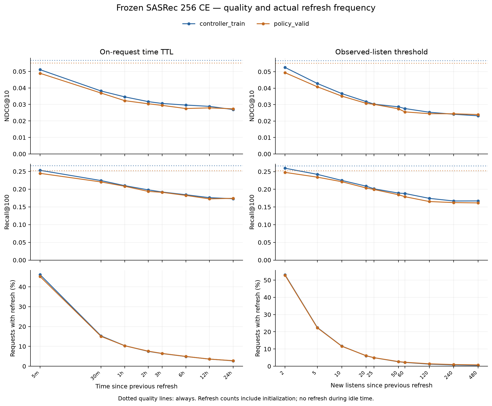
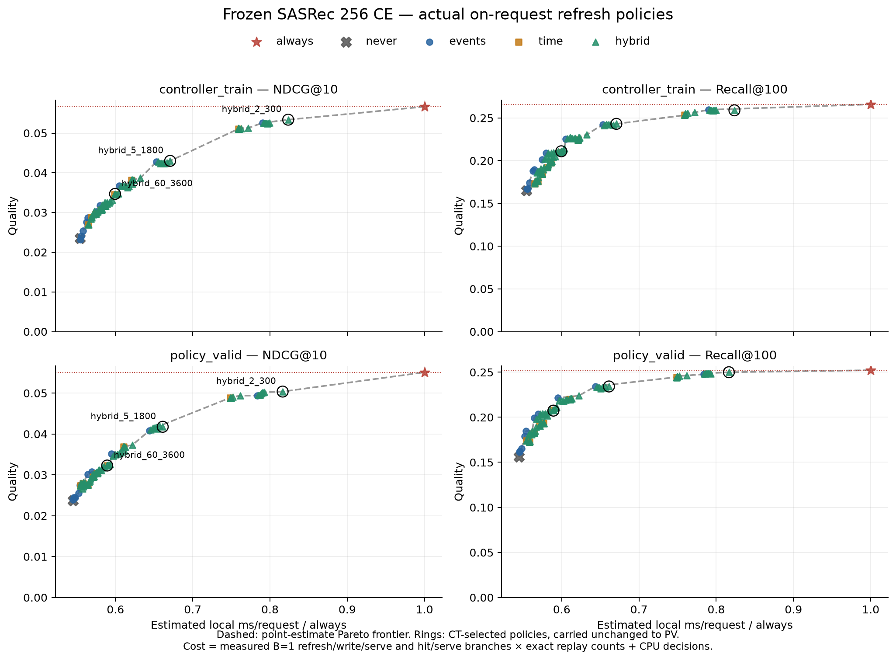

# Более редкие refresh-политики и частота обновлений

10 ноября 2026. Локальный MPS replay на том же frozen 256 CE checkpoint
`decfa67cb…`: история 50, каталог 114 125, **62 129 CT / 29 914 PV запросов**,
52 191 / 23 394 положительных targets. Все прежние результаты сохранены.
[Конфиг](../../configs/experiments/sasrec-256-policies-wide.json),
[протокол расширения](../../notes/sasrec-256-policies-wide.md),
[исходный replay и определения](sasrec-256-policies.md).

Проверены все запрошенные TTL: **30 минут, 1, 3, 6, 12, 24 часа**.
Основная событийная сетка — **10, 20, 60, 120, 240, 480 прослушиваний**; прежние
5m/2h и 2/5/25/50 событий оставлены как контроль. Всего **100 политик**:
always/never, 8 time, 10 events и все 80 hybrid OR.

Пять минут — контроль частого refresh, а не выбранное заранее production
расписание. На PV он обновляет кэш на 45.2% запросов. При 30 минутах доля
падает до 15.0%, при часе — до 10.3%, при сутках — до 2.8%.

## Как считать долю refresh

Один запрос — одна timestamp-группа всех сохранённых прослушиваний пользователя.
Refresh выполняется **перед** прогнозом, только по строго прошлой истории;
после прогнозов вся группа добавляется целиком. Короткие прослушивания и повторы
учитываются в счётчике, текущий label не используется.

`refresh % = 100 × число пересчётов / число запросов`.
`cache hit % = 100 − refresh %`.
Это доли **запросов**, не доли времени или пользователей и не доли positive targets.
Кэш сбрасывается отдельно в начале CT/PV; его первое создание на запросе
оплачивается как refresh. Инициализаций всегда 232 на CT и 216 на PV.
Пользователи без запросов не инициализируются. **В простое refresh нет**:
TTL проверяется при следующем запросе, а не запускается фоновым таймером.

## Частота обновлений по времени

| TTL | CT refresh, шт. | CT refresh | PV refresh, шт. | PV refresh | PV cache hit |
| --- | ---: | ---: | ---: | ---: | ---: |
| 5 мин | 28 673 | 46.15% | 13 520 | 45.20% | 54.80% |
| 30 мин | 9 482 | 15.26% | 4 495 | 15.03% | 84.97% |
| 1 ч | 6 423 | 10.34% | 3 085 | 10.31% | 89.69% |
| 2 ч | 4 645 | 7.48% | 2 266 | 7.58% | 92.42% |
| 3 ч | 3 965 | 6.38% | 1 923 | 6.43% | 93.57% |
| 6 ч | 3 038 | 4.89% | 1 477 | 4.94% | 95.06% |
| 12 ч | 2 238 | 3.60% | 1 072 | 3.58% | 96.42% |
| 24 ч | 1 689 | 2.72% | 835 | 2.79% | 97.21% |

Например, суточный TTL на PV даёт **835 refresh = 216 инициализаций + 619
повторных обновлений**, при 29 914 запросах. Never даёт 216 refresh (0.72%)
и 99.28% cache hit; always — 29 914 refresh (100%).

## Частота обновлений по числу прослушиваний

Событийные пороги — число новых **прослушиваний**, а не уникальных треков.
Сетка 10/20/60/120/240/480 примерно соответствует запрошенным временам при
**условных** 3 минутах на трек. Это не оценка длительности по датасету.
Из-за пауз, коротких прослушиваний и timestamp-групп политики не эквивалентны.

| Новых прослушиваний | CT refresh, шт. | CT refresh | PV refresh, шт. | PV refresh | PV cache hit |
| --- | ---: | ---: | ---: | ---: | ---: |
| 2 | 32 981 | 53.08% | 15 809 | 52.85% | 47.15% |
| 5 | 13 962 | 22.47% | 6 678 | 22.32% | 77.68% |
| 10 | 7 260 | 11.69% | 3 475 | 11.62% | 88.38% |
| 20 | 3 767 | 6.06% | 1 820 | 6.08% | 93.92% |
| 25 | 3 069 | 4.94% | 1 483 | 4.96% | 95.04% |
| 50 | 1 613 | 2.60% | 806 | 2.69% | 97.31% |
| 60 | 1 377 | 2.22% | 691 | 2.31% | 97.69% |
| 120 | 757 | 1.22% | 419 | 1.40% | 98.60% |
| 240 | 446 | 0.72% | 286 | 0.96% | 99.04% |
| 480 | 298 | 0.48% | 231 | 0.77% | 99.23% |

Для 480 событий на PV **231 refresh = 216 инициализаций + 15 повторных**;
режим близок к never. На CT — 298 refresh, из них только 66 повторных.
Суточный TTL делает существенно больше обновлений: например, на первом
запросе после долгой паузы, когда ещё не накоплено 480 новых прослушиваний.

Полная статистика **всех 100 политик на обоих периодах**, включая гибриды,
число cache hit, инициализаций, повторных обновлений и запросов на refresh:
[refresh-statistics.csv](sasrec-256-policies-wide/refresh-statistics.csv).

## Качество при редком refresh

Fresh PV: **NDCG@10 0.055093 / Recall@100 0.252201**.
Ниже стоимость относительно always, на общей неизменной локальной калибровке.

| TTL | PV NDCG@10 | PV Recall@100 | Cost / always |
| --- | ---: | ---: | ---: |
| 5 мин | 0.048886 | 0.244593 | 74.88% |
| 30 мин | 0.036893 | 0.220313 | 61.05% |
| 1 ч | 0.032289 | 0.208130 | 58.89% |
| 2 ч | 0.030388 | 0.193639 | 57.63% |
| 3 ч | 0.029436 | 0.190989 | 57.11% |
| 6 ч | 0.027513 | 0.182354 | 56.42% |
| 12 ч | 0.027922 | 0.172608 | 55.80% |
| 24 ч | 0.027348 | 0.174147 | 55.44% |

| Новых прослушиваний | PV NDCG@10 | PV Recall@100 | Cost / always |
| --- | ---: | ---: | ---: |
| 2 | 0.049400 | 0.247756 | 78.39% |
| 5 | 0.040829 | 0.234291 | 64.39% |
| 10 | 0.035168 | 0.221510 | 59.48% |
| 20 | 0.030776 | 0.203727 | 56.95% |
| 25 | 0.030145 | 0.199367 | 56.43% |
| 50 | 0.027442 | 0.184663 | 55.39% |
| 60 | 0.025573 | 0.179063 | 55.22% |
| 120 | 0.024468 | 0.165427 | 54.80% |
| 240 | 0.024409 | 0.162435 | 54.60% |
| 480 | 0.023946 | 0.161580 | 54.51% |

Переход от 30 минут к суткам уменьшает долю refresh с 15.03% до 2.79%,
но полная локальная стоимость меняется лишь с 61.05% до 55.44% always:
scoring выполняется на каждом запросе. Это ещё около 9.2% экономии относительно
TTL 30 минут при дополнительной потере около 25.9% NDCG. Относительно fresh
NDCG ниже на 33.0% при 30 минутах и на 50.4% при сутках.

Точечные метрики не обязаны строго убывать: например, 12h NDCG немного выше 6h.
Расписание меняет фазы обновлений и состав stale-прогнозов; близкие точки не
означают доказанного превосходства. Парные policy−always интервалы для всех
точек, 2 000 bootstrap целых пользователей, находятся в
[policies.csv](sasrec-256-policies-wide/policies.csv) и
[results.json](sasrec-256-policies-wide/results.json).

## Обновлённый frontier и выбор на CT

CT выбирает максимум NDCG при верхних лимитах 60/75/90% **оценки** always-cost,
с прежним tie-break. Это не гарантия физического latency-бюджета. Настройки
фиксируются перед новым PV scoring. При 60% теперь выбран гибрид **60 событий
OR 1 час**; при 75% и 90% выбор прежний. Сетка расширена после прошлого
validation-анализа, поэтому это не независимая blind replication.

| CT-лимит | Выбрана политика | CT cost | PV cost | PV NDCG@10 | PV Recall@100 |
| --- | --- | ---: | ---: | ---: | ---: |
| 60% | 60 событий OR 1 ч | 59.95% | 58.93% | 0.032282 | 0.207361 |
| 75% | 5 событий OR 30 мин | 67.07% | 66.11% | 0.041759 | 0.234163 |
| 90% | 2 событий OR 5 мин | 82.35% | 81.64% | 0.050378 | 0.249979 |

[Зафиксированный выбор](sasrec-256-policies-wide/selection.json).
Более редкие режимы заполняют дешёвую часть frontier, но пока не дают сохранения
fresh-качества при редких обновлениях. Они полезны как baselines для следующего
сравнения с recent-history ветвью или контроллером, не как доказанная замена fresh.

## Что означает стоимость B=1

**B=1 — один запрос за раз в serving benchmark**, не batch offline replay
(для вычисления рангов используется 256). Измерены полные ветви:

- refresh: encoder → запись vector в CPU-cache → полный scoring/top-100 → CPU result;
- hit: чтение CPU-cache → полный scoring/top-100 → CPU result.

`cost = n_refresh × refresh_branch_ms + n_hit × hit_branch_ms + CPU_decisions`.
Инициализация включена, каждое обращение оплачивается ровно один раз.
Это **оценка** по точным счётчикам и локальным замерам, не сквозной прогон всего
сервиса. Истории уже токенизированы, сети/хранилища истории/очередей нет.
Always здесь тоже пишет cache; optimized direct-fresh без записи не измеряется.

В расширении используются **те же branch coefficients**, что в исходном replay,
и прежние decision costs для 31 общих политик. Их quality/count/cost сохранены
точно, чтобы timing noise не менял выводы о новой сетке. Новые decision costs
замерены локально. Числа в ms — общая reference-калибровка, а не новый SLA.

Повторный короткий mixed-workload benchmark оказался шумным: максимальное
отклонение медианы от оценки на той же выборке **25.8%**. Поэтому выполнена одна
отдельная проверка более длинными сериями: **5×256 запросов, warmup 20** для
always/never и трёх CT-selected политик на каждом split. На CT отличие медиан
не превысило **1.69%**, на PV — **7.58%** (гибрид 2/5m быстрее оценки).
Другие PV-проверки — в пределах 1%. Исходные шумные серии сохранены, а reference
коэффициенты и выбор политик не заменены более удобными замерами.

[Длинная проверка](sasrec-256-policies-wide/cost-recheck.json), исходные mixed
checks и повторения в [results.json](sasrec-256-policies-wide/results.json).
Точные refresh counts от этих колебаний не зависят; близкие cost-точки нельзя
считать надёжно различимыми по абсолютному времени.

## Проверки и reuse

- **56 тестов прошли** на CPU/MPS, включая новый тест reuse: cached/missing
  пары дают те же ранги, что независимый naive evaluator; полностью известные
  пары не пересчитываются. Strict-past, timestamp ties, split reset, label/future
  independence и cost accounting сохранены.
- Проверены checkpoint, manifest, шесть используемых data-файлов, source hashes,
  reference NPZ/JSON, идентичность всех stream arrays и 31 прежнего schedule.
  Фиксированные веса и reference files не меняются. **Test events не открываются**.
- Все 31 прежние quality/count/cost точки совпадают точно. Fresh oracle совпал
  по метрикам: 52 190/52 191 CT ranks точно, все 23 394 PV ranks точно.
- CPU oracle на 256 mixed policy/target парах: те же метрики, 254 ranks точно,
  максимум 1. Ещё 256 пар выбраны **только среди новых, не взятых из cache**:
  суммарные метрики совпали, 253 ranks точно, максимум различия 1.
  [New-pair CPU check](sasrec-256-policies-wide/new-pairs-cpu.json).
- Всего 7 558 500 policy/target оценок и 814 810 уникальных state/target пар.
  **550 026 пар переиспользованы**, вычислено только 264 784 новых.
  Новые scoring/ranking заняли 19.356 с, encoding 92 043 snapshots — 1.690 с.
  Это исследовательская оптимизация; реальные refresh считаются без dedup.
- Peak RSS 1 480.67 MiB, MPS driver после основного run 1 032.70 MiB.
  Unified-memory показатели не складываются как независимая память.

[Verification](sasrec-256-policies-wide/verification.json),
[tests](sasrec-256-policies-wide/tests.txt),
[сводка](sasrec-256-policies-wide/summary.json),
[refresh statistics](sasrec-256-policies-wide/refresh-statistics.csv).
Графики PNG/SVG: [thresholds SVG](sasrec-256-policies-wide/policy-thresholds.svg),
[cost frontier SVG](sasrec-256-policies-wide/frontier-total.svg),
[refresh-count frontier SVG](sasrec-256-policies-wide/frontier-refresh.svg).
Schedule/ranks и логи остаются локально в `data/runs/sasrec-256-policies-wide/`,
raw NPZ 95.81 MiB. Все выводы относятся к одному checkpoint и пилоту 256.
