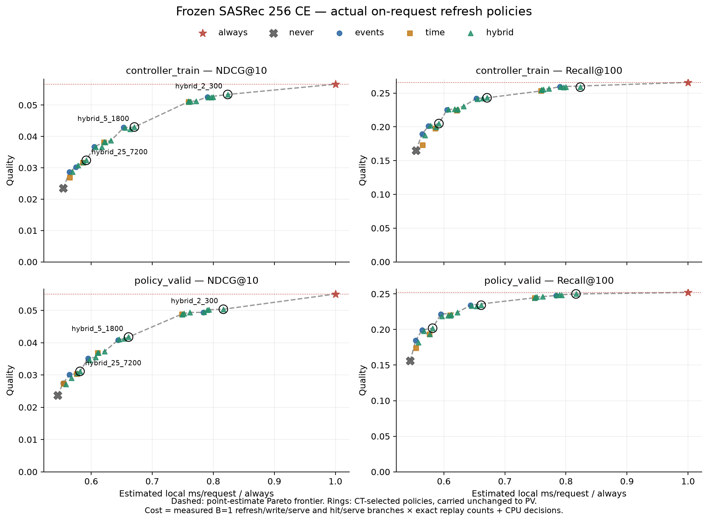
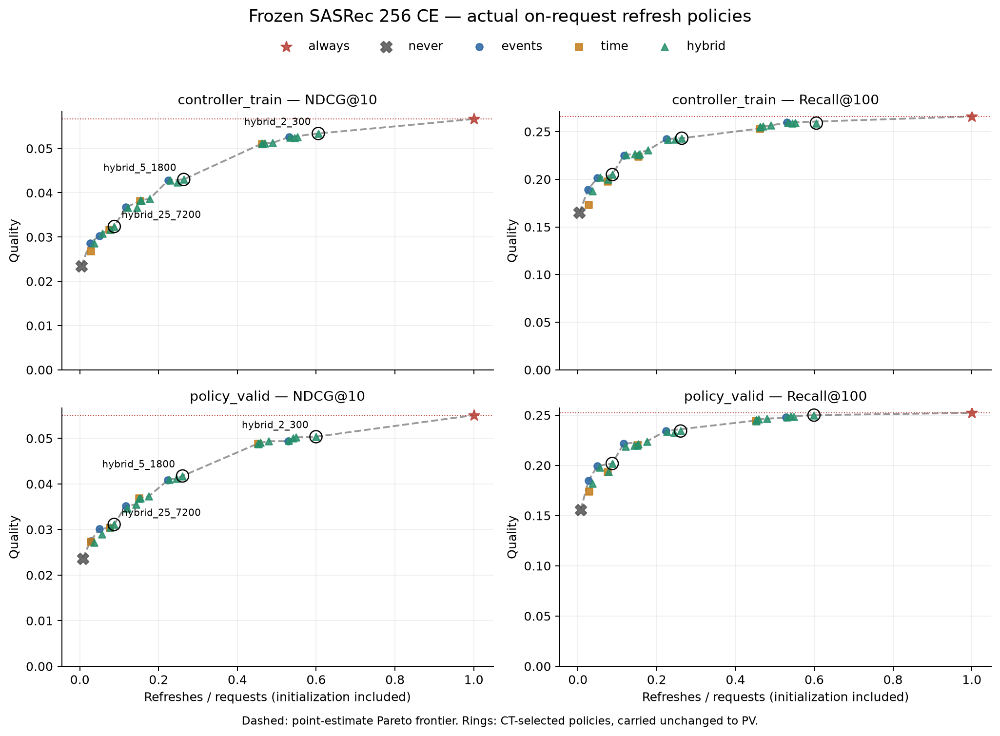

# Refresh-политики на 256 CE

10 ноября 2026. Все вычисления локальны, Apple M3 Pro / MPS FP32,
CPU fallback отключён. Frozen seed-42 checkpoint `decfa67cb…`, история 50,
полный каталог **114 125**. Нового обучения нет.
[Конфиг](../../configs/experiments/sasrec-256-policies.json),
[протокол и команды](../../notes/sasrec-256-policies.md).

На `policy_valid` гибрид **2 события или 5 минут** даёт **−18.4% расчётной
полной локальной стоимости**, **−8.6% NDCG@10** и **−0.9% Recall@100** к always.
Каждые 2 события: **−21.6% стоимости**, **−10.3% NDCG**, **−1.8% Recall**.
Таким образом, уменьшение числа refresh имеет измеримый trade-off; качество
не сохраняется автоматически. Полный отказ от refresh теряет **57.0% NDCG**.

## Поток и определения

Один запрос выполняется **перед каждой timestamp-группой всех сохранённых
прослушиваний**, включая короткие. Сначала все предсказания группы,
затем добавление её событий в историю. Это offline proxy запросов;
production request logs в датасете отсутствуют. Положительные targets прежние,
несколько targets одной группы оцениваются отдельно по одному представлению.

| Период | Прослушивания | Запросы / группы | Пользователи с запросами | Targets | Пользователи с targets |
| --- | ---: | ---: | ---: | ---: | ---: |
| controller_train, 14 дней | 76 610 | 62 129 | 232 | 52 191 | 230 |
| policy_valid, 7 дней | 35 137 | 29 914 | 216 | 23 394 | 209 |

Все targets включены во **все** политики; крайние lag-исключения прошлого
диагностического replay здесь не нужны. История проходит через границы split.
Кэш независимо сбрасывается перед каждым периодом и лениво создаётся на первом
запросе пользователя из полной доступной строго прошлой истории. Стоимость
инициализации включена: 232 / 216 оплаченных refresh даже у `never`.
Пользователи без запросов не инициализируются; CT-cache в PV не переносится.

Сетка **31 политики** задана до запуска:

- **Always**: полный refresh на каждом запросе.
- **Never**: только первый refresh пользователя в периоде.
- **Events**: refresh при ≥2/5/10/25/50 новых прослушиваниях с прошлого refresh.
  Считаются все наблюдённые события, включая неположительные; timestamp-группа
  неделима, поэтому её размер может перескочить порог.
- **Time**: on-request TTL ≥5 минут / 30 минут / 2 часа / сутки с прошлого refresh.
  В простое фоновых пересчётов нет. Это не календарное периодическое расписание.
- **Hybrid**: все 5×4 сочетания; refresh при достижении **любого** порога (OR).

Каждый refresh заново кодирует последние 50 доступных items; hit переиспользует
готовый vector. Веса/словарь фиксированы, KV reuse не применяется. Текущее
прослушивание и его label не используются в решении. Читаются только train,
model_valid, controller_train, policy_valid; **test events не открываются**.

## Quality–cost frontier

Стоимость на графике — оценка по измеренным полным ветвям локального B=1
обслуживания и **точным счётчикам реального расписания**, включая refresh.
Ниже отдельно приведены методика и проверка оценки. Пунктир соединяет Pareto
точки заданной сетки; промежуточные точки не измерены. Frontier строится
отдельно для NDCG и Recall, без усреднения этих метрик.

Все заранее заданные политики показаны на обоих периодах. PV-frontier
описательный. Отмеченные кольцами политики выбраны **только по CT**:
максимум NDCG при верхних лимитах 60/75/90% стоимости always; tie — Recall,
затем меньшая стоимость. [Выбор зафиксирован](sasrec-256-policies/selection.json)
до оценки PV. Лимит не обязан быть полностью израсходован; сетка не содержит
других точек между ~82% и 100% CT-cost.

| Лимит CT-cost | Выбрана политика | Фактический CT-cost / always | CT NDCG@10 | CT Recall@100 |
| --- | --- | ---: | ---: | ---: |
| 100% | Always, контроль | 100.00% | 0.056663 | 0.265870 |
| 90% | 2 события OR 5 минут | 82.35% | 0.053389 | 0.258895 |
| 75% | 5 событий OR 30 минут | 67.07% | 0.043014 | 0.243050 |
| 60% | 25 событий OR 2 часа | 59.19% | 0.032390 | 0.204882 |
| — | Never, контроль | 55.43% | 0.023463 | 0.164971 |

Те же настройки на PV без дополнительного подбора:

| Политика | Refresh / запросы | PV NDCG@10 | PV Recall@100 | Cost / always |
| --- | ---: | ---: | ---: | ---: |
| Always | 100.00% | 0.055093 | 0.252201 | 100.00% |
| 2 события | 52.85% | 0.049400 | 0.247756 | 78.39% |
| 5 событий | 22.32% | 0.040829 | 0.234291 | 64.39% |
| 5 минут | 45.20% | 0.048886 | 0.244593 | 74.88% |
| 30 минут | 15.03% | 0.036893 | 0.220313 | 61.05% |
| 2 события OR 5 минут, CT-selected | 59.94% | 0.050378 | 0.249979 | 81.64% |
| 5 событий OR 30 минут, CT-selected | 26.07% | 0.041759 | 0.234163 | 66.11% |
| 25 событий OR 2 часа, CT-selected | 8.71% | 0.031125 | 0.201804 | 58.16% |
| Never | 0.72% | 0.023680 | 0.155852 | 54.48% |

Полная таблица всех **62 policy/split точек**, ages и парных CI:
[policies.csv](sasrec-256-policies/policies.csv),
[results.json](sasrec-256-policies/results.json).

Это уже разные реальные расписания, а не фиксированные лаги. Например,
`events_2` на PV даёт fresh-prefix у 54.6% targets и не более одного нового
события в stale-cache на любом запросе. Потеря NDCG 10.3%, тогда как
диагностический фиксированный event lag 1 давал 21.5%: распределения ages разные.

Гибрид ограничивает обе причины устаревания. У `events_2` cache time age на
запросе может доходить до 501 180 с после простоя, а у TTL 5 минут число новых
событий — до 124. У `hybrid_2_300` после решения максимум **1 событие и 295 с**.
Это не доказывает, что гибрид всегда лучше: дополнительные refresh тоже платные,
а сбросы счётчиков меняют дальнейшее расписание.

Парные policy−always интервалы используют 2 000 bootstrap целых пользователей,
event-weighted, seed 42. На PV для `hybrid_2_300`:

- NDCG: **−0.004715**, 95% CI **[−0.007105; −0.002700]** — потеря подтверждается.
- Recall: **−0.002223**, CI **[−0.004941; +0.000312]** — интервал включает ноль;
  это не доказательство эквивалентности или non-inferiority.

В дополнительном описательном сравнении гибрид 2/5m выше `events_2` на
0.000978 NDCG, но CI **[−0.000077; +0.002019]** включает ноль. Оснований объявлять
его достоверно лучшим вариантом пока нет, особенно при разной стоимости.
[Дополнительные парные сравнения](sasrec-256-policies/supplementary-comparisons.json)
не использовались для выбора политик. Bootstrap условен на одном checkpoint
и не включает training variance или множественный отбор.

## Стоимость с refresh

Модель/каталог на MPS, user-cache на CPU. Логический vector cache на 256×64
FP32 — 64 KiB. В benchmark заранее подготовлены CPU token windows и уже
существующие cached vectors; сеть, чтение хранилища истории, токенизация,
очереди и параллельный serving не моделируются.

Замеряются две **полные** ветви последовательного B=1 обслуживания:

1. CPU window → encoder → CPU cache write → full-catalog scoring/top-100 → CPU result.
   Новый vector сразу используется для scoring; повторного cache lookup нет.
2. CPU cache lookup → MPS → тот же scoring/top-100 → CPU result.

8 warm-up, 3 серии по 128 случайным запросам каждого split; обе ветви используют
одни queries, каждый запрос синхронизирован. Число ниже — медиана средних серий,
**не p50/p99 latency**. Входной pool — все запросы, не только positive targets.

| Ветвь, ms/request | controller_train | policy_valid |
| --- | ---: | ---: |
| Refresh + write + serve | 1.725671 | 1.741263 |
| Cache hit + serve | 0.953506 | 0.942788 |

`estimated_cost = n_refresh × refresh_write_serve + n_hit × hit_serve + decision_cost`.
`n_refresh` включает initialization; каждое обращение оценивается ровно один раз.
CPU replay самих решений измерен отдельно: примерно **0.33–0.54 μs/request**,
включая небольшую bookkeeping-нагрузку Python. Этот код получает уже известный
счётчик прошлых событий и часы; подготовка всего датасета в cost не включается.

На PV always стоит расчётные **1.7416 ms/request**, `events_2` — **1.3652**,
гибрид 2/5m — **1.4219**, never — **0.9489**. В сравнении с предыдущим microbench
здесь refresh включает cache write, а pool и период замеров другие;
разницу с прежним direct-fresh временем нельзя считать регрессией модели.
Always здесь использует общий cache pipeline и тоже записывает vector.
Оптимизированный direct-fresh без записи может быть дешевле; экономия 18.4%
относится именно к этому измеренному always, а не к любому fresh implementation.

Контроль оценки: always/never и все три CT-selected политики реально выполнены
на 384 случайных запросах каждого split с их настоящими snapshot/refresh
решениями, включая запись обновлённых vectors. Уже существующее cache state
подготавливается вне таймера. Максимальное отличие **медианы** измеренного
смешанного workload от count-weighted оценки на **той же выборке** — **2.48%**.
Один PV-блок 25/2h был медленнее (1.360 против 1.007–1.013 ms); все сырые
средние серий опубликованы. Это проверка локальной модели стоимости, а не
сквозной замер всех 92 043 запросов для каждой политики.

[Ветви CSV](sasrec-256-policies/cost.csv), все повторения и mixed checks в
[results.json](sasrec-256-policies/results.json). Близкие cost-точки и порядок
соседних Pareto-точек чувствительны к шуму измерений. Здесь нет batch-256
frontier, фоновых расходов и production latency benchmark.

Даже never уменьшает полную стоимость лишь на **45.5%** при устранении 99.3%
refresh: scoring каталога и выдача остаются на каждом запросе. Поэтому экономию
encoder нельзя выдавать за такую же экономию всей рекомендательной системы.

## Проверки и артефакты

- **55 тестов прошли**, включая реальные CPU/MPS, timestamp ties,
  неположительные запросы, OR/границы порогов, lazy init, split reset,
  poisoned test-файл, отсутствие зависимости решений от labels/future items,
  naive recomputation, cost accounting и выбор CT-budget.
- Fresh-inputs и метрики полностью совпали с исходным evaluator:
  CT 52 190/52 191 ranks точно, PV все 23 394. Одна глубокая CT-позиция
  отличается на 1 из-за FP32, пороги метрик не затронуты. CPU oracle на 256
  смешанных policy/target парах совпал по метрикам, 255 ranks точно, максимум 1.
- Проверены data/checkpoint/source hashes и неизменность model state.
  [Verification](sasrec-256-policies/verification.json), [tests](sasrec-256-policies/tests.txt).
- Во время проверки исправлено переполнение `int32` в упаковке больших
  `(snapshot, target)` индексов: умножение теперь выполняется в `int64`,
  добавлен отдельный regression test. Ошибочный запуск был остановлен до
  публикации метрик. Прошлый lag-replay использовал `int64` refs и не затронут.
- Offline dedup: 92 043 snapshots, 550 026 уникальных state/target пар для
  **2 343 135** policy/target оценок. Encoding 1.174 с, scoring/ranking 38.459 с.
  Эти исследовательские оптимизации не уменьшают оплаченные refresh в cost.
  Peak RSS **1 146.91 MiB**, MPS driver после замеров **1 032.70 MiB**;
  показатели unified memory не складываются как независимая память.

Локальные schedule/ranks и лог: `data/runs/sasrec-256-policies/`, raw NPZ 45.63 MiB.
В Git — агрегаты, [сводка](sasrec-256-policies/summary.json), CSV, PNG и
[cost SVG](sasrec-256-policies/frontier-total.svg) /
[refresh SVG](sasrec-256-policies/frontier-refresh.svg).

Результат — воспроизводимый frontier простых on-request политик для одного
256-пилота и фиксированного request proxy. Гибрид 2/5m — полезный кандидат для
дальнейшего сравнения, но его преимущество над event-only ещё не установлено.
Итоговая test-оценка и проверка learned controller остаются следующими этапами.
