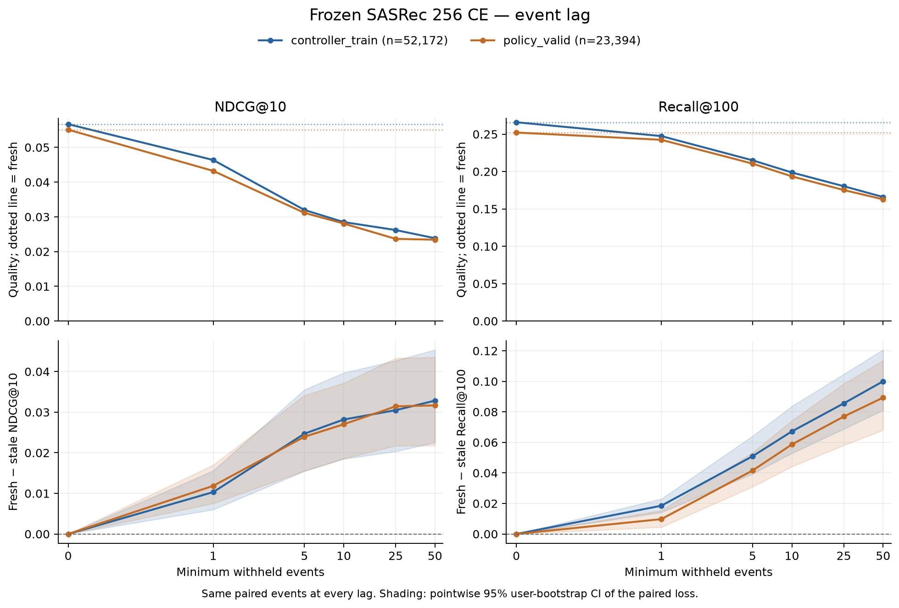
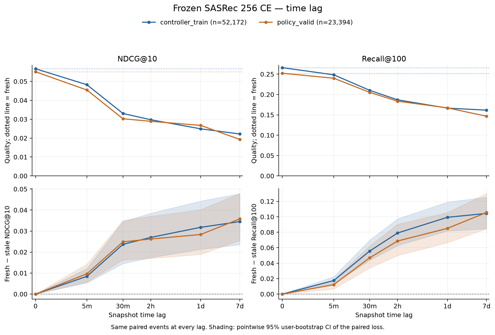
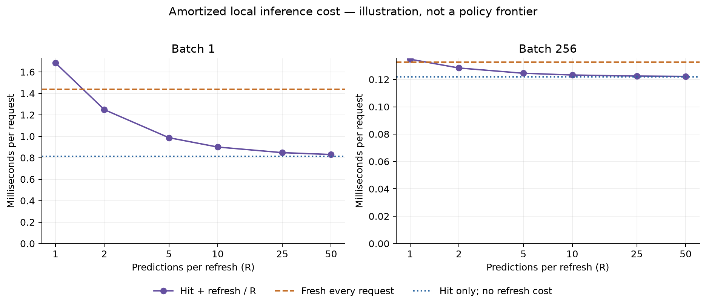

# Fresh/stale replay на 256 CE

10 ноября 2026. Frozen SASRec full CE, seed 42, checkpoint эпохи 4
`decfa67cb…`. Все вычисления локальны: Apple M3 Pro, MPS FP32, CPU fallback
отключён. [Конфиг](../../configs/experiments/sasrec-256-replay.json),
[протокол и команды](../../notes/sasrec-256-replay.md).

Устаревание представления заметно снижает качество в обоих периодах.
На `policy_valid` минимальный лаг в одно взаимодействие даёт **−21.5% NDCG@10**,
5 минут — **−17.5%**, сутки — **−51.5%**. Локальный cache hit без refresh быстрее
fresh в **1.77× при batch 1** и **1.09× при batch 256**. Это отдельные результаты
о качестве и стоимости, а не готовый quality–cost frontier политик.

## Определение replay и хронология

Для каждого target t сравниваются `f(history < t)` и тот же frozen encoder
по более старому prefix, всегда с последними 50 доступными items. Каталог
**114 125** треков и события одинаковы при всех лагах; weights не обновляются.
Snapshot полностью пересчитывается исходным SASRec, затем переиспользуется
готовый user vector. Target labels используются только для оценки рангов.

Event lags исключают **как минимум** 1, 5, 10, 25, 50 новых прослушиваний.
Граница внутри timestamp-группы округляется назад: часть неупорядоченной группы
не считается уже наблюдённой. Медианные фактические event lags совпали с сеткой;
min/p90/max и время cutoff опубликованы в CSV.

Time lags: 5 минут, 30 минут, 2 часа, сутки, 7 суток. Видимы только события
с `timestamp < t−lag`. Временной cutoff описывает возраст входной истории:
все counterfactual snapshots вычисляются offline одними фиксированными весами.
Это controlled age ablation, без симуляции календаря deployment/model version
или конкретного расписания refresh.

Прочитаны train, model_valid, controller_train и policy_valid; файл событий
**test не читается**. Все входные события snapshot строго предшествуют его cutoff.
При отсутствии непустой истории хотя бы для одного лага target исключается
из **всех** условий, включая fresh. Это один paired cohort для обеих осей.

| Период | Все targets | Общий cohort | Пользователи в cohort | Исключено |
| --- | ---: | ---: | ---: | ---: |
| controller_train, 14 дней | 52 191 | 52 172 | 230 | 19 у одного пользователя |
| policy_valid, 7 дней | 23 394 | 23 394 | 209 | 0 |

Полный fresh на controller_train до фильтрации: **0.056663 / 0.265870**
NDCG@10 / Recall@100; на paired cohort — **0.056683 / 0.265947**.
На policy_valid cohort полный. Проверен порядок событий и соответствие
существующим `examples/ranks`; fresh-метрики воспроизведены точно.

## Кривые качества

| Минимальный event lag | CT NDCG@10 | CT Recall@100 | PV NDCG@10 | PV Recall@100 |
| --- | ---: | ---: | ---: | ---: |
| Fresh | 0.056683 | 0.265947 | 0.055093 | 0.252201 |
| 1 | 0.046366 | 0.247432 | 0.043231 | 0.242455 |
| 5 | 0.031982 | 0.215000 | 0.031146 | 0.210610 |
| 10 | 0.028494 | 0.198746 | 0.028074 | 0.193554 |
| 25 | 0.026198 | 0.180365 | 0.023661 | 0.175259 |
| 50 | 0.023848 | 0.165932 | 0.023421 | 0.162862 |

| Time lag | CT NDCG@10 | CT Recall@100 | PV NDCG@10 | PV Recall@100 |
| --- | ---: | ---: | ---: | ---: |
| Fresh | 0.056683 | 0.265947 | 0.055093 | 0.252201 |
| 5 минут | 0.048232 | 0.248447 | 0.045433 | 0.240062 |
| 30 минут | 0.033031 | 0.210266 | 0.030228 | 0.205266 |
| 2 часа | 0.029709 | 0.186939 | 0.028881 | 0.183551 |
| Сутки | 0.024907 | 0.166584 | 0.026732 | 0.167137 |
| 7 суток | 0.022182 | 0.161543 | 0.019302 | 0.146619 |

Интервалы — **парные** 2 000 bootstrap-перевыборок целых пользователей,
event-weighted, seed 42. В JSON/CSV записано `stale − fresh`; нижний ряд графиков
показывает `fresh − stale`, положительное значение означает потерю от устаревания.
Интервалы pointwise, для фиксированного checkpoint.

Пример на policy_valid: NDCG-разница при event lag 1 — **−0.011861**,
95% CI **[−0.016991; −0.007530]**. При суточном лаге — **−0.028361**,
CI **[−0.040190; −0.018868]**. Это paired-сравнения одних событий, без
сопоставления разных пользователей из сырых age buckets.

При time lag 5 минут у **32.2%** PV targets нет новых прослушиваний после cutoff;
snapshot использует тот же prefix, что fresh. Модель получает item IDs и позиции,
поэтому сама длительность без изменения входа представление не меняет.
Медианное число новых событий за сутки — 48 на PV, за неделю — 274.

## Активность и сегменты

Активность считается до target: число всех наблюдённых прослушиваний в
`[t−24h, t)`. Группы и repeat/explore сегменты фиксированы при всех лагах;
последние определяются по **fresh** окну. Групповые результаты описательные.

| Прошлые сутки, PV | Targets | Fresh NDCG | NDCG при лаге сутки | Изменение |
| --- | ---: | ---: | ---: | ---: |
| 0–9 событий | 2 696 | 0.052708 | 0.036799 | −30.2% |
| 10–49 | 9 317 | 0.065280 | 0.037647 | −42.3% |
| 50+ | 11 381 | 0.047318 | 0.015411 | −67.4% |

На суточном лаге относительная потеря особенно велика у наиболее активной
группы этого периода. Это не универсальная монотонная зависимость: например,
при 5 минутах наибольшая потеря здесь у средней группы. Все сегменты для обоих
периодов находятся в [results.json](sasrec-256-replay/results.json).

## Измеренная стоимость

Один контекст на пользователя из controller_train; одинаковые queries для
fresh/cached workload. Модель и каталог на MPS, user vectors в локальном CPU
NumPy-cache (**64 KiB** на 256 пользователей). Histories уже токенизированы;
scoring включает все 114 125 items, top-100 и возврат индексов на CPU.
Network, история вне подготовленного окна и сервисная инфраструктура не моделируются.

После warm-up: 3 серии по 50 batch для B=1 и по 10 batch для B=256,
с синхронизацией каждого batch. Ниже медиана **средних трёх серий**, ms/запрос;
B=256 — время batch, делённое на 256, а не online latency отдельного запроса.

| Компонент | Batch 1 | Batch 256, на запрос |
| --- | ---: | ---: |
| Encoder, вход уже на устройстве | 0.906774 | 0.012011 |
| Scoring + top-100 + CPU result | 0.768303 | 0.121340 |
| Cache lookup + transfer на MPS | 0.147051 | 0.000697 |
| Refresh: вход → encoder → CPU cache write | 0.871193 | 0.012833 |
| Fresh end-to-end | **1.437478** | **0.132629** |
| Cache hit end-to-end, без refresh | **0.812832** | **0.121962** |

Изолированные компоненты не обязаны складываться в end-to-end время:
они измеряются отдельными сериями, с собственными sync/dispatch overhead.
У encode-only B=1 диапазон средних серий 0.760–0.956 ms; fresh E2E стабилен
в 1.436–1.441 ms, hit — 0.812–0.834 ms. Все серии сохранены в CSV.

Без стоимости refresh cache hit даёт ускорение **1.77× / 1.09×**.
При batch 256 доминирует scoring: экономия encoder не переносится в такой же
процент экономии всего pipeline.

Иллюстрация раздельных background refresh и serving: `cost(R) = hit + refresh/R`.
Каждый serving request читает cache; refresh учитывается отдельной работой.
Это амортизированная стоимость операций, не прогноз задержки при конкуренции
запросов с background-работой. Для B=1 при R=2
получается 1.248 ms/запрос, при R=5 — 0.987 ms; при R=1 — 1.684 ms,
дороже прямого fresh из-за read/write. **R не равен event/time lag.**
Эти стоимости нельзя соединять с точками качества выше как frontier:
для этого нужен replay actual refresh schedules, с их распределением cache ages
и учётом всех выполненных обновлений.

## Проверки и артефакты

- **47 тестов прошли**, включая whole timestamp groups, cross-split history,
  poisoned test-файл, независимость CT snapshots от будущих PV событий,
  фиксированный cohort, naive recomputation и CPU/MPS.
- Полный fresh oracle дал те же метрики; 52 168/52 172 CT ranks совпали точно,
  остальные отличаются на одну позицию вне порогов метрик; все PV ranks совпали.
  На 256 смешанных fresh/stale парах CPU oracle совпал по метрикам,
  255 ranks совпали точно, максимум различия — одна позиция.
- Проверены hashes шести реально прочитанных data-файлов, manifest, checkpoint,
  исходного кода и неизменность всего model state до/после replay. Test events
  не открывались. [Verification](sasrec-256-replay/verification.json),
  [tests](sasrec-256-replay/tests.txt).

Offline deduplication оставила **100 873 snapshots** и **645 916 пар snapshot/target**
для 831 226 оценок. Их encoding занял 1.325 с, scoring/ranking — 45.665 с;
это время оптимизированного исследования, не serving refresh policy.
Peak process RSS 1 217.58 MiB; MPS driver после замеров 1 043.73 MiB.
Показатели unified memory не складываются как независимая память.

[Качество CSV](sasrec-256-replay/quality.csv), [стоимость CSV](sasrec-256-replay/cost.csv),
[краткая сводка](sasrec-256-replay/summary.json).
Векторные версии: [event SVG](sasrec-256-replay/events-lags.svg),
[time SVG](sasrec-256-replay/seconds-lags.svg), [cost SVG](sasrec-256-replay/amortized-cost.svg).
Исходные snapshots/ranks и лог находятся в локальном `data/runs/sasrec-256-replay/`.

Результаты относятся к одному frozen checkpoint и 256-пилоту. Bootstrap не
включает training variance; activity-таблица не выделяет причинный эффект
активности. Лаговые кривые подтверждают чувствительность к свежим событиям;
выбор политики и её compute–quality trade-off требует отдельной проверки
на этих подготовленных периодах до итогового test.
