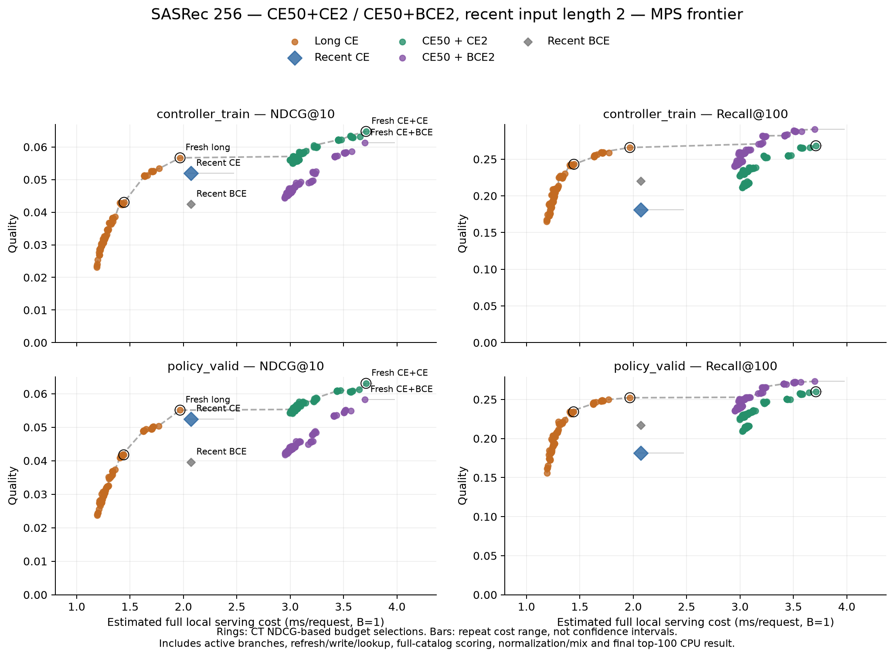
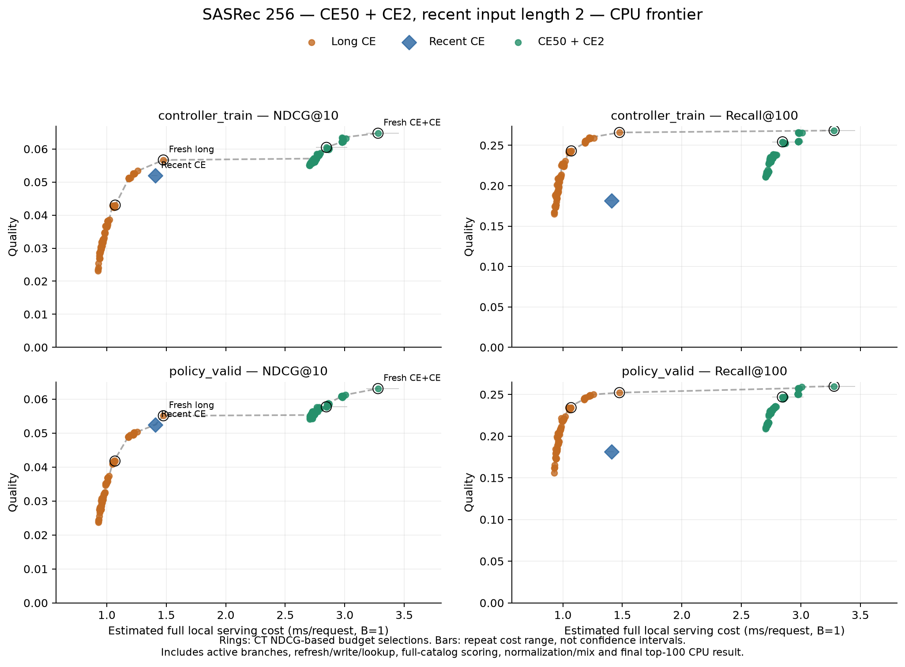

# Native recent2: эквивалентность, ресурсы и frontier

11 ноября 2026. Пилот 256, Apple M3 Pro / 36 GiB, локальные CPU/MPS FP32,
4 CPU-потока, MPS fallback отключён. Нового обучения нет: checkpoints, каталог
114 125 items, histories и выбранные ранее на CT alpha сохранены.
[Протокол и команды](../../notes/sasrec-256-short-inference.md),
[сводка JSON](sasrec-256-short-inference/summary.json).

## Изменение inference

Recent получает tensor **B×2**, attention работает с двумя токенами.
Сохранены последние learned positions **48/49** из обученной таблицы длины 50;
новая таблица позиций не создаётся. Long получает прежний B×50.
Укорочение включается `recent_input_length=2` в serving config, проверяется
совпадение с checkpoint `context_keep=2`. Без флага действует padded режим.

В eval удалённые padding keys полностью закрыты mask. LayerNorm, FFN,
residuals и projection работают по токенам, поэтому удаление padding rows
не меняет математический результат для оставшихся токенов. Causal mask
сохраняет прежние разрешённые связи. Это эквивалентность inference без dropout,
не обещание одинакового RNG/градиентов при обучении. В FP32 разные kernel shapes
могут дать небольшие численные отличия и поменять порядок почти равных scores.

Checkpoint files побитово неизменны, по **7 357 888 параметров** у каждой модели;
две item-таблицы и таблицы positions сохранены. Уменьшается расчёт encoder,
а не число весов или каталог scoring. Проверены CE2 и BCE2.

## Проверка эквивалентности

Все **92 043 CT/PV request windows**, включая initialization, проверены
попарно padded50 против native2 на одном устройстве. Scores дополнительно
сравнены на фиксированных 256 запросах по всем 114 125 кандидатам, до и после
z-score. Допуски заданы до запуска: **atol 2e−5, rtol 1e−4**.

| Проверка | Все request vectors | Max abs vector error | Max abs sample score error |
| --- | ---: | ---: | ---: |
| cpu-ce | 92,043 | 0 | 0 |
| mps-ce | 92,043 | 1.14e-05 | 1.91e-05 |
| mps-bce | 92,043 | 3.34e-06 | 9.54e-06 |

CPU vectors и проверенные scores совпали побитово. На MPS результат численно
эквивалентен в заданных допусках; побитовое совпадение не заявляется.
Проверки padding, одного события, UNK, repeats, реальной attention width 2,
cache write/hit, alpha endpoints и CPU/MPS включены в **71 прошедший тест**.

Recent ranks пересчитаны на **75 585 targets**. Для CE и BCE на MPS также
пересчитаны **все 100 выбранных смесей** на каждом из двух split, с прежними
alpha, без нового подбора. NDCG@10, Recall@100 и Hit@1 совпали с прежним replay
для каждой политики на CT и PV. Это не только проверка fresh endpoint.

Проверены и индивидуальные вклады каждого target: нет изменений top-10 ranks,
переходов через Recall@100 или изменений Hit@1. Равенство агрегатов не является
результатом компенсации ошибок между событиями.
[Проверка вкладов](sasrec-256-short-inference/metric-contributions.json).

В хвосте каталога exact ranks могут отличаться: у mixtures максимум **3 позиции
для CE / 2 для BCE**; на измеряемые метрики это не повлияло. У recent-only
CE относительно сохранённого MPS replay максимальная разница больше (CT 25 /
PV 47). CPU recent ranks также сопоставлены с сохранённым MPS replay: этот
rank comparison включает различия устройств; within-CPU vectors/scores точны.
Полные exact-match counts и разницы сохранены в
[CPU CE](sasrec-256-short-inference/equivalence-cpu-ce.json),
[MPS CE](sasrec-256-short-inference/equivalence-mps-ce.json),
[MPS BCE](sasrec-256-short-inference/equivalence-mps-bce.json).

| Fresh model, policy_valid | NDCG@10 | Recall@100 | Hit@1 |
| --- | ---: | ---: | ---: |
| Long CE50 | 0.055093 | 0.252201 | 0.024109 |
| Recent CE2 | 0.052459 | 0.181457 | 0.026674 |
| CE50+CE2, α=0.4 | 0.063086 | 0.259853 | 0.028383 |
| Recent BCE2 | 0.039578 | 0.216979 | 0.014405 |
| CE50+BCE2, α=0.3 | 0.058224 | 0.273190 | 0.021330 |

[CE quality replay](sasrec-256-short-inference/quality-ce.json),
[BCE quality replay](sasrec-256-short-inference/quality-bce.json).
Строго прошлые timestamp-группы, targets и candidates прежние. Test не открыт.

## Парный контроль скорости

Чтобы отделить эффект width от изменений нагрузки машины между днями,
padded50 и native2 измерены **в одном процессе**, с теми же weights, CT windows,
batch и числом повторов, в перемешанном порядке. CE checkpoint общий для пары.
B=1: 5×128 запросов, warmup 16; B=256: 3×8 batch, warmup 2.
Каждый запрос синхронизируется на MPS, результат final top-100 возвращается на CPU.
`hybrid` — fresh смесь α=0.4; `recent` — полное recent-only serving;
`encoder` — только recent encoder вместе с подготовкой/transfer token IDs.

Медианы серий, **мс на запрос**. Для B=256 это batch duration / 256,
то есть показатель throughput, а не latency одного online-запроса.

| Устройство | Batch | Ветвь | Padded50 | Native2 | Speedup |
| --- | ---: | --- | ---: | ---: | ---: |
| CPU | 1 | encoder | 0.32013 | 0.26977 | 1.19× |
| CPU | 1 | recent | 1.29234 | 1.19719 | 1.08× |
| CPU | 1 | hybrid | 2.80776 | 2.81306 | 1.00× |
| CPU | 256 | encoder | 0.03617 | 0.00304 | 11.91× |
| CPU | 256 | recent | 0.09959 | 0.06713 | 1.48× |
| CPU | 256 | hybrid | 0.48081 | 0.45108 | 1.07× |
| MPS | 1 | encoder | 1.10661 | 1.24266 | 0.89× |
| MPS | 1 | recent | 1.89814 | 2.05581 | 0.92× |
| MPS | 1 | hybrid | 3.46408 | 3.57349 | 0.97× |
| MPS | 256 | encoder | 0.01577 | 0.00558 | 2.82× |
| MPS | 256 | recent | 0.15939 | 0.14937 | 1.07× |
| MPS | 256 | hybrid | 0.28226 | 0.27290 | 1.03× |

[CPU raw](sasrec-256-short-inference/paired-cpu.json),
[MPS raw](sasrec-256-short-inference/paired-mps.json),
[парные CSV](sasrec-256-short-inference/paired.csv).
Эти paired результаты используются для оценки ускорения; абсолютные времена
из отчёта предыдущего дня не являются чистым контролем width.

## Полный serving и память

Отдельно повторён исходный benchmark всех полных paths и refresh schedules.
Serving включает нужные encoders, CPU cache write/lookup, обе item-таблицы,
full-catalog scoring, z-score обеих ветвей, mix и один final top-100 CPU result.
Always использует direct fresh без ненужной cache write; alpha endpoints
пропускают неиспользуемую модель. Storage/network/queues не моделируются;
вход — готовые CPU token IDs, masking/transfer включены.

У одинакового long-контроля в отдельных MPS-процессах время различалось:
**2.40246 / 1.90562 мс**. Поэтому эти timings не объединены напрямую.
Для общего MPS frontier все CE/BCE paths перекалиброваны **в одном процессе**
с перемешанным порядком в каждой серии и одним shared long-контролем.
Качество и CPU decision costs переиспользованы, mixed-workload checks выполнены
заново. Отдельные запуски сохранены в
[CE](sasrec-256-short-inference/separate-mps.json) /
[BCE](sasrec-256-short-inference/separate-bce-mps.json) как диагностика дрейфа.

| Path | CPU B=1 | MPS B=1 | CPU B=256 | MPS B=256 |
| --- | ---: | ---: | ---: | ---: |
| Fresh long | 1.4755 | 1.9689 | 0.1071 | 0.1664 |
| Recent CE2 | 1.4094 | 2.0694 | 0.0705 | 0.1575 |
| Fresh CE50+CE2 | 3.2795 | 3.7104 | 0.4746 | 0.2828 |
| Hybrid hit, α=0.7 | 2.7011 | 3.0159 | — | — |
| Hybrid refresh/write, α=0.7 | 3.1762 | 3.8851 | — | — |

[B=1/256 resource CSV](sasrec-256-short-inference/resources.csv).
Все serving jobs выполнялись после quality jobs, без параллельных ML-задач.
Профильные input widths проверены: long 50 / recent 2. Нельзя складывать
component timings для получения whole-pipeline latency; ниже frontier использует
непосредственно измеренные полные refresh/hit paths.

| Profile | Process peak RSS, MiB | Max saved MPS tensor stage B=1 | B=256 | Final MPS driver, MiB |
| --- | ---: | ---: | ---: | ---: |
| cpu | 1136.77 | — | — | — |
| mps | 713.11 | 61.56 | 396.38 | 1053.81 |
| bce-mps | 708.66 | 61.53 | 396.35 | 1053.78 |

RSS и memory stage probes взяты из отдельных процессов с двумя моделями и
выбранными диагностическими vectors; это не память трёх моделей процесса
совместной MPS-калибровки. Память последнего отдельно сохранена в поле
`interleaved_calibration.joint_process_memory`. Stage snapshots
не гарантируют захват пика временных kernel buffers. RSS, active MPS tensors и
driver allocations — разные показатели unified memory, складывать их нельзя.
Long cache — прежние **64 KiB** на 256 пользователей, без Python metadata;
у direct-fresh он не нужен. Большие item-таблицы и score buffers остаются, поэтому
экономия encoder activations не означает пропорционального уменьшения общей памяти.

[CPU profile](sasrec-256-short-inference/resources-cpu.json),
[MPS CE profile](sasrec-256-short-inference/resources-mps.json),
[MPS BCE profile](sasrec-256-short-inference/resources-bce-mps.json).

## Quality–cost frontier

На каждом split: CPU **201** точка (100 long, 100 CE hybrid, CE recent),
MPS **302** (дополнительно 100 BCE hybrid и BCE recent). Для MPS обе рецептуры
используют одну новую long-only калибровку; старые padded costs сюда не подмешаны.
Точные initialization/refresh/hit counts из прежнего replay применены к новым
полным B=1 paths; CPU decisions измерены заново. Показана медиана пяти weighted
cost estimates. Long TTL/event policies по-прежнему on-request, не background jobs.

Выбор в таблице — **только CT NDCG** под бюджетом относительно fresh long;
PV оценивает уже выбранную настройку. `hybrid_E_T` означает OR: E новых
прослушиваний либо T секунд. Префикс `hybrid:` означает score-ensemble.

| Устройство | CT бюджет | Выбор | PV мс/запрос | PV NDCG | PV Recall |
| --- | ---: | --- | ---: | ---: | ---: |
| CPU | 0.60× | Нет допустимой точки | — | — | — |
| CPU | 0.80× | `long:hybrid_5_1800` | 1.069 | 0.041759 | 0.234163 |
| CPU | 1.00× | `long:always` | 1.476 | 0.055093 | 0.252201 |
| CPU | 1.25× | `long:always` | 1.476 | 0.055093 | 0.252201 |
| CPU | 1.50× | `long:always` | 1.476 | 0.055093 | 0.252201 |
| CPU | 2.00× | `hybrid:events_5` | 2.845 | 0.057725 | 0.246986 |
| CPU | 2.50× | `hybrid:always` | 3.279 | 0.063086 | 0.259853 |
| MPS | 0.60× | Нет допустимой точки | — | — | — |
| MPS | 0.80× | `long:hybrid_5_1800` | 1.441 | 0.041759 | 0.234163 |
| MPS | 1.00× | `long:always` | 1.969 | 0.055093 | 0.252201 |
| MPS | 1.25× | `long:always` | 1.969 | 0.055093 | 0.252201 |
| MPS | 1.50× | `long:always` | 1.969 | 0.055093 | 0.252201 |
| MPS | 2.00× | `hybrid:always` | 3.710 | 0.063086 | 0.259853 |
| MPS | 2.50× | `hybrid:always` | 3.710 | 0.063086 | 0.259853 |

Recall frontier относится к сохранённым **NDCG-selected alpha**. PV frontier
описательный, без подбора по PV. Дискретные Pareto-точки соединены только для
чтения графика; интерполяция не обещается. Cost bars — диапазон серий, не CI.

Mixed workload checks: 384 реальных request snapshots/refresh flags каждого split;
existing cache подготовлен до таймера, refresh внутри. Максимальная абсолютная
ошибка медианной calibrated оценки на этих samples:
**CPU 16.70% / MPS CE 17.31% / MPS BCE 10.39%**.
Это выборочная проверка, не универсальная граница ошибки. Для B=256 показан
throughput; partially refreshed B=256 frontier не измерялся.

[Все frontier points CSV](sasrec-256-short-inference/frontier.csv),
[итоговая проверка](sasrec-256-short-inference/verification.json).

## Вывод и ограничения

Укорочение сохраняет качество и уменьшает работу encoder. Выигрыш полного
serving ограничен scoring по 114 125 items, нормировкой/смешиванием и накладными
расходами B=1. Две ветви продолжают использовать две item-таблицы и два scoring;
редкие long refresh сами по себе не гарантируют экономии относительно fresh long.
CE hybrid остаётся сильнее по NDCG, BCE hybrid — по Recall.

В paired-контроле batch256 даёт encoder speedup **11.9× CPU / 2.8× MPS**.
При B=1 recent-only быстрее на CPU примерно на **7.4%**, но на MPS медленнее
примерно на **8.3%**; MPS encoder также медленнее. Поэтому native2 не выбран
как безусловная latency-оптимизация MPS B=1. Причина потери на этой форме
требует отдельного профилирования backend; точный kernel bottleneck здесь
не установлен. Полный fresh hybrid почти не ускоряется при B=1.

Один pilot и один seed на рецепт, исследовательские CT/PV периоды; без нового
training или финальной test-оценки. Fused scoring, quantization, KV cache и
controller в этом изменении не добавлялись.
