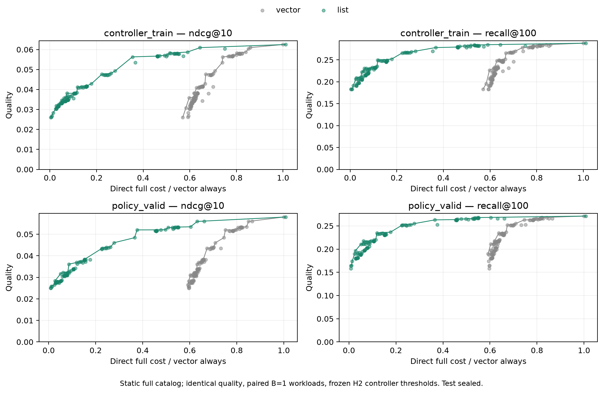

# H4: кэш готового top100 при статичном каталоге

14 ноября 2026. В текущем long-only replay можно сохранять готовый top100
вместе с user vector. Метрики сохраняются точно; на PV events3 полный
serving дешевле примерно вдвое, TTL30мин — в4.3 раза. Это отдельный
serving-контракт, который существенно меняет quality–cost frontier.

## Условия и точность

Frozen student43, item embeddings, один полный каталог114125, без новых
candidate filters/context/seen exclusions между refresh. В таких условиях
неизменный user vector даёт неизменный ranking. Кэш final list применим
к long-only ranker; при новых кандидатах, downstream features, обновлении
item table или изменяющейся recent-ветви нужен другой serving-контракт.

Построены92043 snapshot lists, те же106 простых правил и3 фиксированных
порога immediate-MLP42. Все218 строк CT/PV воспроизводят прежние
NDCG@10, Recall@100 и Hit@1 **точно**, membership differences0.
Есть80 отличий позиции внутри top100 между batch scoring kernels,
которые не меняют эти метрики. Поэтому полное побитовое равенство
исторических ranks не заявляется.

Top100 упорядочивается score-desc/item-id-asc, включая ties на границе100.
768 проверок ранга по полной той же score matrix прошли. Фиксированный
список воспроизводит ranking того же score tensor; отдельные тесты
проверяют внутренние и граничные ties. Подготовка14.85с, scoring11.70с.

## Прямые замеры

Оба пути измерены парно на одинаковых384 requests каждой политики и
каждого периода: всего436 workload cases,3 interleaved блока по128.
Число refresh стратифицировано к фактической доле с округлением; максимум
ошибки доли0.129 процентного пункта. Cost — среднее времени всех384
операций, не медиана блоков с разным числом refresh. Время всего этапа145.19с.

В timed path входят causal policy/controller decision, lookup/copy кэша,
CPU→MPS transfer при vector hit, encoder на refresh, запись user vector,
полный scoring, canonical top100 и CPU output. List path на refresh
дополнительно записывает top100, на hit копирует готовый CPU list.
CPU-only hit не синхронизирует простаивающий MPS. Чтение histories с диска,
сеть и сериализация ответа исключены одинаково.

| Одна и та же политика, PV | Refresh | Vector, мс/запрос | Vector+list, мс/запрос | Экономия |
| --- | ---: | ---: | ---: | ---: |
| always |100%|1.9025|1.9173|−0.8%|
| never, включая initialization |0.72%|1.1344|0.0162|98.6%|
| events3 |36.17%|1.4183|0.6954|51.0%|
| TTL3мин |62.42%|1.6180|1.2023|25.7%|
| TTL30мин |15.03%|1.2424|0.2901|76.6%|
| TTL24ч |2.79%|1.1449|0.0564|95.1%|
| MLP42 q50 |36.75%|1.4300|0.7150|50.0%|
| MLP42 q25 |64.88%|1.6457|1.2581|23.6%|

Старый floor около стоимости full-catalog scoring на cache hit исчезает.
Homogeneous branch diagnostics на PV: never hit1.130мс→0.000973мс;
MLP q50 list hit0.00830мс с causal features и CPU prediction. Это
диагностика ветвей; основной frontier использует прямые mixed workloads.

Первоначальная additive cost model дала mixed error до21.29% на CT
(events60:0.0262мс predicted против0.0318мс measured). Редкие refresh и
очень дешёвые hits делают такую ошибку существенной относительно cost.
Поэтому модель **не используется** в итоговом frontier; сохранена как
диагностический отрицательный результат.

## Frontier и CT-selected точки

Ось cost нормирована на общий vector always. В следующей таблице каждый
режим нормируется на own always, как при выборе на CT. Простые правила
выбираются из106; у MLP сохранены только3 порога из H2 — специально
для list режима новые thresholds не подбирались.

| Regime | CT budget | CT-selected policy | PV cost / own always | PV NDCG@10 | PV Recall@100 |
| --- | ---: | --- | ---: | ---: | ---: |
| vector |60%|hybrid25events/6h|60.31%|0.031074|0.210952|
| vector |75%|MLP q50|75.17%|0.052003|0.252372|
| vector |90%|MLP q25|86.50%|0.055933|0.265453|
| list |60%|hybrid2events/5min|59.89%|0.053455|0.267718|
| list |75%|MLP q25|65.62%|0.055933|0.265453|
| list |90%|MLP q25|65.62%|0.055933|0.265453|

Повтор q25 в двух budgets отражает ограниченный фиксированный набор
контроллеров и CT selection. Это не доказательство оптимальности
контроллера или отсутствия лучших точек. Полный PV frontier — описательный;
опубликованные budget choices определяются только на CT.

## Память, проверки и вывод для диплома

Vector64×FP32 —256B/user; top100 int64 —800B/user; оба —1056B/user,
то есть264KiB для256 пользователей вместо64KiB. Это payload, без overhead
словарей/объектов и histories. Peak RSS подготовки1176.7MiB, прямых замеров
1080.2MiB; MPS driver около1GiB — process-level allocator, а не размер кэша.

21 CPU/MPS тест прошёл. Проверены все218 metric rows,436 парных case
metadata/means, hashes, causal user/split/time boundaries, неизменность
encoder и CT selection на PV. Raw timings включают естественный дрейф
локальной системы; небольшие cost-различия и точки близко к budget ceiling
не трактуются как точные оптимумы. Test закрыт.

При первоначальном сохранении прямых замеров переменная имени файла
перекрылась именем rank artifact. JSON сохранён без изменения содержимого,
rank NPZ восстановлен из готовых списков с **исходным SHA-256**. Исполнявшиеся
версии драйвера архивированы как свидетельство; рабочий driver исправлен,
existing-output guard проверен. Повтор GPU-замеров не потребовался.

H4 подтверждена в указанном статичном режиме. **Top100-cache обязателен
как baseline для нашего fixed-full-catalog long-only сценария.** Vector-cache
отдельно описывает обслуживание сменных кандидатов/передачу representation
другой модели. Прежние результаты не переписываются; в дипломе serving
regime становится явным фактором эксперимента. Полезность learned policy
внутри одного режима по-прежнему требует отдельного сопоставления.

Дальше H5 — готовый student другого seed и CE1k; новое обучение SASRec
не нужно. Для метрик @10/@100 можно переиспользовать проверенный top100
способ оценки, сохранив точные первые100 позиций и обозначив остальные
как outside-top100. Это уменьшает дорогой повтор scoring одного snapshot
для разных targets; полные ranks/MRR таким способом не оцениваются.

[Проверки](static-list-cache/verification.json),
[все политики](static-list-cache/policies.csv),
[CT-selected точки](static-list-cache/selected.csv),
[прямые замеры](static-list-cache/benchmark-direct.json),
[диагностика cost model](static-list-cache/diagnostic-mixed-errors.csv).
