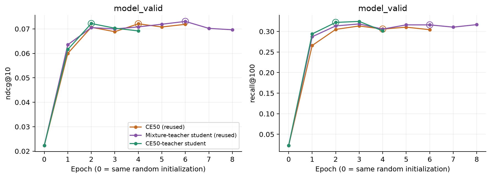

# Контроль источника знаний student

11 ноября 2026. Пилот на 256 пользователей, локальный Apple M3 Pro / MPS FP32,
4 CPU-потока, fallback отключён. Один новый student обучен с нуля с готовым CE50 teacher:
**alpha0, T2, lambda1**. CE50 и прошлый student со смесью переиспользованы.
[Протокол](student-teacher-control/protocol.json),
[план и команды](../../notes/student-quality-next-experiment.md).

**Удаление CE2 из учителя не восстановило общий PV NDCG.** Новая модель
имеет близкие к прошлому student точечные NDCG/Recall; интервалы различий включают ноль.
Повторы последнего трека по точечной оценке частично улучшились, но потеря
относительно CE50 осталась, особенно на менее популярных треках. Смесь
учителя не является необходимым условием этой потери в проверенном seed.

## Что сохранено и проверено

Train **739571** prefixes, model_valid **29313**, history50, dim64,
2 blocks/heads, dropout0.2, batch256, Adam0.001/(0.9,0.98), clip5,
seed42, dummy negatives16, полный каталог **114125**, patience2 по model_valid
NDCG. Все ID-векторы trainable, random epoch0 не кандидат; warm start отсутствует.
Остановка без лимита эпох. Сохранены прежние OOT, positive target и строгая
история до всей текущей timestamp group.

Все **29** начальных тензоров и CPU/MPS RNG совпали с восстановленной CE50
инициализацией и прошлым student; guard пройден в фактическом training loop.
У старого CE50 не было отдельного initial.pt: восстановление использует
архивный source/config/seed, saved CPU RNG и initial validation ranks.
[Initialization proof](student-teacher-control/initialization.json).

AST Teacher, objectives и DistillationStep совпадает с прежним запуском,
trainer/SASRec/batching source не менялся. Единственный фактор обучения —
источник soft targets. Загружается только CE50; CE2 не участвует в forward
и не загружается в training process. Teacher frozen/eval, raw logits CE50;
loss = CE + T² KL(teacher||student), batchmean по примерам и сумма по каталогу.
На всех 29313 validation targets teacher logits точно совпали с raw CE50,
воспроизведены прежние NDCG/Recall/Hit1.
[Matched setup](student-teacher-control/matched-setup.json),
[teacher check](student-teacher-control/teacher-check.json).

## Обучение

| Модель | Эпох | Best | model_valid NDCG | Recall | Trainer, мин | Средняя train-эпоха, с |
| --- | ---: | ---: | ---: | ---: | ---: | ---: |
| CE50, готовый | 6 | 4 | 0.072085 | 0.305769 | 12.63 | 122.79 |
| Student, teacher CE50+CE2, готовый | 8 | 6 | 0.073060 | 0.315935 | 46.94 | 348.76 |
| Student, teacher CE50, новый | 4 | 2 | 0.072193 | 0.321939 | 16.10 | 238.03 |

Новый best epoch2, затем две эпохи без роста NDCG. Recall epoch3 выше
(0.324361), но это не критерий checkpoint selection. Best SHA:
`28445611be332350f3af7bd9a8c9e7131721612a151feb6145e7d9ef6dead2a0`.
Время полного нового запуска с setup/проверками **16.11 мин**.

[Все эпохи, CE/KL и времена](student-teacher-control/training.csv),
[новый training JSON](student-teacher-control/training.json),
[журнал](student-teacher-control/training-log.txt).

Разные best epochs — следствие одинакового validation-правила, а не
сравнение при равном числе optimizer steps. Времена контроля и прошлого
student исторические; это не парный benchmark одинаковых training workloads.
У нового student меньше total epochs и одна teacher-ветвь вместо двух.

## Качество на тех же событиях и кандидатах

Model_valid/CT/PV: **29313 /52191 /23394** targets. Для всех моделей одни
prefixes, target IDs и полный каталог; все представления fresh. Checkpoint
зафиксирован до CT/PV. Прежние ranks и признаки событий переиспользованы,
новому student пересчитаны model_valid и CT/PV ranks. Test не читается.

| Split | Модель | NDCG@10 | Recall@100 | Hit@1 |
| --- | --- | ---: | ---: | ---: |
| model_valid | CE50 | 0.072085 | 0.305769 | 0.031420 |
| model_valid | Student со смесью | 0.073060 | 0.315935 | 0.032068 |
| model_valid | Новый student | 0.072193 | 0.321939 | 0.030874 |
| controller_train | CE50 | 0.056663 | 0.265870 | 0.022839 |
| controller_train | Student со смесью | 0.058451 | 0.276810 | 0.023874 |
| controller_train | Новый student | 0.056874 | 0.280757 | 0.021326 |
| policy_valid | CE50 | 0.055093 | 0.252201 | 0.024109 |
| policy_valid | Student со смесью | 0.053961 | 0.264512 | 0.022869 |
| policy_valid | Новый student | 0.053899 | 0.265966 | 0.021288 |

На PV к CE50: **−2.17% NDCG /+5.46% Recall**. К прошлому student:
**−0.12% /+0.55%**. Парные интервалы нового student минус baseline:

| Baseline | Метрика | Delta | 95% CI |
| --- | --- | ---: | --- |
| CE50 | NDCG@10 | −0.001194 | [−0.003440; +0.000882] |
| CE50 | Recall@100 | +0.013764 | [+0.009200; +0.018512] |
| Student со смесью | NDCG@10 | −0.000063 | [−0.002844; +0.002664] |
| Student со смесью | Recall@100 | +0.001453 | [−0.003574; +0.006329] |

Общий NDCG-прирост не подтверждён. Recall выше CE50, но отличия нового
student от прошлого по обеим общим метрикам неубедительны.
CI: 2000 bootstrap целых пользователей, seed42, event-weighted, fixed weights;
pointwise, без поправки на исследование срезов, без training variance.
Model_valid использован для выбора эпохи, его интервалы описательные.
[Все метрики и CI](student-teacher-control/comparison.json),
[metrics CSV](student-teacher-control/metrics.csv).

## Что произошло с проблемными событиями

PV NDCG, четыре непересекающиеся history-группы и один вложенный срез:

| Target | N | CE50 | Прошлый student | Новый student |
| --- | ---: | ---: | ---: | ---: |
| Последний трек | 415 | 0.569501 | 0.492436 | 0.518510 |
| Предпоследний, кроме последнего | 289 | 0.179030 | 0.196269 | 0.153693 |
| Более ранний в окне50 | 3835 | 0.105617 | 0.100874 | 0.105799 |
| Вне окна50 | 18855 | 0.031595 | 0.032588 | 0.031587 |
| Последний и после train top10000 | 153 | 0.341739 | 0.187522 | 0.217058 |

На последнем треке улучшение к прошлому student **+0.026074**,
CI **[−0.006577; +0.060509]**, включает 0. Потеря к CE50 **−0.050990**,
CI **[−0.100755; −0.012273]**, сохраняется. На менее популярных повторах
потеря к CE50 **−0.124681**, CI **[−0.209341; −0.061313]**.
Таким образом, повторы всё ещё хуже даже с самим CE50 в роли учителя.

Одновременно потеря на предпоследнем треке к прошлому student **−0.042576**,
CI **[−0.075983; −0.006851]**. Удаление CE2 убирает часть его полезного
сигнала; общий NDCG не восстанавливается за счёт точечного выигрыша других групп.
Потеря второго среза и ослабление NDCG вне окна компенсируют улучшения
последнего и более ранних треков. На менее популярных повторах Recall
вырос к прошлому student **0.431373 →0.516340**, оставаясь ниже CE50 **0.588235**.

[Срезы и popularity bins](student-teacher-control/segments.csv),
[rank transitions и paired CI](student-teacher-control/comparison.json).
На PV новый student выше CE50 по NDCG в 3 из 7 дней; макро-разница по
пользователям **+0.001320** при основной event-weighted разнице **−0.001194**.
Эффект неоднороден; основная метрика сохраняется по исходному протоколу.
[Пользователи](student-teacher-control/users.csv),
[дни относительно начала split](student-teacher-control/days.csv).

## Ресурсы и вывод

| Модель | Peak RSS, MiB | Max saved MPS tensors, MiB | Max saved MPS driver, MiB |
| --- | ---: | ---: | ---: |
| CE50 | 1033.7 | 112.9 | 1051.9 |
| Прошлый student | 1083.8 | 169.4 | 2075.9 |
| Новый student | 1078.2 | 141.2 | 2075.9 |

MPS — snapshots после эпох и allocator residency, не гарантированный
внутренний пик kernels. RSS и MPS относятся к общей unified memory,
складывать их нельзя. В saved student одна SASRec50 с **7357888** параметрами;
teacher в serving не нужен. Архитектура inference прежняя, свежие serving
timings в этой задаче не измерялись. Прежние cache/frontier относятся к CE50.

Контроль показывает, что смесь учителя не объясняет всю проблему repeat/tail
качества. Он не разделяет действие temperature, KL strength, оптимизации и
выбора эпохи; один seed не оценивает вариативность training. PV уже участвовал
в предыдущей диагностике, поэтому это исследовательское сравнение.
**Исходный CE50 сохраняется как NDCG baseline.**

80 CPU/MPS тестов прошли, recipe/init/data/checkpoint/source hashes проверены;
все quality metrics воспроизведены из сохранённых ranks, интервалы пересчитаны.
[Тесты](student-teacher-control/tests.txt),
[проверки артефактов](student-teacher-control/verification.json).
Checkpoints и per-event ranks сохранены локально в `data/runs/student-teacher-control/`;
небольшие JSON/CSV, графики и этот отчёт публикуются в Git.
