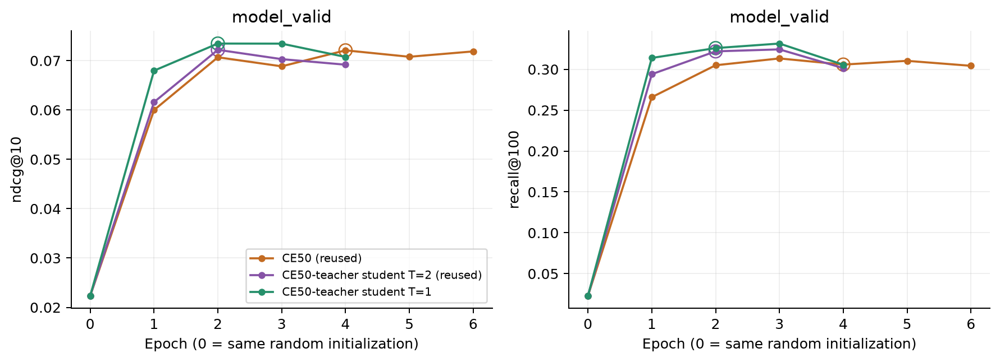

# Контроль температуры дистилляции

12 ноября 2026. Один новый локальный student на пилоте256, MPS FP32,
4 CPU-потока, fallback0. Teacher — готовый CE50 best4, alpha0, lambda1.
Изменена только **T: 2 →1**. Готовые CE50 и T2 переиспользованы.
[Протокол](student-temperature-control/protocol.json),
[план и команды](../../notes/student-temperature-control.md).

**T1 улучшил T2 на PV по NDCG и Recall**, оба парных 95% CI выше нуля.
К CE50 Recall выше, но NDCG-прирост пока не подтверждён интервалом.
Потеря на повторах последнего/менее популярного трека сохраняется:
улучшение общей метрики не означает исправления исходного repeat-среза.

## Сохранённая постановка

Train739571, model_valid29313, history50, dim64, 2blocks/heads, dropout0.2,
batch256, Adam0.001/(0.9,0.98), clip5, seed42, dummy negatives16,
полный каталог114125 и прежний OOT/positive target. Все ID-векторы trainable.
С нуля, без warm start, random epoch0 не кандидат. Остановка без лимита эпох,
patience2 только по model_valid NDCG.

Все29 начальных тензоров, CPU/MPS RNG и initial validation ranks совпали
с восстановленной CE50 и T2. В реальном training loop state/RNG проверены
до первого update. Исходники trainer, model, teacher и loss побайтово
совпадают с T2; base config, alpha и lambda те же.
[Initialization](student-temperature-control/initialization.json),
[matched setup](student-temperature-control/matched-setup.json).

Loss = CE +lambda×T²×KL(teacher||student), batchmean по примерам, сумма
по каталогу. Стандартный T² scaling сохранён: multiplier1 вместо4.
Поэтому опыт меняет температуру вместе с её множителем в принятой формуле;
он не изолирует одну форму soft targets при одинаковом multiplier.
Teacher eval/frozen, только CE50, без recent-ветви. Его raw logits/ranks
не зависят от T: proof на29313 validation targets переиспользован с проверкой
source/checkpoint; actual T1 log-probabilities отдельно проверены на32 MPS inputs.
[Teacher check](student-temperature-control/teacher-check.json).

## Обучение и стоимость

| Модель | Эпох | Best | model_valid NDCG | Recall | Trainer, мин |
| --- | ---: | ---: | ---: | ---: | ---: |
| CE50 | 6 | 4 | 0.072085 | 0.305769 | 12.63 |
| Student T2 | 4 | 2 | 0.072193 | 0.321939 | 16.10 |
| Student T1 | 4 | 2 | 0.073463 | 0.325930 | 16.35 |

У T1 и T2 выбран одинаковый номер эпохи, **5778 updates**, и одинаковое
число полных train-проходов. Recall T1 на epoch3 выше (0.331491), но checkpoint
по нему не выбирался. После двух validation без роста NDCG выполнена остановка.
Новый full run с setup/проверками16.35мин. Best SHA:
`a95907c5399293783574d398183cce5605d426ec569a27aa86319d19e8601e16`.

[Training CSV](student-temperature-control/training.csv),
[training JSON](student-temperature-control/training.json),
[журнал](student-temperature-control/training-log.txt).

Peak RSS T1/T2: **1079.0 /1078.2 MiB**; saved MPS tensors **141.2 /141.2 MiB**,
driver **2075.9 /2075.9 MiB**. MPS — snapshots после эпох и allocator residency,
не гарантированный внутренний peak; с RSS их не складываем в unified memory.
Времена T2/CE50 исторические, это не парный performance benchmark. Архитектура
inference прежняя: **7357888 параметров**, без teacher modules. Новые serving
timings и cache/frontier не измерялись; старые policy результаты относятся к CE50.

## Те же события и кандидаты

Checkpoint зафиксирован до CT/PV; все представления fresh, строго прошлые
prefixes перед всей текущей timestamp group, каталог114125 без seen-item exclusion.
Проверены target/user/event_id alignment, hashes cached ranks и их связь с
selected checkpoints. Для T1 заново рассчитаны model_valid и CT/PV ranks.
T2 и CE50 ranks переиспользованы. Test не читается.

| Split | Модель | NDCG@10 | Recall@100 | Hit@1 |
| --- | --- | ---: | ---: | ---: |
| model_valid | CE50 | 0.072085 | 0.305769 | 0.031420 |
| model_valid | T2 | 0.072193 | 0.321939 | 0.030874 |
| model_valid | T1 | 0.073463 | 0.325930 | 0.030191 |
| controller_train | CE50 | 0.056663 | 0.265870 | 0.022839 |
| controller_train | T2 | 0.056874 | 0.280757 | 0.021326 |
| controller_train | T1 | 0.057909 | 0.284819 | 0.021881 |
| policy_valid | CE50 | 0.055093 | 0.252201 | 0.024109 |
| policy_valid | T2 | 0.053899 | 0.265966 | 0.021288 |
| policy_valid | T1 | 0.055750 | 0.272036 | 0.022356 |

PV: к T2 **+3.43% NDCG /+2.28% Recall**; к CE50 **+1.19% /+7.86%**.
Hit1 выше T2 на5.02%, ниже CE50 на7.27% — верх ранжирования ещё не восстановлен.

| PV baseline | Метрика | T1 − baseline | Парный 95% CI |
| --- | --- | ---: | --- |
| T2 | NDCG@10 | +0.001851 | [+0.000179; +0.003627] |
| T2 | Recall@100 | +0.006070 | [+0.002507; +0.009629] |
| CE50 | NDCG@10 | +0.000657 | [−0.001575; +0.002869] |
| CE50 | Recall@100 | +0.019834 | [+0.015338; +0.024302] |

2000 bootstrap целых пользователей, seed42, event-weighted, fixed weights;
pointwise, без поправок за исследование срезов и без training variance.
Model_valid использован для выбора эпохи; его интервалы описательные.
PV уже участвовал в предыдущей диагностике, поэтому это исследовательское сравнение.
[Все метрики, CI и rank transitions](student-temperature-control/comparison.json),
[metrics CSV](student-temperature-control/metrics.csv).

## Где находится выигрыш

PV NDCG; четыре непересекающиеся history-группы и один вложенный срез.
Популярность определяется только по положительным train-прослушиваниям,
tie — item_idx; «после top10000» означает позицию в этом train-ранжировании.

| Target | N | CE50 | T2 | T1 |
| --- | ---: | ---: | ---: | ---: |
| Последний трек | 415 | 0.569501 | 0.518510 | 0.508014 |
| Предпоследний, кроме последнего | 289 | 0.179030 | 0.153693 | 0.178503 |
| Более ранний в окне50 | 3835 | 0.105617 | 0.105799 | 0.108821 |
| Вне окна50 | 18855 | 0.031595 | 0.031587 | 0.033120 |
| Последний и после train top10000 | 153 | 0.341739 | 0.217058 | 0.210288 |

К T2 вклад в общий PV NDCG: последний **−0.000186**, предпоследний
**+0.000306**, более ранние **+0.000495**, вне окна **+0.001236**;
сумма **+0.001851**. Основная компенсация приходит извне окна, а не из
исправления последних повторов. Условная разница вне окна **+0.001533**,
CI **[+0.000204; +0.002988]**; предпоследнего **+0.024810**,
CI **[+0.000044; +0.050079]**. Эти интервалы исследовательские.

На последнем треке к CE50 сохраняется потеря **−0.061487**,
CI **[−0.100933; −0.031624]**; после train top10000 — **−0.131451**,
CI **[−0.202249; −0.079078]**. Отличие последнего трека от T2 имеет CI,
включающий ноль. Гипотеза, что T2 объясняет repeat-потерю, не подтверждена.

На PV T1 выше T2 по NDCG во всех7 днях, выше CE50 в5 из7. Макро-разница
по пользователям к T2 **+0.002114**, к CE50 **+0.003434**; основная метрика
остаётся event-weighted. [Срезы](student-temperature-control/segments.csv),
[пользователи](student-temperature-control/users.csv),
[дни относительно начала split](student-temperature-control/days.csv).

## Проверки и предел вывода

80 CPU/MPS тестов прошли, включая формулу loss/gradients и teacher targets
для T1/T2. Пересчитаны все общие/условные paired CI, проверены вклад групп,
config/init/RNG/data/checkpoint/source hashes и идентичность cohort/candidates.
[Тесты](student-temperature-control/tests.txt),
[проверки артефактов](student-temperature-control/verification.json).

T1 — более сильный KD-вариант, чем T2, в этом seed. Это ещё не доказательство
общего превосходства над CE50: NDCG CI к CE50 включает ноль и остаётся
repeat/tail потеря. Прежний CE50 cache baseline сохраняется до отдельного решения.
Один seed/пилот256 ограничивают обобщение. Новых экспериментов автоматически
не запускалось. Checkpoints и per-event arrays сохранены локально в
`data/runs/student-temperature-control/`; небольшие JSON/CSV/графики и отчёт — в Git.
