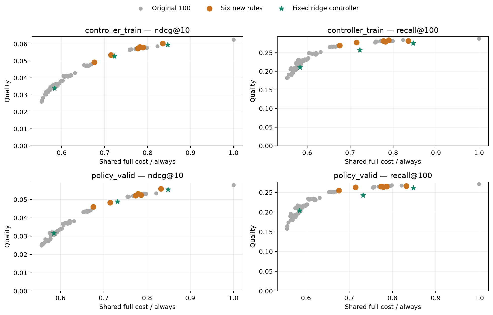

# H1: более плотная сетка refresh-политик

14 ноября2026. Первая проверка автономной серии. Гипотеза: часть новых
NDCG-точек ridge-контроллера обусловлена отсутствием промежуточных простых
правил в исходной сетке. Добавлены ровно6 заранее выбранных правил,
модель student43 и контроллер сохранены. [Очередь гипотез](../../notes/autonomous-experiments.md).

## Протокол

Events3/4; TTL180/240секунд; OR-гибриды3/4 события+300секунд.
Те же62129/29914 requests,52191/23394 targets, каталог114125, frozen student43.
Готовые ranks старых100 политик переиспользованы; рассчитано только21448
новых snapshot/target пар из177227 требуемых уникальных пар. Encoding1.69с,
scoring1.93с, весь этап7.62с, MPS FP32.

Стоимость — общая фиксированная совместная калибровка предыдущего этапа;
новые CPU schedule times измерены отдельно. Новый serving benchmark не
проводился. Выбор comparator под cost контроллера — только последние4 дня CT.
Контроллер и его пороги не перенастраивались. Test закрыт.

## Новые правила на PV

| Правило | Cost / always | Refresh | NDCG@10 | Recall@100 |
| --- | ---: | ---: | ---: | ---: |
| events_3 | 71.45% | 36.17% | 0.048396 | 0.262888 |
| events_4 | 67.60% | 27.56% | 0.046054 | 0.254852 |
| time_180 | 83.20% | 62.42% | 0.055940 | 0.265966 |
| time_240 | 77.91% | 50.61% | 0.053074 | 0.263743 |
| hybrid_3_300 | 78.64% | 52.22% | 0.052398 | 0.264726 |
| hybrid_4_300 | 77.33% | 49.28% | 0.052126 | 0.264940 |

## Контроллер против выбранного на CT простого правила

| CT budget | Simple | Ctrl cost | Simple cost | Ctrl NDCG | Simple NDCG |
| --- | --- | ---: | ---: | ---: | ---: |
| 60% | events_20 | 58.48% | 57.99% | 0.031648 | 0.032198 |
| 75% | events_3 | 73.18% | 71.45% | 0.048884 | 0.048396 |
| 90% | time_180 | 84.84% | 83.20% | 0.055476 | 0.055940 |

В среднем режиме events3 даёт0.048396 NDCG при71.45% стоимости always;
контроллер —0.048884 при73.18%. Delta NDCG контроллера **+0.000489**,
95% CI **[−0.004182; +0.004970]**. Его Recall ниже на **0.020005**,
CI **[−0.032653; −0.010670]**.

В дорогом режиме time180 даёт0.055940 NDCG при83.20% стоимости;
контроллер —0.055476 при84.84%. TTL3мин доминирует эту точку по point estimates.
NDCG-разница контроллера **−0.000464**, CI **[−0.002074; +0.001189]**;
это не статистическое доказательство превосходства TTL по NDCG.

Гипотеза H1 частично подтверждена: один из двух новых NDCG frontier points
ridge исчезает, оставшийся почти повторяется более дешёвым простым правилом
с лучшим Recall. Прежние100 политик были недостаточно плотным контролем
для заявления об адаптивном преимуществе. Строгого выигрыша ridge по
NDCG при сопоставимой стоимости по-прежнему нет.

## Проверки и следующий шаг

9 policy CPU/MPS тестов прошли; causal users/splits/time cutoffs, checkpoint/
source hashes и CPU oracle проверены.12 paired CI независимо пересчитаны
через user-count matrix. Кандидаты выбраны на CT; PV — исследовательская
оценка, pointwise CI2000 whole-user bootstrap, seed42, fixed weights.

[Проверки](student43-dense-policies/verification.json),
[политики](student43-dense-policies/policies.csv),
[парные сравнения](student43-dense-policies/controller-comparison.csv),
[конфиг](student43-dense-policies/config.json).

Следующий шаг H2 — matched ridge/MLP на причинных признаках с CT8/2/4
fit/early-stopping/tuning и плотной простой сеткой. Нового обучения энкодера
для этой проверки не требуется. Raw arrays остаются в data/runs/student43-dense-policies.
