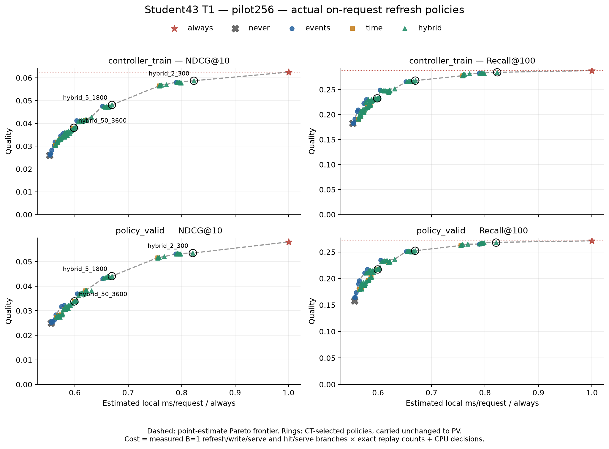
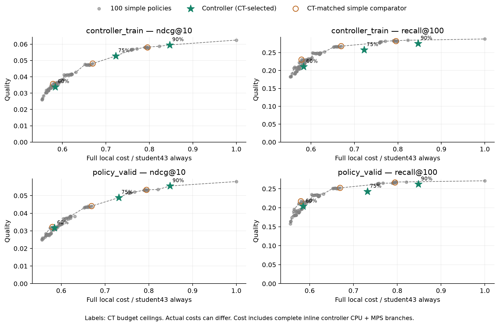

# Student43: refresh frontier и обученный контроллер

13 ноября2026. Все вычисления локальны: MPS FP32, CPU fallback0,4 CPU-потока.
Frozen student43 best9, T1/alpha0/lambda1, history50, dim64,2blocks/heads.
Нового обучения энкодера нет. [Протокол и команды](../../notes/student43-maintenance.md).

**Фронтир готов.** Student43 сохраняет Recall-преимущество над CE42 в трёх
выбранных простых политиках. Контроллер добавил две point-estimate NDCG-точки
относительно дискретной сетки100 политик. Но при близкой ожидаемой стоимости
его преимущество над CT-выбранными смесями простых политик не подтверждается
парными CI; Recall у двух более дорогих режимов ниже. Заменять простые правила
на этот контроллер как доказанно лучший вариант оснований пока нет.

## Общий сетап

Те же62129 CT/29914 PV requests,52191/23394 positive targets, каталог114125.
Одна timestamp-группа — запрос; все прогнозы и решения до добавления её
событий. В историю входят все прошлые прослушивания. Seen-item exclusion нет.
Инициализации232/216 оплачиваются; кэш сбрасывается на CT/PV границе.
Refresh только on-request. Test не читается.

Перенесены100 готовых расписаний: always/never,10 event,8 time,80 hybrid OR.
Проверены все timelines, targets, refs и refresh flags; CE42 ranks и стоимость
не переносились в student. Scoring качества offline B=256; стоимость — B=1
inline refresh/write/full-catalog top100/CPU result либо cache hit/serve.
Все расходы считаются на requests, качество — на positive targets.

## Фронтир простых политик

Рабочие точки выбраны на полном CT по максимуму NDCG при лимитах60/75/90%
стоимости student always. Ties: Recall, затем меньшая стоимость. На PV настройки
перенесены без изменения. Ниже фактические PV costs относительно student always.

| CT budget | Политика | PV cost | Refresh | NDCG@10 | Recall@100 |
| --- | --- | ---: | ---: | ---: | ---: |
| 60% | hybrid_50_3600 | 59.94% | 10.42% | 0.033800 | 0.217021 |
| 75% | hybrid_5_1800 | 66.94% | 26.07% | 0.044054 | 0.252372 |
| 90% | hybrid_2_300 | 82.09% | 59.94% | 0.053455 | 0.267718 |
| Always | always | 100% | 100% | 0.057996 | 0.271095 |

60%-точка —50 событий OR1час;75% —5 событий OR30мин;90% —2 события OR5мин.
Лимит бюджета — верхняя граница затрат, а не требуемая доля refresh.

[Quality/refresh frontier](student43-maintenance/frontier-refresh.png),
[пороговые кривые](student43-maintenance/policy-thresholds.png),
[все200 policy/split строк](student43-maintenance/policies.csv),
[refresh statistics](student43-maintenance/refresh-statistics.csv).

## Сравнение качества с CE42

Те же политики, запросы, targets и каталог. Старые CE42 timings не считаются
парным текущим performance benchmark; ниже сравнивается только качество.

| CT budget | Политика | CE42 PV NDCG | Student PV NDCG | CE42 PV Recall | Student PV Recall |
| --- | --- | ---: | ---: | ---: | ---: |
| 60% | hybrid_50_3600 | 0.032297 | 0.033800 | 0.207874 | 0.217021 |
| 75% | hybrid_5_1800 | 0.041759 | 0.044054 | 0.234163 | 0.252372 |
| 90% | hybrid_2_300 | 0.050378 | 0.053455 | 0.249979 | 0.267718 |

У всех трёх точек Recall-разница имеет CI выше0. Для NDCG60/75% CI включает0;
у90% delta **+0.003077**, CI **[+0.000424; +0.005787]**. Сравнение не означает
превосходства student на каждой из100 политик. [Все парные сравнения](student43-maintenance/compare-ce42.csv).

## Контроллер: обучение и настройка

Один CPU weighted ridge, lambda0.001,8 признаков: log новых событий, возраста
кэша, активности1ч/24ч, последней паузы и длины истории, два взаимодействия
age/events с активностью24ч. Все признаки строго прошлые. Для history counts
прочитан только нужный суточный prefix из model_valid и готовые request-группы.

Train — первые10 дней CT:44113 requests; tuning — последние4:18016 requests
и14801 targets.493808 разных stale(request,snapshot) контекстов получены из
готовой policy-сетки. Дубликаты убраны, суммарный вес каждого запроса1;
43892 запросам доступны такие контексты. Nonpositive requests имеют gain0.
Label — суммарный fresh−cached NDCG текущей группы; отрицательные gains сохранены.

Fit занял0.4с. Weighted MSE0.026642 против0.026828 у constant predictor:
прирост объяснённой вариации небольшой. Weighted положительных labels6.61%,
отрицательных2.15%; большинство контекстов дают нулевую NDCG-разницу.
Это модель немедленной пользы, будущие последствия обновления в label не включены.

Проверены9 порогов из weighted quantiles fit-prediction. Каждый replay имеет
собственный эволюционирующий кэш; на внутренней границе CT reset нет.
Порог выбирается на последних4 днях CT под тот же cost budget. Simple comparator
выбирается там же среди100 правил с cost не выше cost контроллера. После
selection.json на PV считаются только выбранные пороги. Refit на всём CT нет.

[Модель](student43-maintenance/model.json),
[выбор контроллера](student43-maintenance/controller-selection.json),
[конфигурация](student43-maintenance/controller-config.json).

## Итог контроллера на PV

Costs ниже — полные совместные CPU+MPS измеренные ветви, с признаками и
предсказанием внутри. Контроллер и simple comparator имеют общий CT cost ceiling,
но их фактические PV costs различаются. Показываем это явно.

| CT budget | Controller cost | Simple cost | Comparator | Ctrl NDCG | Simple NDCG | Ctrl Recall | Simple Recall |
| --- | ---: | ---: | --- | ---: | ---: | ---: | ---: |
| 60% | 58.48% | 57.99% | events_20 | 0.031648 | 0.032198 | 0.203813 | 0.217235 |
| 75% | 73.18% | 66.94% | hybrid_5_1800 | 0.048884 | 0.044054 | 0.242883 | 0.252372 |
| 90% | 84.84% | 79.49% | hybrid_2_7200 | 0.055476 | 0.053266 | 0.262033 | 0.266564 |

| CT budget | Ctrl−simple NDCG | Парный95% CI |
| --- | ---: | --- |
| 60% | -0.000550 | [-0.002996; +0.001943] |
| 75% | +0.004830 | [-0.000520; +0.011115] |
| 90% | +0.002209 | [+0.000122; +0.004709] |

При60% контроллер доминируется простыми политиками. При75/90% он добавляет
NDCG-точки дискретного фронтира, но дороже выбранного simple comparator
примерно на9.33%/6.73% на PV. NDCG-разница90% имеет CI выше0 к этому
более дешёвому baseline; при75% CI включает0. Recall ниже, при60/90%
его отрицательная разница подтверждается CI. На Recall-frontier контроллер
новых недоминируемых точек не добавляет.

[Полные сравнения и расходы](student43-maintenance/controller-comparison.csv).

### Справочное ожидание смеси при близкой стоимости

Дискретная сетка имеет разрывы по стоимости. Чтобы не приписывать выигрыш
одной адаптивности, на CT tuning выбрана пара готовых политик и вероятность
второй, максимизирующие ожидаемый NDCG при cost контроллера. Ветвь выбирается
независимо для пользователя один раз; ниже вычислено **ожидание**, а не
реализован новый serving benchmark. На PV перенесены CT-пара и вероятность.
Дополнительные расходы assignment и вариативность его реализации не измерены.

| CT budget | Ожидание cost | Controller cost | Ожидание NDCG | Ctrl−ожидание NDCG | Парный95% CI |
| --- | ---: | ---: | ---: | ---: | --- |
| 60% | 58.55% | 58.48% | 0.030901 | +0.000747 | [-0.001580; +0.003448] |
| 75% | 71.87% | 73.18% | 0.048507 | +0.000377 | [-0.004026; +0.004334] |
| 90% | 84.62% | 84.84% | 0.054312 | +0.001164 | [-0.000441; +0.003038] |

Во всех трёх NDCG CI ноль присутствует. На75/90% Recall контроллера ниже
ожидания смеси с CI ниже0. Это не доказательство фактической победы randomized
implementation, но достаточная причина не объявлять общее преимущество
контроллера при равной стоимости. [Mixture reference](student43-maintenance/mixture-reference.csv).

## Стоимость и проверки

Первичная аддитивная оценка CPU+старых MPS branches расходилась с mixed
замерами до46.22% и не используется в итоговых costs. Выполнена совместная
interleaved калибровка plain/controller hit/refresh путей с перемешанным порядком,
warmup8,128 запросов×3 повтора. Модель, признаки и9 порогов сохранены;
коэффициенты побитово совпали с первоначальным fit. Новые пороги/простые
точки выбраны только по CT. PV-качество не участвовало в исправлении cost model.

| Полный plain путь | CT, ms/request | PV, ms/request |
| --- | ---: | ---: |
| refresh_write_serve | 1.680769 | 1.673948 |
| cache_hit_serve | 0.926127 | 0.924980 |

Controller branches уже включают scalar history searches, feature extraction
и prediction; отдельно CPU time не начисляется. Его standalone decision time
около3.1мкс/request сохранено как диагностическая разбивка. Итоговые mixed
checks отклоняются от предсказания максимум на **2.12%**. Считаются initializations,
refresh/write/serve, cache hit/serve и все requests. Network/history loading
и системная конкуренция production не моделируются.

[Калибровка](student43-maintenance/calibration.csv),
[mixed validation](student43-maintenance/mixed-validation.csv),
[cost correction](student43-maintenance/cost-diagnostic.json).

**23 теста прошли.** Независимо восстановлены train labels и веса всех493808
контекстов, повторены selected rollouts, проверены fit/serving features,
source/data/checkpoint hashes, causal boundaries и cost formulas. Пересчитаны
824 paired CI. CPU oracle256 пар:252 точных ranks, max delta1, метрики совпали.
Все JSON/CSV/SVG проверены, графики просмотрены. Test закрыт.

[Verification](student43-maintenance/verification.json),
[тесты](student43-maintenance/tests.txt).

CI:2000 whole-user bootstrap, event-weighted, seed42, fixed checkpoints;
pointwise, без correction за множество сравнений и без training variance.
Контроллер исследуется на одном encoder seed/пилоте256. PV уже использовался
в предыдущей диагностике; окончательный test остаётся отдельным этапом.

Получен проверяемый frontier сильного single encoder и первый learned-refresh
baseline. Его общий выигрыш при близких расходах пока не подтверждён;
основой сравнения остаются простые правила. Конфиги/веса CPU-контроллера,
JSON/CSV/графики и отчёт публикуются. Encoder checkpoints, per-event arrays и
train examples остаются в локальном data/runs/student43-policies и
data/runs/student43-controller-calibrated.
